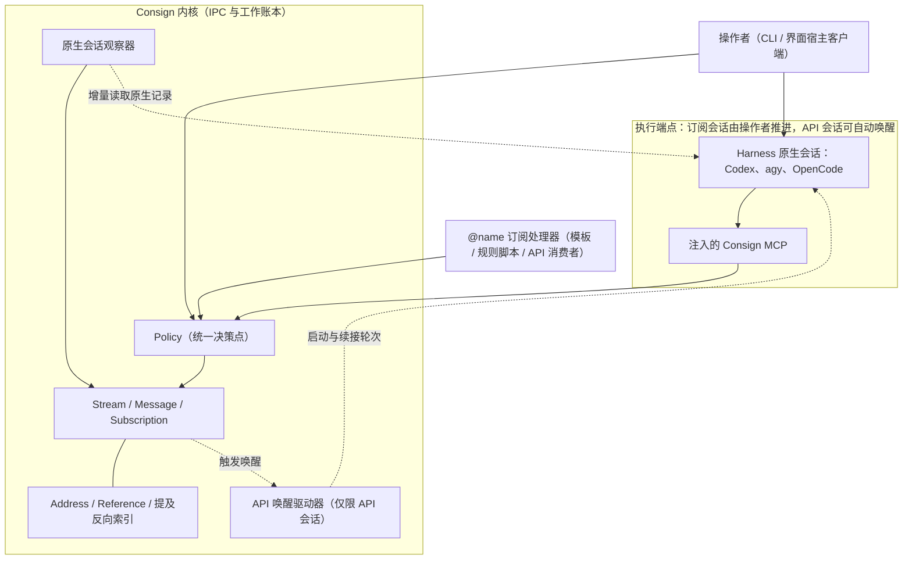

# Consign 架构设计

Consign 的设计建立在两条基本判断之上：

- **协同是认知过程之间的因果耦合；组织是这种耦合在时间上的持续化、结构化与约束化。** 单个会话中的模型负责局部的认知与推理；协作框架不插手模型内部如何思考，只负责让不同认知过程之间的因果连接跨会话延续、沉淀出清晰结构并受到边界约束。
- **组织记忆必须独立于执行主体而存在。** 组织的扩展能力，取决于它能否低摩擦地让局部认知成果脱离产生它的会话主体，转化为其他主体可直接消费的公共事实，而不必绑定原会话的生命周期，更不必继承其推理偏见。

基于这两条判断，Consign 构建了一个**人机共处的 Agent 协作环境**，本质上是**面向智能执行主体的进程间通信（Agent IPC）与工作账本**。传统 IPC 在进程间传递数据结构与调用参数；Consign 在具备认知能力的端点之间传递**意图（Intent）、不可变引用（Immutable References）与工作契约**——至于如何按需阅读上下文、权衡推理并完成交付，则交由通信端点自主完成。

本文阐述 Consign 要解决的核心问题、概念模型、最小内核与关键机制。人机交互立场与界面宿主边界见 [INTERACTION.md](INTERACTION.md)；协议规格、状态机、数据模型与各 Harness 接入细节见 [IMPLEMENTATION.md](IMPLEMENTATION.md)。

---

## 1. 问题背景

### 1.1 异构模型协作与离散轨迹

一项稍复杂的工程任务往往需要多种模型配合，而不同模型的系统性偏差截然不同：GPT 擅长严密执行，但在方案设计阶段容易过度工程化、偏离既有代码风格；Gemini 擅长文字表达与方案权衡，但容易发散和产生幻觉；DeepSeek 成本低廉，但 token 效率偏低。**工程质量来自异构交叉验证与人对关键取舍的校准**：同一项工作交由不同特性的模型接力，检查者不能是作者，而核心取舍由操作者拍板。

在日常工作中，这些认知过程分散在 Codex、agy、OpenCode 等执行环境（下称 **Harness**）的原生会话里。一次缺陷排查、设计审查或版本发布往往跨越数天、横跨多个终端会话。如今单个 Agent 已具备完成大多数局部步骤的执行能力；**真正的瓶颈不在单点执行，而在跨会话的信息连接**。

下面这个真实场景揭示了断层所在：操作者在两个独立的 Codex 会话中分别排查两个 issue。第一个会话的首轮分析解释了测试断言为何失败，但实际上只是把表象复述了一遍。操作者知道该模块长期稳定，判断模型停在了表面，于是追问上游成因，最终定位到根因：某条路由路径在过期成员视图下使用了不一致的筛选规则。操作者随即怀疑第二个 issue 源于同一缺陷，于是从第一个会话中翻找出分析段落，复制粘贴到第二个会话中。第二个会话结合自身的重放结果交叉核对，确认两者共享同一根因，最终通过一次修复关闭了两个 issue。

这一过程所需的全部原始信息都落盘在原生会话记录中，但**因果连接却只存在于操作者的脑海里**：

- **意图极短，搬运极重**：操作者的意图只有一句话（“核对这两处是否为同一根因”），但为了送达这句话，必须回忆出处、翻找历史、复制段落、补充背景；一旦粘贴过去，原始出处与上下文链路随之断裂。
- **进展散落，缺乏全局视图**：两个 issue 的共享边界、各自的验证进度（一边重放触发了故障，另一边尚未触发）散落在两段独立对话中，无法从 issue 锚点直接汇集。
- **认知纠偏无处留痕**：“首轮解释停在表面，需要继续追问上游”这一关键判断没有留下结构化记录，无法与被纠偏的原轮次建立显式关联。
- **决策有效性难以追溯**：想要确认几天前的某项工程取舍当前是否仍然有效、被哪些后续改动覆盖，只能靠人工向前翻阅数十轮对话。

### 1.2 人被迫充当串行路由器

剖析上述跨会话操作可以发现，操作者的大多数动作并不是在创造新信息，而是在**建立已有信息之间的拓扑关系**：让一个会话参考另一个会话的某轮设计，让新会话继承排查事实但剥离原有的错误假设，或将某次讨论敲定的工程约束施加到后续实现中。

只要跨 Harness 的信息传递必须由人手工搬运，协作网络就会退化为**以人为中心的星形拓扑**——因为人同一时刻只能聚焦一个输入框。即便多窗口终端、侧边栏或群聊界面把复制粘贴做得再顺手，优化的也只是人在串行路径上的搬运速度，系统的并发上限依然被锁死在操作者单点注意力的带宽上。

### 1.3 写进 Prompt 与单环境插件的局限

将协作流程写进系统 prompt 或绑定在某个单一 Harness 的插件里，会让工作流退化为会话内部的散落文本：既无法跨 Harness 复用，也经不起上下文压缩（Compaction），更难以在事后审计“某项决定究竟是如何演变成最终代码的”。

Consign 的选择是将**协作轨迹与通信机制**从单个 Agent 的上下文窗口中剥离出来，下沉为独立的本地中心服务；注入各个会话的 MCP 工具只是访问这一公共基础设施的入口。

### 1.4 订阅条款与接入倒置

在工程实践中，性价比最高的执行方式是在 Codex、agy 等官方客户端内使用消费级订阅额度；但消费级订阅条款普遍禁止第三方程序在外部通过自动化循环无人值守地驱动官方客户端。按量计费的 API key 则没有这一限制。

为兼顾合规与效率，Consign 采用**接入倒置（Integration Inversion）**架构：

- **订阅会话（被动观察 + 主动调用）**：照常由操作者在官方客户端中发起每一轮交互，Consign 绝不从外部向其注入输入；会话内的模型在操作者触发的轮次中，通过注入的 Consign MCP 主动拉取引用、查询收件箱或投递意图，Consign 同时在后台增量观察其落盘的原生记录。
- **API 会话与后台处理器（自动唤醒）**：由 Consign 显式携带 API key 启动的会话及后台订阅处理器，可由内部驱动器按事件自动唤醒并推进轮次。

两类端点共享完全一致的寻址、消息与账本语义，唯一区别在于“由谁触发下一轮执行”。

---

## 2. 核心模型

### 2.1 从传递 Context 转向传递 Intent + References

Consign 中跨会话协作的最小交互原语是 **`Recipient + Intent + References`**：

```text
To: @review  （或具体会话地址 consign://codex/01a2…）
Intent: 根据下列审查结论调整路由筛选设计；仅处理第二项缺陷，保留已确认的兼容性取舍。
Refs:
  consign://codex/01a2…/turn/42
  consign://agy/09f1…/span/L12-L18@sha256:…
```

Consign **不会**替发送方把所有引用展开并拼接成一份庞大的 prompt，也不会替接收方预判哪些背景值得阅读。基础设施只保证引用不可篡改、随时可解析、来龙去脉可追溯；**工作的方向由发起方的 Intent 指明，上下文的展开深度由接收方模型按需决定**。

### 2.2 对等通信语义，不对等权限与唤醒

剥离最终拍板权之后，操作者在日常协作中的绝大多数动作——查阅历史、挑选关键片段、发起新请求、引用既有决定、提出审查反馈、触发独立复核——模型本身都具备对等的认知与执行能力。

因此，Consign 确立了一条核心架构准则：**任何可由操作者通过 Consign 发起的协作操作，在获得相应授权的前提下，同样可以由 Agent 发起，反之亦然。** 内核不区分“人工工作流”与“Agent 工作流”：操作者在界面上选中片段并派发任务，与某个会话或后台处理器调用工具向另一端点投递意图，在底层是同一种 IPC 语义；人类界面只是接入这套 IPC 机制的客户端之一。

**对等的是通信语义，不对等的是权限边界与唤醒机制**：

- **授权不对等**：操作者拥有设立与变更目标、批准外部副作用、放行高风险操作以及撤销委派的最终裁决权；Agent 发起的动作仅作为提议（Proposed），必须经由策略层（Policy）准入。
- **鉴权通道物理隔离**：在同一台机器、同一系统用户下，供操作者使用的**人类接口**与供模型/脚本调用的**机器接口**分属不同的监听通道与凭据体系，从根源上杜绝 Agent 冒充操作者自我审批。
- **投递与唤醒解耦**：意图消息可以对等地投递至任意端点，但消息入队后能否自动唤醒目标，取决于目标端点的运行形态（订阅会话交由操作者推进，API 会话与后台处理器由系统自动唤醒）。

### 2.3 Session 是一等通信端点，委派是血缘而非控制树

在 Consign 中，Harness 是执行环境的提供者，而具体承载工作上下文的 **Session（原生会话）** 才是一等通信端点。同一个 Harness 下并行开启的多个会话（一个查根因、一个审方案、一个写补丁）在协作网络中彼此独立；只要具备唯一地址并能收发消息，任何原生会话都是协作图中的对等节点，无需预先包装一层常驻的虚拟角色（Actor）。

由此，一个会话向另一个会话发起协作委派，其本质接近于“在工作区新开一个独立终端并交接上下文”，而非传统多 Agent 框架中由主 Agent 层层支配的树状 Subagent：

```text
Human ──发起──→ Session A
                  │
                  ├──交接──→ Session B
                  │             │
                  │             └──交接──→ Session C
                  │
Human ──介入──→ Session B
```

会话间的创建与交接只记录为**可追溯的历史血缘（Lineage）**，不构成永久的控制与从属关系。操作者可以随时直接介入 Session B 与其对话，Session B 可以继续把后续环节交接给 Session C，而早先完成任务的 Session A 可以随时结束退出，不会导致下游会话级联失效。

### 2.4 架构最小性原则与三层划分

底层模型与官方 Harness 的演进极快，上层固化的编排逻辑与专用界面极易在模型能力跃迁后沦为负资产。为此，Consign 恪守**架构最小性原则**：**凡是模型能够利用既有原语自然完成的事项，基础设施默认不代劳；只有当某项能力要求跨会话持久性、确定性不变量、外部系统访问或消除高频重复摩擦时，才将其下沉为基础机制。**

据此，系统严格划分为正交的三层：

1. **机制层（稳定内核，工程投入重心）**：仅提供正交、可组合的底层原语，包含两部分——负责通信与状态持久化的 **IPC 与账本内核**（见第 3 节），以及负责承载即用即抛界面的**交互宿主内核**（见 [INTERACTION.md](INTERACTION.md)）。
2. **策略层（外围配置，高频低成本调整）**：定义路由规则、待办优先级、权限分级、跳数熔断、预算上限、唤醒防抖以及窗口焦点放置规则。策略表现为声明式配置、外部脚本或轻量级评判 prompt，随时按需调整而不触动内核代码。
3. **流程层（场景组合，按需涌现与沉淀）**：具体业务场景下的多步协作拓扑与临时交互视图，由模型和操作者在机制与策略之上现场组合；只有经过实践检验的高频稳定路径，才逐步固化为命名处理器（`@name`）或组件模板。

### 2.5 单环节独立交付与框架不变量

对等通信赋予了协作拓扑充分的自由，但这绝不意味着鼓励多个模型在后台无休止地来回辩论。受限于模型能力边界，两个模型自由多轮对话极易滑向相互迎合（Sycophancy）或共同强化初始错误假设，反而摧毁了异构模型的判断独立性。

因此，Consign 的默认协作范式是**单环节独立交付**：每个会话只专注完成一个明确界定的环节；环节交接时只传递不可变引用与清晰意图；独立审查会话只读取产物快照与设计决定，不继承作者会话的冗长推理过程；出现关键分歧时立即升级，交由操作者裁决。

在此之上，有一类**跨步骤才成立的系统不变量**，无法指望单个模型靠 prompt 自律来维持，必须由框架强力守住：

- **利益冲突隔离**：审查者与复核者不能处于作者或修复者的会话血缘链中；
- **副作用受控**：任何对外部系统产生不可逆影响的动作必须获得显式授权；
- **可靠投递与幂等入账**：消息不静默丢失，同一调用重试或崩溃重放只产生一次状态变更；
- **会话单写者排他**：同一个执行会话在同一时刻不会被两路输入并发写入。

框架对不变量的执行分为两种力度：凡是 Consign 处于执行必经路径上的动作（服务端写入校验、SQLite 事务、沙箱边界、API 会话的准入与驱动），一律执行**事前硬阻断**；而对于操作者亲自在官方客户端中推进的订阅会话，Consign 不劫持客户端输入，而是通过原生记录观察执行**事后检出与冲突告警**（例如当操作者把复核消息送入作者血缘链内的会话时，自动标出利益冲突并提示裁决）。

---

## 3. 最小内核



Consign 内核收敛为六个正交原语：

| 内核原语 | 核心职责 |
| --- | --- |
| **Address** | 统一文本寻址：定位操作者、原生会话、轮次、记录片段、工作流（Stream）、消息（Message）、命名入口（`@name`）以及外部锚点（如 GitHub Issue / PR、Git Commit） |
| **Reference** | 不可变的上下文与产物快照：携带 SHA-256 内容摘要或 Git 对象 ID，作为可靠的证据与交接依据（涵盖 `transcript_span`、`git_snapshot`、`blob` 等） |
| **Message** | 意图（`to + intent + refs`）、请求与反馈的持久化信封；内建幂等去重、决定集版本核对与完整的生命周期状态机 |
| **Stream** | 只追加（Append-only）的有序事件与工作轨迹；原生会话、专题工作流与账本变更皆表示为流，可绑定外部锚点以维护跨会话延续的决定集与证据链 |
| **Subscription** | 持久化的消费游标与唤醒触发器；支撑参与者按需发现待办事项，支持批量合并防抖、死信升级与跨重启的持久等待（Durable Waiting） |
| **Policy** | 统一的策略决策点（Decision API）：集中管控读取授权、投递准入、血缘冲突、跳数熔断、预算上限以及经由 Harness Hook / 回调拦截的工具执行 |

### 3.1 统一寻址、证据固定与提及反向索引

在 Consign 中，一切协作对象皆通过标准化的文本 URI 寻址：

- **导航型地址 vs. 证据型引用**：指向会话（`consign://codex/<session>`）与轮次（`.../turn/<turn>`）的链接用于上下文导航，其内容随会话推进而增长；而一旦某段内容被用作工程证据或跨会话交接依据，则必须转化为不可变的 **Reference** 固定下来。记录片段链接（`.../span/L<a>-L<b>@sha256:<digest>`）内置行号区间与字节哈希，执行固定（Pin）后将原始内容快照存入内容寻址存储，即使原会话日志事后被清理或改写也依然可校验、可读取；未提交的工作区代码改动则先合成为脱离工作区状态的 Git 快照（`git_snapshot`）再行引用。
- **寻址统一到片段，语义只统一到轮次**：不同 Harness 的底层日志格式在“轮次（Turn）”这一层具有高度一致的语义，但往下的工具调用、思考块与内部事件结构差异极大。Consign 不强行发明一套抹平所有 Harness 细节的大一统 AST：**结构化语义只提取到轮次**（记录发起方、用户输入、最终答复、起止时间、用量与回应关系）；轮次内部的推理过程与工具输出保持原生 JSONL 结构，统一通过片段链接（Span）按需定界与读取。
- **提及提取与反向索引（Backlinks）**：观察器持续扫描所有原生会话与工作流记录中的 `consign://` 链接及外部锚点（如 `github:owner/repo#907` 或仓库上下文下的 `#907`），自动构建双向提及索引。操作者在某条会话里随口问出一句“这和 #907 是不是同一回事”，两条原本孤立的排查会话便经由 `#907` 自动编织进同一张知识网络，无需任何人工建单或归档动作。反向索引完全是派生投影，可随时从原生日志与事件账本重建；**索引只忠实呈现“谁提及了谁”，至于两处上下文是否构成实质因果关联，交由调用 `resolve` 与 `backlinks` 的模型或操作者自主判断**。

### 3.2 `@name`：基于 `Address + Subscription` 的渐进式流程入口

诸如 `@review`、`@verify`、`@triage` 这样的协作角色，在内核中并不是某种特权实体，而仅仅是 **`Address + Subscription` 的标准组合**。这一设计使得同一命名入口可以在不改动调用方语义的前提下，沿自动化光谱平滑演进：

1. **轻量模板阶段**：`@review` 只是一段绑定在命名地址上的结构化 prompt 模板与目标偏好，收到消息后渲染出审查指令并放入操作者待办，由操作者手动送入某个订阅会话执行。
2. **确定性规则阶段**：`@review` 是一段订阅特定流事件的规则脚本（例如监听到新代码快照登记后，自动构造复核意图并投递给目标端点）。
3. **后台 API 消费者阶段**：`@review` 是一个携带 API key（如 DeepSeek）运行的普通后台订阅进程，支持按批量窗口合并唤醒，自主读取引用、筛查重叠问题或分派下游任务；当它发出一条需要等待下游回复的消息时，可将等待关系持久化到账本中并立即释放运行进程，待下游结果入账后由内核重新唤醒。

对于发起方而言，手工输入 `@review` 与由上游规则自动触发 `@review`，在通信协议与账本记录上完全同构，差异仅在于 `Policy` 对其触发方式的准入裁决。

### 3.3 三类接入与执行通道

| 通道名称 | 覆盖范围 | 架构职责 |
| --- | --- | --- |
| **MCP 注入** | 全部执行会话（订阅与 API） | **依赖倒置的主动入口**：模型在轮次执行中按需调用 `resolve`、`backlinks`、`self`、`inbox`、`send`、`record_evidence` 等工具；服务端在工具实现内强制执行去重、哈希校验与权限不变量 |
| **原生会话观察** | 全部执行会话（含历史会话） | **零侵入的基准事实源**：后台守护进程按字节游标与前缀哈希增量跟进 Harness 落盘的原生日志，无论会话内模型是否调用过 MCP 工具，都能完整捕获轮次、提及与投递标记 |
| **API 唤醒驱动** | 仅限 Consign 用 API key 启动的会话 | **受控的自动执行能力**：通过 Harness 官方非交互协议（如 Codex `app-server`、agy `headless`）启动和续接轮次、对接轮内审批回调、执行崩溃后状态核对，并支持操作者随时接管与归还 |

---

## 4. 关键机制设计

本节说明核心机制的设计取向与不变量设计；具体的数据表结构、状态迁移表与接口定义见 [IMPLEMENTATION.md](IMPLEMENTATION.md)。

### 4.1 渐进式自动化：解耦“意图生成”与“会话唤醒”

从全人工协作演进到高度自动化，底层 IPC 原语无需任何变更，演进只是在**“谁产生意图”**与**“谁唤醒执行会话”**两个正交维度上做局部替换：

| 演进形态 | 谁产生意图（Intent Producer） | 谁唤醒执行会话（Wake-up Driver） | Consign 内核动作 |
| --- | --- | --- | --- |
| **纯手动协作** | 操作者 | 操作者（订阅会话） | 统一寻址、投递登记、轨迹观察 |
| **半自动辅助** | 会话模型提议，操作者确认 | 操作者（订阅会话） | 寻址、准入拦截（`Held`）、确认放行、记录 |
| **规则驱动协作** | 确定性规则脚本 | 操作者 或 API 唤醒驱动 | 寻址、策略准入、投递/唤醒、记录 |
| **全自动闭环** | 会话模型 或 后台 API 处理器 | API 唤醒驱动（仅限 API 会话） | 寻址、策略准入、自动唤醒、熔断与预算守卫 |

借助这一正交解耦，任何新工作流都可以先由操作者在低成本的订阅会话中手工跑通，在账本中沉淀真实的交接轨迹与纠偏记录；待路径收敛后，再将“提出下一步意图”提炼为规则或后台处理器，或将特定执行环节平滑切换到 API 会话实现无人值守。账本忠实记录每条意图的来源（`origin`），使得规则与模型策略的实际效果可以直接对照评估。

### 4.2 乐观并发准入：基于决定集版本的使用前核对

在异步协作网络中，一条意图消息从“被操作者确认”到“真正被目标会话消费执行”，中间可能隔着队列等待、资源锁排队甚至跨天搁置。在此期间，工作流上的工程决定（Decisions）可能已经发生变更，或者所引用的代码快照已被新提交覆盖。

为避免目标会话按过期前提白白消耗算力或做出反向修改，Consign 引入**基于决定集版本的乐观并发准入**：

- 每条工作流维护单调递增的**决定集版本号（`decision_version`）**。
- 意图消息在确认入队时，固化其意图正文（`intent`）、选定引用（`refs`）以及当时的版本号 `confirmed_decision_version`。
- 当目标端点真正准备消费该消息时，内核对比确认时的版本与工作流当前版本：
  1. **版本未变**：直接放行，附带当前有效决定。
  2. **仅有收窄型变更（Narrowing）**：若期间新增的决定纯粹是追加约束（例如“本轮不修改 `Cargo.toml`”、“仅补充日志”），与原意图不构成方向性冲突，则自动携带最新决定集放行。
  3. **存在非收窄型变更或引用失效**：若期间发生了改变目标、放宽限制的决定（默认归入此类），或消息依赖的引用哈希失效、关联证据已标记为过期（`stale`），内核立即将该消息退回待确认状态（`Held`）并列出精确差异，交由操作者重新裁决。

对于由操作者手工送达订阅会话的消息，正文末尾附带包含消息链接的**投递标记**；观察器仅在目标会话的人工输入记录中识别该标记并自动登记送达，而 API 会话则由驱动器在事务内直接登记送达。

### 4.3 介入即一等信号：认知纠偏的轨迹留痕

操作者出手介入的时刻——无论是修改一条待确认的意图消息、驳回模型的提议，还是在原生会话中对停在表面的分析继续追问——恰恰是**模型默认直觉与工程真实需求发生偏离的分水岭**。

在传统工具中，这些纠偏动作要么直接覆盖了原稿，要么湮没在漫长的聊天记录里。Consign 将操作者介入作为一等公民写入账本：

- 对意图消息的编辑、驳回以及策略层的自动改写，均在只追加事件流中完整保留**修改前原稿、修改后内容与驳回理由**；
- 操作者在原生会话中的手工追问，不仅保存原始输入，还在具备明确针对性时通过 `responds_to_turn_id` 显式指向被纠偏的上一轮输出；
- 后台订阅处理器对消息的筛选、合并与转交同样属于有损认知判断，其消费游标、取舍依据与产出消息全部记入流事件，杜绝后台自动化沦为新的黑箱。

当团队回溯工程历史、横向评测模型能力或判断某类任务是否值得自动化时，可以直接检索“哪些环节反复需要人工纠偏”。

### 4.4 约束的三层落地与同机安全边界

自然语言描述的工程决定无法在底层工具调用处做完备的静态判定，而单纯依靠命令字符串正则匹配又极易被 shell 技巧绕过。Consign 将安全与工程约束分为三层协同落地：

1. **硬边界（Harness 沙箱）**：文件系统可写目录范围、网络访问开关与只读角色限制，交由操作系统级的 Harness 沙箱强制执行，作为唯一不可绕过的物理底线。
2. **机械规则（Hook 与 Decision API）**：工作区路径越界、高危命令模式、血缘利益冲突、连续自动跳数上限与预算耗尽，通过 Harness 的 `PreToolUse` Hook 或审批回调统一汇总至内核的 Policy 决策点，拦截绝大部分无意违规。
3. **输出关口（Output Gate）**：诸如“本次仅重构错误处理，不改变对外接口语义”的自然语言决定，在执行环节产出 Git diff 快照后，交由异构审查会话或操作者对照当前有效决定集做后置核验，不合规则退回重做。

在同机同系统用户的运行环境下，“Agent 能够读到的凭据与能够连上的本地 socket，等同于 Agent 已经拥有该权限”。因此，Consign 严格分离**只读查询/机器提议接口**（如 `query.sock`、MCP）与**人类特权接口**（如 `operator.sock`）：消息与轮次的真实来源（`origin`）一律由服务端根据受信任的接入通道填写，API 凭据与特权令牌绝不注入执行会话的环境变量，驱动器启动子进程时主动剥离外部发布凭据（如 `gh`、`git push` 凭据）。

### 4.5 崩溃恢复：区分“意图已记录”与“动作已发生”

分布式与跨进程协作中最危险的故障模式，是在进程崩溃重启后把“本地尚未收到完成确认”误判为“外部动作尚未发生”，从而盲目重试导致重复评论、重复提交或并发写坏同一会话。

Consign 的恢复协议严格区分**“启动意图已持久化”**与**“外部副作用已发生”**：

- 无论是调用外部系统接口，还是通过 API 驱动器向 Harness 发起新轮次，执行器必须在调用前将执行尝试（Attempt）先行写入 SQLite 事务。
- 守护进程重启或租约过期后，发现处于“已启动但未完成”状态的尝试时，**绝不立即重发**，而是先向外部系统或原生会话日志核对真实状态：确认已完成则幂等补齐结果；确认从未执行才重新排队；若原生状态无法唯一判定，则转入 `NeedsConfirmation` 状态交由操作者拍板。
- 后台订阅处理器在等待下游消息回复时，将等待依赖持久化落盘并退出运行槽位，唤醒完全由结果入账事件驱动，不依赖任何驻留内存的协程状态。

---

## 5. 系统边界

为保持内核的纯粹与稳固，Consign 明确划定以下边界：

- **不预设上层产品形态**：看板、群聊室、审批工作台、Planner 或 Supervisor 都不是内核原语，而是构建在六大 IPC 原语之上的客户端视图或普通订阅参与者。
- **绝不外部驱动订阅会话**：Consign 仅对自身携带 API key 启动的受控会话执行自动唤醒；所有消费级订阅会话均由操作者在官方客户端内推进。
- **因果相关性归参与者，指向关系归内核**：内核只负责让链接、提及和历史轨迹低成本可见、可反查；至于两条记录是否存在实质因果联系、某轮结论是否停在表面，完全由模型或操作者自主判断。
- **单机优先，平滑扩展**：第一阶段由单机守护进程与本地 SQLite（WAL）承载全部状态与流语义；跨机器的会话观察、远程链接解析与产物按需物化建立在同一套内容寻址与流接口之上，在多机阶段按需引入。

---

## 6. 待探索的方向

1. **轨迹沉淀对首轮判断的长期增益**：完整保留操作者纠偏记录与跨会话证据链后，模型在后续同类任务中的首轮反应是否显著逼近操作者预期，需通过真实工程历史回放与日常迭代持续验证。
2. **后台订阅处理器的批量防抖与唤醒粒度**：在高频事件流下，后台 API 消费者按多大的时间窗口与事件批量合并唤醒最兼顾响应延迟与 token 成本，以及何时值得引入常驻的后台上下文整理者。
3. **流存储引擎的演进边界**：单机阶段基于 SQLite 实现完整的只追加流、消费游标与事务去重；随着多机并发增长，何时以及以何种协议边界将其底层替换为独立的消息中间件。
