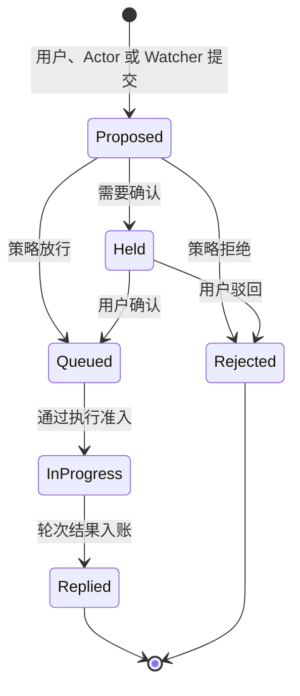
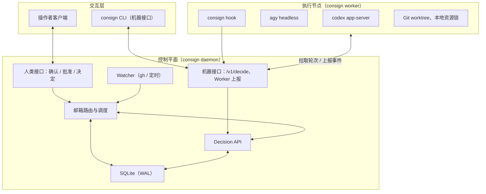

# Consign 设计

## 1. 概述

Consign 把 Agent 之间的交接变成可恢复的组织流程。一次审查可以由单个 Agent 在上下文里依次完成分析、修复和复核，但会话历史很难回答每一步由谁接手、依据哪个决定、验证了哪个快照。Consign 把这些信息写入工单账本，让操作者可以换会话继续工作，也能从多次实际交接中识别值得固定的步骤。

Actor 表示组织中的持久角色，原生 Harness 会话负责执行。固定流程可以声明何时提出下一封信、交给哪个角色、需要什么证据，以及由谁确认。人工交接和流程生成的交接共用邮箱、准入和入账机制。

第一阶段交付单机控制面和 Harness 接入。一个本地 daemon 持有 SQLite，操作者和驱动通过接口写入。真实模型调用使用 API key，故障恢复使用可控的测试驱动验证。

---

## 2. 设计前提

| 前提 | 推出的要求 |
| --- | --- |
| **模型的偏差是系统性的，且因模型而异。** GPT 擅长执行，但做方案容易过度设计、偏离项目风格；Gemini 文字好、能接受取舍，但容易发散和幻觉；DeepSeek 便宜，但 token 效率低 | 质量来自异构交叉检查和人对取舍的校准。系统要能把同一件事交给不同模型，并保证检查者不是作者 |
| **模型调用和工具执行由 Harness 负责。** | 驱动记录执行身份、会话和轮次，工单及交接记录独立于任何会话 |
| **上下文是易失的，工作是持久的。** 调查、发布、审查往往跨越多天和多个会话 | 身份、归属、决定、证据、等待都存放在上下文之外，交接时按需注入 |
| **人的注意力是唯一不可扩展的资源** | 优化目标是用户的注意力。用户只处理决定、确认和例外，其余过程进入账本 |
| **模型会变强，但跨步骤的不变量不会自动成立。** 「检查者不是作者」「外部副作用需要授权」「消息不丢失」「同一会话不被两方同时写入」都无法由单个模型保证 | 模型决定做什么；框架负责寻址、记录、授权和恢复。框架也不能假设模型会遵守框架的规则 |

---

## 3. 核心概念

### 3.1 五个原语

| 原语 | 职责 | 状态归属 |
| --- | --- | --- |
| **Actor** | `@handle`、职责档案、绑定（节点、Harness、凭据类型、模型、沙箱）、会话亲和策略、触发策略（`manual` / `auto`） | 只持有收件箱与会话映射，不存业务状态 |
| **Mailbox** | 成员间唯一的协作通道：持久队列、幂等去重、单会话串行、超时升级 | `messages` |
| **Ticket & Ledger** | 工单（可锚定 GitHub issue、PR、分支）、只追加的事件账本、结构化的决定、绑定快照的证据 | `tickets` / `events` / `decisions` / `evidence` |
| **Decision API** | 统一的策略决策点：邮箱准入、副作用审批、资源锁校验、命令审批 | 规则配置、`approvals` / `policy_audit` |
| **Session Driver** | 屏蔽各 Harness 的差异：进程管理、流式事件、结构化输出、会话血缘、下钻支持 | `sessions` / `turns` |

### 3.2 模型与框架的分工

| 判据 | 交给模型 | 交给框架 |
| --- | --- | --- |
| 出错的代价 | 错了看得见、改得掉：先验证哪个假设、方案怎么写 | 不可逆或不易察觉：消息丢失、对外评论或推送、在忙碌的机器上跑 benchmark |
| 作用范围 | 单个步骤内部 | 跨步骤才成立的性质：独立复核、有效决定、单写入方 |
| 生命周期 | 一次上下文内结束 | 必须长于上下文：身份、归属、等待 |
| 可验证性 | 需要判断力 | 能用确定性方法检查：产物是否存在、测试是否通过、输出是否符合 schema |

探索性工作由操作者逐步确认转交。步骤稳定后，流程规则可以根据已入账的结果提出下一封信，每一封信仍按同一套协议准入和执行。

---

## 4. 机制

### 4.1 转交与信封

转交是系统最基本的动作：把一件事从一个成员交给另一个成员，或从用户交给某个成员。

每次转交，系统根据工单生成一份**信封**。信封分为两部分：

- **请求**：目标、要求、用户选定的引用。用户确认的是这一部分，确认后不再变化。
- **上下文**：当前有效决定、相关证据。这一部分在执行准入时重新解析，不使用生成信封时的快照（见 4.7）。

其他规则：

- 操作者可在确认前编辑信封。首阶段由操作者确认每次转交，后续可为特定 Actor 配置自动投递策略。
- 信封作为普通用户消息发送，不改写 Harness 的系统提示词和工具定义。
- 信封只携带引用（见 4.9），不复制大段正文。

### 4.2 邮箱与状态机

#### 准入与执行



用户可以在确认前编辑信封。策略放行时也可以按规则改写信封。

#### 等待与恢复

| 当前状态 | 条件 | 下一状态 |
| --- | --- | --- |
| `Queued` | 资源锁不可用或会话被占用 | `WaitingResource` |
| `WaitingResource` | 资源或会话释放 | `Queued` |
| `Queued` | 执行准入要求重新确认决定集或引用（见 4.7） | `Held` |
| `Queued` | 排队超时 | `Escalated` |
| `InProgress` | 中断且可幂等重试 | `Queued` |
| `InProgress` | 中断且含不确定副作用 | `NeedsConfirmation` |
| `InProgress` | 超时或重试耗尽 | `Escalated` |
| `NeedsConfirmation` | 用户确认重试 | `Queued` |
| `NeedsConfirmation` | 无法恢复结果 | `Escalated` |
| `Escalated` | 用户改派或重试 | `Queued` |

进入 `Held` 的情况有三种：
- 目标 Actor 的触发策略为 `manual`；
- 信件包含外部副作用；
- 单张工单连续多跳没有用户介入（跳数熔断，在 `Proposed` 阶段检查）。

成员在输出中建议的转交，如果目标是 `manual` 的 Actor，就以 `Held` 状态出现在用户收件箱里。

所有 Actor 的结构化输出统一为 `TurnOutput`：

```json
{
  "reply": { "summary": "string", "artifact_paths": ["string"] },
  "send": [{ "to": "@review", "kind": "request", "ask": "string", "refs": ["commit:...", "file:..."] }],
  "propose": [{ "action": "github_comment", "params": {}, "rationale": "string" }],
  "evidence": [{ "kind": "finding|repro|benchmark", "summary": "string", "refs": ["string"] }],
  "need_human": { "reason": "string", "question": "string" }
}
```

结构化输出由 Harness 的 schema 约束机制保证：Codex 用 `outputSchema`，agy 用 `--json-schema`。模型输出的 `artifact_paths` 和 `refs` 只是路径或 commit；入账时由系统计算内容哈希、必要时生成 git 快照，转换为不可变的产物引用（见 4.9）。

### 4.3 Decision API

邮箱路由、外部动作执行器和各 Harness 的审批入口，都调用同一个决策点：

```json
// Request
{
  "point": "mail.deliver | tool.exec | action.propose | resource.acquire",
  "actor": "@dst",
  "session_id": "codex:01a2...",
  "subject": { "tool": "Bash", "command": "cargo test", "cwd": "/wt/T7" }
}
// Response
{ "verdict": "allow | deny | hold | mutate", "reason": "string", "rule_id": "string", "tier": 0, "mutate": {}, "approval_id": "A42" }
```

决策点根据 `session_id` 反查工单、worktree、有效决定和资源锁，所以审批是**感知工单上下文**的。例如：在工单的 worktree 内运行测试自动放行；越界修改主工作区，或未持有 `bench` 锁就运行压测，则拦截。

**三层裁决**：

| 层级 | 实现 | 职责 |
| --- | --- | --- |
| Tier 0 | Rust 内置规则、TOML 参数、外部脚本扩展点 | 去重路由、会话血缘检查、修复改写、worktree 路径边界、只读角色、跳数熔断、命令白名单与黑名单 |
| Tier 1 | 廉价模型评判（可选，使用 API key） | 灰区命令。只能放行低风险或拒绝，高风险一律升级 |
| Tier 2 | 用户审批 | 外部副作用、高风险命令、例外 |

**各 Harness 的审批入口**：

| 场景 | 入口 | 说明 |
| --- | --- | --- |
| Codex，由系统驱动 | app-server 审批回调 `item/commandExecution/requestApproval` | 系统作为协议客户端接收请求，可以在轮内等待操作者通过人类接口裁决 |
| Codex，用户在 TUI 中下钻 | 用户级 `~/.codex/hooks.json` 的 `PreToolUse` hook | TUI 也连接同一个 app-server，审批请求可能发给 TUI；hook 在 app-server 进程中执行，作为兜底 |
| agy headless | 全局 `~/.gemini/config/hooks.json` 的 `PreToolUse` hook | hook 是同步的。命中 Tier 2 时立即返回 `deny` 并创建审批单；用户批准后写入一次性授权，再发起下一轮让会话继续 |

用户级 hook 同时覆盖普通会话和受管会话。普通会话沿用 Harness 自身的审批策略。受管会话依赖策略裁决的操作在控制面不可用时拒绝执行。

### 4.4 决定的执行

决定是自然语言，无法在工具调用层面完整执行；对命令字符串做匹配也不构成安全边界，因为模型可以换一种写法绕过。所以决定分三层执行：

| 层 | 适用的决定 | 机制 |
| --- | --- | --- |
| 硬边界 | 可写目录、网络访问、只读角色 | Harness 沙箱（`read-only` / `workspace-write`、禁用网络）。这是唯一可靠的边界 |
| 机械规则 | 能写成路径或命令模式的决定，如「不改 `Cargo.toml`」 | Decision API 在工具调用时拦截。可以被绕过，但能挡住大多数无意越界 |
| 输出关口 | 自然语言决定，如「这轮只加日志」 | 拿到 diff 后，对照有效决定检查，由异构复核模型或用户判断；不合格则退回 |

信封会携带所有有效决定，但这只是告知模型；真正的执行靠上面三层。

### 4.5 决定、证据与会话血缘

- **决定**：用户的短指令经确认后成为决定。作用域分为本轮、本工单、本项目，新决定可以取代旧决定。工单级决定可以升格为项目惯例，此后每次规划都会注入，用于持续收敛模型的过度设计倾向。
- **证据**：审查发现、复现结果、测量数据通过产物引用（见 4.9）绑定到快照，并记录环境指纹和产出时的决定集版本。快照变化时，证据标记为 `stale`；决定变化时，只附加「产出于旧决定集」的提示，不自动作废。
- **会话血缘**：`sessions.parent_session_id` 记录会话从哪里分叉而来。修复意味着原实现跑偏，策略会把修复请求改写为：从审查会话 fork 出新会话，先重新梳理方案。复核会话必须不在作者和修复者的血缘链中。Codex 可以使用原生 fork；其他驱动可以创建新会话并附上审查发现。

### 4.6 人工介入

人类接口提供确认转交、确认决定、处理审批和接管工单的操作。剪贴板交接也可以使用同一账本。复制信封时记录请求版本，操作者提交回复时将其关联到该版本。

切换到原生会话操作时，调度器先暂停该会话的自动投递，等待当前轮次结束，再将会话交给操作者。归还时，驱动根据已持久化的历史补录操作。无法确认会话状态时，交由操作者核对。

**agy 下钻后的同步**：租约释放时，系统读取 agy `transcript.jsonl` 的增量，把用户在 TUI 中的输入和模型回复写入账本。也可以再发一轮结构化收尾，让会话输出 `TurnOutput`。

### 4.7 契约一：信封的执行准入

信封从生成到执行之间，可能经过用户确认、资源等待和排队。这段时间里决定可能变化：

| 时刻 | 事件 |
| --- | --- |
| T0 | 生成信封，当时有效的决定为 D1 |
| T1 | 用户确认转交 |
| T2 | 等待资源 |
| T3 | 用户用 D2 取代 D1 |
| T4 | Worker 取信，准备执行 |

**机制**：
- 每张工单维护单调递增的**决定集版本** `decision_version`。本工单或本项目范围内的决定有任何新增、取代或撤销，版本都加一。
- 用户确认信封时，记录当时看到的版本 `confirmed_decision_version`。
- 在 `Queued → InProgress` 这一步做**执行准入检查**，与入队后经过多长时间无关：
  1. 版本没变：直接执行。
  2. 版本变了，且期间的变化全部是**收窄型**决定：重新解析上下文，带着新决定直接执行。
  3. 版本变了，且有任何**非收窄型**决定：回到 `Held`。该信件附上决定差异，等待操作者重新确认。
  4. 请求中用户选定的证据已变为 `stale`，或引用无法解析（见 4.9）：回到 `Held`。

**决定的类型**：确认决定时标注 `effect`。
- `narrowing`（收窄型）：只增加限制，例如「这轮只加日志」「不改 `Cargo.toml`」。收窄只会缩小授权范围，所以原请求仍然有效。
- `other`（其他）：改变目标、放宽限制，或无法判断。**默认是 `other`**，宁可多确认一次。

**执行中的轮次**：决定在轮次执行期间发生变化时，模型本轮读到的仍然是旧决定。为此：
- 本轮产出按照执行准入时记录的版本入账；输出关口则按**当前**决定检查 diff（见 4.4）。
- 对于非收窄型的变化，记录变化供操作者判断是否中断当前轮次。

在同一笔 SQLite 事务中读取适用的决定集、检查请求并记录轮次准入。事务提交时为该轮固定决定版本。需要授权的外部动作在执行前按当前策略复核。

### 4.8 契约二：轮次结果的原子入账

一次轮次完成可能产生多个持久化效果：回复、后续转交、外部动作提议、证据、人工请求。如果系统在写完回复、还没创建下一封信时崩溃，恢复时既不能重新调用模型，也不能丢掉后续转交。

**轮次的两个事务**：

| 时机 | 同一个 SQLite 事务内的操作 |
| --- | --- |
| 轮次开始 | 当前信件 `Queued → InProgress`；写入 `turns` 启动意图、原生会话 id 和解析出的上下文；提交后调用 Harness，取得原生轮次 id 后立即补写 |
| 轮次完成 | 保存原始 `TurnOutput`；写入账本事件；登记证据；创建后续信件（`Proposed`）；为外部动作提议创建审批单；当前信件 `InProgress → Replied` |

**规则**：
- 入账前先校验 `TurnOutput`：schema、引用能否解析、Tier 0 预检。校验失败时，保存原始输出，信件进入 `Escalated`，不产生任何后续效果。
- 轮次完成事务只接受尚未入账的轮次。后续信件的 `idempotency_key` 由 `turn_id` 加上它在 `send` 数组中的下标确定。重复入账时不会产生重复的信。
- **外部副作用不在事务内执行**。事务只创建审批单；批准后由 `ExecDriver` 单独执行，并携带自己的幂等键。执行结果不确定时，进入 `NeedsConfirmation`。

**崩溃恢复**：对于 `InProgress` 但没有完成记录的轮次，按原生轮次 id 查询。启动请求已发出但 id 尚未保存时，先尝试从原生历史可靠关联；无法判断请求是否被接受时，进入 `NeedsConfirmation`。

| 原生会话中的状态 | 处理 |
| --- | --- |
| 已完成 | 取回最终输出，执行「轮次完成」事务 |
| 仍在运行 | 重新接入事件流，继续等待 |
| 确认未执行 | 回到 `Queued` |
| 无法确定 | 进入 `NeedsConfirmation`，由操作者核对后决定是否重试 |

结果从哪里取回：Codex 用驱动版本支持的线程历史接口读取对应轮次；agy 读 `transcript_full.jsonl`。因此受管会话**不使用临时线程**：Codex 的 `ephemeral` 线程无法读取历史轮次（见附录 A.1）。

### 4.9 契约三：产物引用

信封只携带引用，而会话固定在节点上。到了多机阶段，Linux 上的 Codex 产生的未提交 diff、测试日志、本地文件，需要能被 Mac 上的 Actor 读到。消费节点可以从可访问的 Git 仓库取回提交。尚未写入 Git 的内容需要先保存为快照或 blob。

**统一的引用格式**：

```json
{
  "kind": "git_commit | git_snapshot | file | blob",
  "node_id": "linux-pc",
  "repo": "flowmq",
  "path": "logs/run-118/trace.txt",
  "version": "sha256:… 或 git 对象 id",
  "size": 18234,
  "created_at": "…"
}
```

**规则**：
- **引用不可变**：创建引用时就记录内容哈希或 git 对象 id。只有路径的引用不合法，因为路径指向的内容会变。读取时如果哈希不一致，就视为引用失效：信件回到 `Held`，相关证据标记为 `stale`。
- **未提交状态做成 git 快照**：基于明确选定的文件构建 Git tree，再用 `git commit-tree` 创建提交对象，写入隐藏引用 `refs/consign/<ticket>/<n>`。它的 `kind` 是 `git_snapshot`，可以像普通 commit 一样被 diff、检出、在节点之间 fetch。
- **仓库外的文件**（日志、报告）作为 `blob`，按内容哈希存放在来源节点的内容寻址目录中。
- **解析**：
  - 第一阶段在本地读取保留的 Git 对象或内容寻址 blob；原始路径用于标识产物来源；
  - 多机阶段，消费节点与来源节点不同时按需物化：`git_commit` / `git_snapshot` 通过 `git fetch` 隐藏引用获取，`blob` 由 Worker 之间点对点传输，或经控制平面中转（设大小上限）。

这里也是将来接入工作区存储层（快照、低成本分叉、按需加载）的位置：存储层只需要替换引用的物化方式，引用格式和上层语义保持不变。

---

## 5. 安全模型

agent 与用户在同一台机器上、以同一个系统用户身份执行 shell。因此，**agent 能读到的凭据、能访问的接口，都等于 agent 也拥有**。需要防范的情况包括：agent 调用本地接口批准自己的审批单，或伪造一封来自用户的信。

| 措施 | 说明 |
| --- | --- |
| 接口分离 | `/v1/decide`、Worker 上报等**机器接口**，与批准、发信、确认决定等**人类接口**分开监听 |
| 人类接口授权 | 操作者接口接受独立的本地凭据。控制面进程和操作者可以访问该凭据，工具进程的沙箱禁止访问凭据和监听入口 |
| `origin` 由服务端写入 | 每封信的来源由服务端根据认证结果填写，请求方声称的来源一律不采信 |
| 子进程环境剥离 | 启动 Harness 子进程时，剥离系统相关的环境变量，以及 `gh`、`git push` 等凭据 |
| 沙箱禁网 | `workspace-write` 沙箱禁用网络，阻止 agent 访问本机 TCP 接口；Unix socket 放在沙箱无法访问的目录 |
| app-server 是特权接口 | 能连上节点 app-server 的进程，就能向任意线程注入轮次。app-server 优先监听权限为 `0600` 的 Unix socket；使用 WebSocket 时只绑定本机地址，并启用 capability token，令牌不进入 Harness 子进程的环境 |
| 独立系统用户（后续） | 系统以独立的系统用户运行，人类接口的 socket 只对用户的登录会话开放 |

确认和批准由服务端校验操作者权限。工具进程即使能运行 `consign`，也只能使用显式授予它的机器接口。Worker 上报和 Agent 提议使用各自的权限。

---

## 6. Harness 接入

### 6.1 传输方式

| Harness | 传输 | 提供的能力 |
| --- | --- | --- |
| Codex | `codex app-server`，每个节点一个进程，由 `consign worker` 管理 | 线程的创建、恢复、fork，`outputSchema`，审批回调，流式通知，额度与 token 用量通知，TUI 通过 `--remote` 共享线程 |
| agy | headless 模式：`--print`、`--output-format stream-json`、`--json-schema`；多轮时用 `--input-format stream-json` 保持 stdin 打开 | 结构化输出、续接会话、`PreToolUse` hook |
| DeepSeek 等 | HTTP，JSON 模式 | 摘要、分派建议、Tier 1 评判 |

Codex 的备用传输是 `codex exec --json --output-schema`，用于 app-server 不可用时。

### 6.2 凭据与使用条款

开发与集成测试使用各提供商的 API key。驱动按节点配置认证方式，密钥由 Harness 使用，工单账本只记录凭据类型。Codex 用 API key 接入 app-server。agy 可用 Gemini API key 和 `modelProvider=gemini` 运行官方 CLI。

Google 文档将 `agy acp` 用于编辑器交互，并说明消费级方案对第三方应用封装 headless 的限制。ACP 接入需要分别验证轮内审批、结构化输出和恢复能力。手动交接时，操作者可以复制信封到自己的原生会话，随后将回复带回工单。

- [Codex 非交互模式](https://learn.chatgpt.com/docs/non-interactive-mode)
- [Antigravity CLI 认证](https://antigravity.google/docs/cli/install/)
- [Antigravity ACP](https://antigravity.google/docs/cli/acp)
- [Antigravity FAQ](https://antigravity.google/docs/faq/)

---

## 7. 系统架构

### 7.1 技术选型

- **Rust**：单二进制、常驻开销低、Linux 与 macOS 原生编译、强类型状态机。核心依赖为 `tokio`、`axum`、`rusqlite`（bundled，WAL）、`serde`、`schemars`、`reqwest`、`clap`、`nix`。

### 7.2 控制平面与执行节点

控制平面（`consign daemon`）和执行节点（`consign worker`）通过 HTTP/JSON + SSE 通信；单机部署时运行在同一个进程中。



**部署形态**：
- **单机**：`consign up` 在一个进程中运行控制平面和本地执行节点。
- **多机**：控制平面可以运行在常驻的低配服务器上，只负责 SQLite、队列、Watcher和 Decision API；Linux PC 和两台 Mac 各自运行 `consign worker`，上报自身能力（Harness、操作系统、资源、仓库）。

daemon 是消息状态的唯一写入入口。每次状态变化和对应的账本事件在同一事务写入。收件箱按消息和待处理事项查询；客户端可通过 SSE 获知变更，断线后重新查询。多机部署继续由控制面持有数据库。

**会话固定在节点上**：Codex 和 agy 的会话状态都存放在节点本地，所以会话只能在所属节点上恢复，由 `sessions.node_id` 记录。每个节点各自登录 Harness。跨机下钻时：
- **Codex**：通过 ssh 端口转发连接目标节点的 app-server，在本地运行 `codex resume --remote`，命令在 app-server 所在节点执行；
- **agy**：`consign open` 通过 ssh 在目标节点上运行原生 TUI。

### 7.3 模块划分

```text
consign/
├── Cargo.toml
├── crates/
│   ├── ap-core/     # 领域模型、TurnOutput 与 Decision 协议、状态机（无 IO）
│   ├── ap-store/    # SQLite、迁移、事件投影
│   ├── ap-policy/   # Decision API（Tier 0/1/2）
│   ├── ap-driver/   # Codex app-server、agy headless、HTTP、Exec 驱动；进程组；worktree；transcript 同步
│   ├── ap-daemon/   # axum（人类接口与机器接口分离）、调度、Watcher、节点管理、恢复
    └── ap-cli/      # consign up / daemon / worker / open / send / hook / status
```

### 7.4 数据模型

| 表 | 字段 | 说明 |
| --- | --- | --- |
| `events` | `seq, ts, kind, ticket_id, actor, node_id, payload_json` | 只追加，是所有视图的事实来源 |
| `nodes` | `id, name, capabilities_json, status, last_heartbeat_at` | |
| `actors` | `handle, profile, harness, credential_kind, trigger, node_selector, model, sandbox, session_policy, config_json` | `credential_kind`：`subscription` / `api_key` / `none`；`trigger`：`manual` / `auto` |
| `tickets` | `id, anchor, repo, goal, status, decision_version, hop_count, hop_limit, created_at` | `decision_version` 是决定集版本（见 4.7） |
| `messages` | `id, ticket_id, thread_id, origin, from_actor, to_actor, kind, state, idempotency_key, request_json, confirmed_decision_version, reply_to, attempts, timeout_at` | `origin` 由服务端写入：`human` / `actor` / `watcher`；`request_json` 是信封中经用户确认的请求部分 |
| `sessions` | `id, node_id, harness, native_id, parent_session_id, actor, ticket_id, worktree_id, lease_owner, lease_until, transcript_cursor` | |
| `turns` | `id, session_id, message_id, native_turn_id, driver, cli_version, resolved_context_json, decision_version, started_at, ended_at, status, raw_output, exit_detail, usage_json, rate_limit_json` | 每一轮执行的记录：`resolved_context_json` 是执行准入时解析出的上下文；`raw_output` 是原始输出；也用于额度统计 |
| `artifacts` | `id, kind, node_id, repo, path, version, size, git_ref, created_at` | 不可变的产物引用（见 4.9） |
| `worktrees` | `id, node_id, repo, path, base_rev, created_at, create_ms, size_bytes, removed_at` | 同时记录工作区生命周期数据，为评估存储层积累轨迹 |
| `decisions` | `id, scope, scope_id, body, effect, status, supersedes_id, source_msg_id, created_at` | `effect`：`narrowing` / `other`，默认 `other` |
| `evidence` | `id, ticket_id, kind, summary, artifact_ids, decision_version, env_json, stale_reason` | 证据通过 `artifacts` 绑定快照 |
| `approvals` | `id, point, ticket_id, session_id, subject_json, state, decided_by, grant_once_key, created_at` | |
| `locks` | `name, node_id, holder_turn_id, acquired_at, heartbeat_at` | |
| `policy_audit` | `id, ts, point, ticket_id, session_id, rule_id, tier, verdict, latency_ms, subject_json` | |

---

## 8. 端到端示例

### 8.1 变更审查

1. 用户通过操作者接口对 `HEAD~3..HEAD` 发起审查。系统建立工单和临时只读 worktree，生成信封。
2. 用户确认信封。`@review`（异构模型，只读沙箱）产出绑定 `git_rev` / `diff_hash` 的发现。
3. 用户勾选要修的条目和提交边界，形成决定。
4. 策略把修复改写为：从审查会话 fork 出新会话，先重新梳理方案；用户确认后再实现。
5. 实现产出的 diff 经过输出关口，对照有效决定检查。
6. 复核由不在血缘链中的新会话完成。原有发现因 diff 变化标记为 `stale`。

### 8.2 DST 调查

1. Watcher 发现 `issue #812` 被指派给用户，按 issue 去重，建立或关联工单 `T7`，准备 worktree，投递到用户收件箱。
2. 用户确认转交给 `@dst`；策略复用 `T7` 绑定的会话。
3. `@dst` 复现问题并提出假设，建议由 `@review` 复核，这条建议出现在用户的收件箱里。
4. 用户在线程中回复「这轮只加日志」并确认为决定。此后每份信封都携带这条决定，输出关口也据此检查 diff。
5. 对照实验需要申请 `bench` 锁。在 `#812` 下评论需要操作者批准，由 `ExecDriver` 调用 `gh` 执行。

---

## 9. 实施路线

| 阶段 | 交付物 | 验收 |
| --- | --- | --- |
| **Phase 1：本地控制面与 Harness** | Rust workspace、本地 daemon、SQLite 邮箱与账本、操作者和驱动接口、信封确认、可控测试驱动、使用 API key 的 Codex app-server 驱动、轮次恢复、本地 Git 快照及 blob 引用 | 通过接口完成只读审查和一次后续转交。对启动结果未知、原生轮次已完成但尚未入账、重复上报三种情况分别验证恢复行为 |
| **Phase 2：决定与策略** | 决定集版本、执行准入、证据时效、审批与输出关口、agy 驱动验证 | 排队期间变更授权后，旧信封按准入结果处理；用同一个工单在两种 Harness 之间交接 |
| **Phase 3：固定流程与资源** | 由既有交接轨迹提炼的流程模板、Watcher、资源锁、外部动作审批 | 按固定审查流程提出后续交接，异常进入同一个人工待办队列 |
| **Phase 4：多机** | 远程 Worker、跨节点产物物化、会话定位和接管 | 在不同节点执行同一工单的交接，授权记录及产物来源可追溯 |

---

## 10. 风险与对策

| 风险 | 对策 |
| --- | --- |
| agy 接入能力和运行形态有差异 | 使用 API key 验证所选传输的审批、输出与恢复能力 |
| Harness 接口变化 | 驱动层保持很薄；每一轮记录 CLI 版本；app-server 不可用时回退到 `codex exec` |
| agent 冒充用户 | 见第 5 节：接口分离、凭据不落盘、服务端写入 `origin`、沙箱禁网 |
| 命令匹配被绕过 | 沙箱是硬边界，Decision API 是第二道防线，自然语言决定在输出关口检查 |
| 订阅额度耗尽 | 记录 Harness 上报的额度和用量 |
| 下钻造成账本断档 | 接管期间暂停投递，归还后同步持久历史 |
| 成员之间互发信死循环 | 跳数熔断在 `Proposed` 阶段生效，超限进入 `Held` |
| 排队中的信封按旧决定执行 | 决定集版本与执行准入检查（4.7） |
| 崩溃导致重复调用模型或丢失后续转交 | 从原生历史找回已完成结果并原子入账，启动状态未知时等待人工核对（4.8） |
| 跨节点引用无法读取或内容已变 | 引用不可变（记录内容哈希或 git 对象 id），未提交状态生成 git 快照，多机阶段按需物化（4.9） |
| 并发修改同一仓库 | 只读角色用临时 detached worktree，写入角色每张工单一个 worktree |

---

## 11. 待决问题

1. **原生轮次关联**：验证 Codex 在启动响应丢失后能提供哪些持久信息，用于关联 Consign 的启动意图。
2. **agy 传输能力**：验证 ACP 权限事件的覆盖范围、最终结果格式，以及重连后能否定位已提交的轮次。
3. **本地隔离**：验证授权凭据、Worker 接口和 app-server 对工具进程的隔离，在 Linux 和 macOS 分别确认。

---

## 附录 A：Harness 接口事实

以下事实在 `codex-cli 0.171.0`、`agy 1.5.14`（ACP server 1.5.15）上验证。

### A.1 Codex

| 能力 | 用法 | 约束与细节 |
| --- | --- | --- |
| 非交互执行 | `codex exec --json --output-schema <file> -o <out>` | 首行事件 `thread.started` 含 `thread_id`；`-o` 文件是符合 schema 的 JSON |
| 续接与分叉 | `codex exec resume <id>`、`codex exec fork <id>` | fork 生成新的 `thread_id` |
| app-server 线程管理 | `thread/start`、`turn/start`、`thread/fork` | fork 结果包含 `forkedFromId`；临时线程（`ephemeral: true`）不能 fork，也不能读取 turns |
| app-server 结构化输出 | `turn/start` 的 `outputSchema` 参数 | 最终 `agentMessage`（`phase: final_answer`）的文本符合 schema |
| app-server 审批 | 服务端请求 `item/commandExecution/requestApproval` | 参数含 `command`、`cwd`、`threadId`、`turnId`、`availableDecisions`；客户端回复 `{"decision":"decline"}` 后命令被拒，该轮正常结束 |
| app-server 额度通知 | `account/rateLimits/updated`、`thread/tokenUsage/updated` | 用于额度统计 |
| TUI 共享线程 | `codex resume --remote <ws 或 unix 地址> <thread_id>` | TUI 显示已有历史；TUI 发起的轮次，其他客户端实时收到 `userMessage` / `agentMessage`；其他客户端发起的轮次，TUI 实时显示。同一 app-server 上会出现 TUI 自己的辅助线程 |
| 工具进程环境变量 | — | 包含 `CODEX_THREAD_ID`、`CODEX_SESSION_ID`、`CODEX_TOOL_CALL_ID`、`CODEX_SANDBOX_NETWORK_DISABLED` |
| 用户级 hook | `~/.codex/hooks.json` 的 `PreToolUse` | 在未信任的目录中同样加载（项目级 `.codex/hooks.json` 则不会加载）。stdin 字段：`session_id`、`turn_id`、`cwd`、`model`、`permission_mode`、`tool_name`（shell 工具为 `Bash`）、`tool_input.command`、`tool_use_id`。返回 `hookSpecificOutput.permissionDecision: "deny"` 即拦截。hook 进程中没有 `CODEX_THREAD_ID`，要用 stdin 中的 `session_id` 识别会话。首次使用需要在 Codex 中信任该 hook |
| 删除会话 | `codex delete --force <id>` | 不加 `--force` 会等待交互确认；有 fork 子会话时需先删除子会话 |

### A.2 agy

| 能力 | 用法 | 约束与细节 |
| --- | --- | --- |
| headless 结构化输出 | `agy --output-format stream-json --json-schema <file> --print "<prompt>"` | `--print` 会把紧随其后的参数当作 prompt，其他选项必须放在它前面。首个事件 `init` 含 `conversation_id`；最终 `result` 事件的 `structured_output` 是已解析的对象 |
| 续接会话 | `agy --conversation <id> ... --print "<prompt>"` | 可命中缓存 |
| 多轮会话 | `--input-format stream-json`，保持 stdin 打开 | 每行一个 JSON 事件；关闭 stdin 后，进程在当前轮次结束后退出 |
| hook | 工作区级 `.agents/hooks.json`，或全局 `~/.gemini/config/hooks.json` 的 `PreToolUse` | headless 下生效。stdin 含 `conversationId`、`cwd`、`modelName`、`toolCall.{id,name,args}`；返回 `{"decision":"deny","reason":"..."}` 约 100ms 内生效；还支持 `allow`、`ask`、`force_ask` 以及改写参数的 `overwrite`。hook 进程继承 agy 的环境变量 |
| 工具进程环境变量 | — | 包含 `ANTIGRAVITY_CONVERSATION_ID` |
| fork | — | 不支持原生 fork |

本机 `agy acp` 1.5.15 的 `initialize` 返回 ACP v1，声明 `load`、`resume`、`list`、`close`，并列出 Gemini API key 认证。交互期间的权限回调和轮次恢复需要独立验证。
