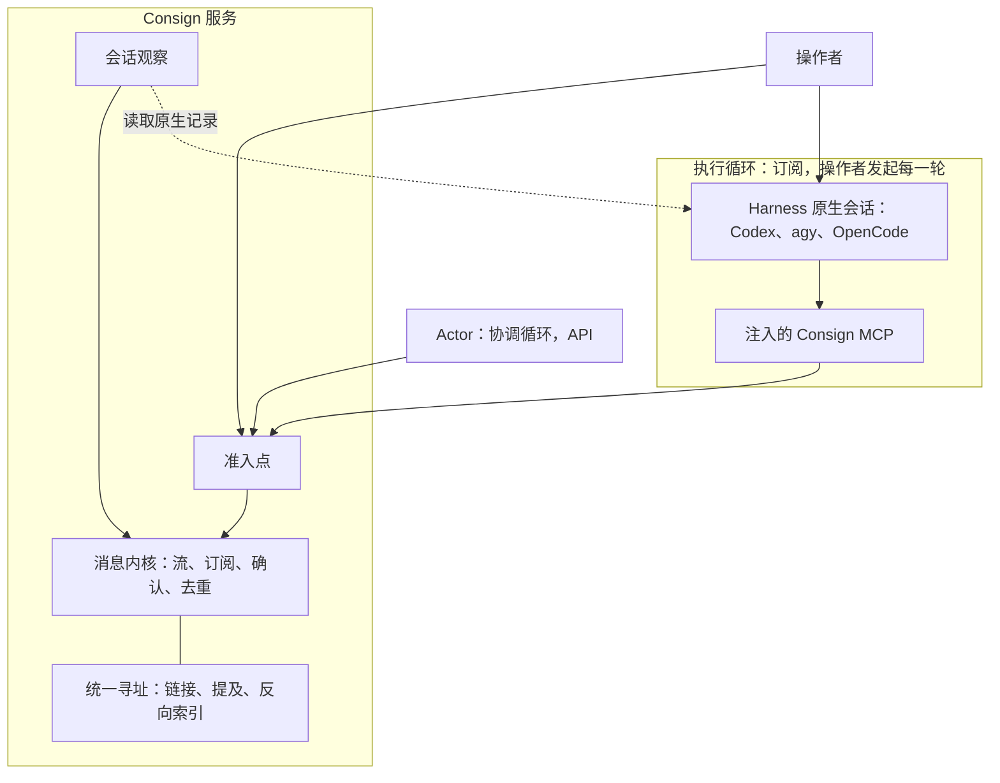

# Consign 设计

Consign 是多 Agent 协作的组织层。操作者、各个模型和各个执行会话之间发生的事，在 Consign 里记成可寻址、可订阅、可追溯的消息；交接、授权和恢复的机制都建立在这些消息之上。谁和谁协作、按什么流程推进、用什么界面操作，由使用者在这些机制上组合，Consign 本身不规定产品形态。

Consign 是一个中心化的服务，以 MCP 的形式注入各个执行会话，由会话里的模型主动调用；它不管理、也不驱动执行会话。需要自动运转的协调工作通过 API 调用模型完成；具体的执行留在操作者亲手操作的会话里。

本文说明 Consign 要解决的问题、问题的建模方式、责任的划分和机制的方向。数据结构、协议、状态机和各 Harness 的接入细节见 [IMPLEMENTATION.md](IMPLEMENTATION.md)。

---

## 1. 现状

### 1.1 工作怎样发生

一项工程工作通常同时用到几个模型，而它们的偏差是系统性的，各不相同。GPT 擅长执行，但做方案时容易过度设计、偏离项目风格；Gemini 文字好、能接受取舍，但容易发散和幻觉；DeepSeek 便宜，但 token 效率低。所以质量来自异构交叉检查和人对取舍的校准：同一件事交给不同的模型，检查者不能是作者，取舍由操作者拍板。

这些工作分散在 Codex、agy、OpenCode 等执行环境（下称 Harness）的原生会话里。一次调查、一次审查、一次发布往往跨越几天和多个会话。操作者在会话之间切换，决定什么时候交给谁，把一个会话的结论带进另一个会话。

单个 Agent 已经能完成其中大部分步骤。一个 Codex 会话可以依次扮演作者、审查者和修复者；需要另一个模型时，在命令行里调一次 `agy -p` 就完成了跨模型交接。缺口不在执行能力。

### 1.2 信息完整，但十分离散

缺口在于，工作的来龙去脉只留在各个会话的上下文里。下面这个例子说明问题出在哪里。

两个 issue 分别在两个 Codex 会话里调查。第一个会话的首轮分析解释了测试断言为什么失败，但实际只是复述了失败现象。操作者知道这块代码长期稳定，判断这个解释停得太早，于是追问上游原因，一轮之后找到了真正的问题：某条路由路径在过期的成员视图下使用了不一致的筛选规则。操作者随即怀疑另一个 issue 也出自同一个原因，从第一个会话里挑出相关分析，复制粘贴进第二个会话。第二个会话用自己的重放结果交叉核对，确认两个 issue 共享这个缺陷，最后一个修复关闭了两个 issue。

这个过程需要的信息全都在会话记录里，但信息之间的连接只存在于操作者的脑子里：

- 操作者要记得另一个会话里有相关内容，翻到那一段，再复制过去。粘贴进去的文字在目标会话里只是一段普通输入，来源就此丢失。
- 两个 issue 共享的范围、各自验证到哪一步（一边的重放进入了故障条件，另一边没有），没有地方记录，散在两段对话里。
- "首轮解释停得太早"这个判断来自操作者对项目的长期了解。它决定了调查方向，却没有留下任何记录。
- 想弄清某个决定现在是否还有效，要回头读很多轮。

操作者在这里同时充当了索引、搬运工和项目记忆。人的注意力是整个系统里唯一不可扩展的资源，消耗的恰恰是它。

### 1.3 写进 prompt 和插件的代价

上面的流程都可以用 prompt 或 Harness 插件在会话内部实现。代价是流程本身变成散落在 prompt 里的文本，执行轨迹留在上下文里：想改以后怎么走，要去改分散的 prompt；想查某一次是怎么走的，要去翻会话。流程和轨迹还会被锁在某一个 Harness 里，换一个 Harness 就要重来一遍。

Consign 把轨迹和流程从 Agent 的边界里拿出来，集中在一个服务里维护。查某次工作怎么走，打开它的记录；想改以后怎么走，打开流程定义。注入会话的 MCP 只是会话访问这个服务的入口：记录在服务里，不在上下文里。

### 1.4 订阅不允许外部循环

执行工作最划算的方式是各家的订阅，也就是在 Codex、agy 等官方客户端里使用订阅额度。但消费级订阅普遍不允许第三方程序封装客户端、在外部自动循环地发起轮次；按量计费的 API key 没有这个限制。

这个约束决定了 Consign 的形态。如果 Consign 作为调度者去启动和驱动 Harness 会话，执行就只能走 API，成本和可选的模型都受限制。反过来，Harness 照常作为官方客户端由操作者使用，会话里的模型通过注入的 MCP 主动调用 Consign，订阅的用法就和平时完全一样：每一轮都由操作者发起，模型调用 Consign 只是它自己的工具调用。

---

## 2. 问题建模

### 2.1 三种状态，三种寿命

上面的问题里混着三种寿命不同的状态：

| 状态 | 例子 | 寿命 |
| --- | --- | --- |
| 执行上下文 | 模型在一个会话里读过的文件、做过的推理 | 一次会话，随时可以替换 |
| 工作状态 | 谁负责、确认了哪些决定、证据针对哪个快照、在等什么 | 跨会话、跨模型，直到工作结束 |
| 组织经验 | 哪些解释曾被推翻、哪类工作反复需要人纠正、项目里什么长期稳定 | 跨工作长期积累 |

现在三者都放在执行上下文里，会话一结束、一压缩，后两种就跟着消失或沉底。Consign 的基本做法是把后两种放到上下文之外：组织责任持久，执行上下文可以替换。交接时再按需把相关部分带进上下文。

### 2.2 一切都是可寻址的消息

Telegram 里每条消息都有一个链接；在 GitHub 的一个 issue 里提到另一个 issue，对方页面就会出现反向链接。这两个机制合起来，正好补上 1.2 里缺的东西：能稳定指向一段内容的地址，以及引用发生时自动建立的关联。

照这个思路，Consign 把工作中发生的事都看作消息，放在有序的流里：

- 一个原生会话是一条流，成员是操作者和一个模型；
- 一个邮箱是只有一个收件人的流；
- 一个群组是多个成员（会话、Actor、操作者）共享的流；
- 一张工单的账本也是一条流。

每条消息由"哪条流、第几条"唯一确定，这就是它的链接。链接是普通文本，可以出现在任何地方：信封、回复、原生会话里的用户输入、提交信息。某处一旦出现链接或外部标识（issue 编号、PR 编号、提交 id），就记下一条"A 提及 B"。回到 1.2 的例子：操作者在第一个会话里问"这和另一个 issue 是不是同一回事"，这句话本身就让两个会话经由 issue 编号连了起来；把分析带进第二个会话时附上链接，来源就不会丢。

关联因此成了引用的副产品，不需要另外设计归档流程。链接的含义也足够简单，模型读了说明就能自己找到对应的原生记录，所以寻址不依赖某个特定的程序。

### 2.3 在机制上打补丁

多个 Agent 并行工作时，协调问题会接连冒出来：两个会话其实在解决同一个问题怎么办？要不要一个 leader？要不要广播、拉群、在固定环节开会？每个问题都有几种看似合理的机制。把它们逐个加进框架，就像用一条条 `if` 去识别手写数字：每条规则覆盖一些情况，规则的组合却永远追不上实际情况的变化。

手写数字最后是靠改变设计对象解决的：工程师不再写规则，转而设计架构、数据和目标，规则从数据里学出来。Consign 采取对应的立场：

- **内核只提供可组合的原语**：流、订阅、链接、准入点。这相当于架构。
- **协调策略在原语之上组合**：谁来领一项共享修复、什么时候拉群、哪一步固定成流程，由操作者、Actor 或规则决定。策略可以替换和演化，内核不变。
- **实际轨迹完整保留**，尤其是操作者在哪里介入、改了什么。这相当于数据。积累的记录能否让 Actor 形成更好的判断，是 Consign 要验证的主张；机制保证这些材料不丢。

### 2.4 不变量交给框架

有一类性质要跨越多个步骤才成立，单个模型保证不了：

- 检查者不是作者；
- 外部副作用需要授权；
- 消息不丢失，同一动作重试只生效一次；
- 同一个会话不会被两方同时写入。

模型会越来越强，但这些不变量不会因此自动成立。它们由框架负责，而且框架不能假设模型会遵守自己的规则：约束要落在模型绕不过去的地方，比如沙箱、服务端校验和数据库事务。

### 2.5 两个循环

Consign 不再操作 Harness 之后，工作分成两个循环：

| 循环 | 由谁维持 | 计费方式 | 做什么 |
| --- | --- | --- | --- |
| 协调循环 | Actor，自动运行 | API key | 整理记录、建立关联、起草交接、发现重叠、等待结果 |
| 执行循环 | 操作者 | 订阅 | 在原生会话里发出每一轮，审阅输出，决定下一步 |

协调循环只调用 API，所以可以完全自动，最大限度地承担协调工作。执行循环始终由操作者维持。从更高一层看，操作者就是执行循环里的那个"模型"：读材料、做判断、发出下一轮。Consign 的目标是让这个循环的每一步尽量便宜：材料已经整理好，链接一点就到，上下文一键复制。

---

## 3. 责任归属

### 3.1 模型与框架

模型决定做什么；框架负责寻址、记录、授权和恢复。一件事该归哪一边，可以从四个方面判断：

| 判据 | 交给模型 | 交给框架 |
| --- | --- | --- |
| 出错的代价 | 错了看得见、改得掉：先验证哪个假设、方案怎么写 | 不可逆或不易察觉：消息丢失、对外评论或推送、在忙碌的机器上跑 benchmark |
| 作用范围 | 单个步骤内部 | 跨步骤才成立的性质：独立复核、有效决定、单写入方 |
| 生命周期 | 一次上下文内结束 | 必须长于上下文：身份、归属、等待 |
| 可验证性 | 需要判断力 | 可以机械检查：动作的参数、权限和引用 |

### 3.2 组织责任与执行分开

负责一项工作的主体和实际执行它的会话是两回事。`@review` 负责一次复核：它决定这次怎么审、交给哪种会话、带上哪个快照；执行完后，它整理哪些发现值得接受、下一步交给谁。执行会话只负责把这次审查做完。会话可以中断、更换、换模型，`@review` 对这项工作的责任和记录都不变。

这个划分也把两种独立性分开了。作者和复核者可以用同一个模型，只要会话隔离、上下文独立、各自对结论负责。如果复核还要发现某个模型反复出现的盲点，再把这类任务交给异构模型。

### 3.3 人

操作者维持执行循环，处理决定、确认和例外，其余过程进入记录。

- **维持执行循环**：执行会话里的每一轮都由操作者发出。Consign 负责把需要的材料整理好，随时可以取用。
- **决定**：操作者的短指令经确认后成为决定，带明确的作用域（本轮、本工单、本项目），可以被新决定取代。工单级决定可以升格为项目惯例，用来持续收敛模型的过度设计倾向。
- **确认与授权**：交接、外部副作用、高风险操作由操作者批准。批准由服务端校验，Agent 不能批准自己的请求，也不能冒充操作者发信。
- **介入**：操作者介入的地方，往往就是 Agent 对问题的理解和操作者分开的地方：改写一封信封，驳回一项提议，或者在会话里对已经给出的结论继续追问。介入和它针对的内容放在一起记录。

项目层面的判断，比如"这块长期稳定，突然出问题多半是回归"，目前由操作者承担。Consign 不把这类判断写成规则，而是保留产生判断的材料：当时的事实、操作者的追问、后来的验证。

---

## 4. 抽象划分

### 4.1 消息内核

内核提供消息中间件那一层的能力：只追加的有序流、按主题层级的订阅、带游标的持久消费者、确认与重投、重投耗尽后的死信、按消息 id 去重、请求与应答、保留策略。这些能力有成熟的语义，可以参照 JetStream、Kafka 一类中间件，与任何产品形态无关。邮箱、群组、频道、工单账本只是主题和订阅关系的不同组合。

内核是确定性的，不调用模型。第一阶段在单机 SQLite 上实现这些语义，接口按流语义设计，以后可以换成独立的中间件。

### 4.2 统一寻址

所有对象都通过链接指向：原生会话以及其中的轮次和片段，Consign 自有的流和消息，工单、决定、证据。

两类对象的寻址要求不同。会话和轮次的链接用于导航，指向的内容会随会话增长。作为证据或交接依据的内容必须固定：片段链接带内容哈希，被引用时保存当时选中的内容，原始记录被清理或改写后仍然可读。代码状态同理，未提交的修改先做成快照再引用。

各 Harness 的会话记录在轮次这一层语义相近，往下差别很大。Consign 把寻址统一到片段，把语义只统一到轮次：轮次记录发起方、输入、最终输出和它回应的上一轮；轮次以下的工具调用和推理保留原生结构，通过片段链接访问。这样既能精确指向任意一段内容，又不必把各 Harness 压成最小公共集。

提及索引是从流里派生出来的视图，可以随时重建。它只说明一处内容指向了另一处，是否真的相关由读的人判断。模型通过两个只读操作使用它：给定链接取回内容，给定对象查出谁提及了它。沿哪些链接查下去由模型决定。

### 4.3 准入点

所有改变组织状态或产生副作用的动作都经过同一个决策点：消息投递、组织动作的提议、资源获取，以及通过 Harness 的 hook 送来的工具执行请求。决策点能根据会话反查所属工单、工作区、有效决定和资源锁，所以裁决是感知工作上下文的。比如在工单的 worktree 里跑测试可以自动放行，越界修改主工作区则拦截。

裁决分三级：内置规则处理确定的情况；廉价模型只处理灰区，而且只能放行低风险操作或拒绝；其余交给操作者。

### 4.4 Harness 与 MCP 注入

Harness 是承载具体会话的执行环境，由操作者按平常的方式使用。Consign 不启动、不驱动这些会话，通过两种方式与它们连接：

- **MCP 注入**：Consign 以 MCP server 的形式注入执行会话，提供解析链接、查询反向索引、发布消息、提出交接、登记证据等工具。会话里的模型在操作者发起的轮次中按需调用。这是一层依赖倒置：Consign 不需要知道某个 Harness 怎样启动、怎样续接，只需要 Harness 支持 MCP，再能确定调用来自哪个会话。Consign 的核心不包含任何 Harness 专属的执行逻辑。
- **观察**：Consign 读取 Harness 落盘的原生记录，把会话作为一条流导入，并按游标跟进。原生记录始终是事实来源。操作者自己打开的会话、历史上已有的会话，都能进入 Consign 的视野，不依赖模型是否调用过工具。

链接的含义写在随 MCP 提供的说明里，模型也可以自己找到对应的原生记录去读。MCP 工具提供的是更便宜、更可靠的路径：只返回需要的片段，哈希校验和账本写入由确定性代码完成。

### 4.5 Actor（书记员）

Actor 是持久的组织身份，例如 `@review`，带有职责、权限、委派偏好和可查询的工作记录。每次被唤醒，它读取职责、相关记录和这次收到的消息，判断是自己处理、起草一封交接，还是请操作者判断。一次唤醒称为一次 Actor Run。Actor 运行在协调循环里，通过 API 调用模型，可以无人值守地运行。

Actor 也是异步消息和按轮次工作的会话之间的适配层。模型按轮次工作，一轮进行中"听"不到新消息。Actor 替会话收听：订阅相关的流，整理出这个会话需要知道的内容。送达有两条路：放进操作者的待办，由操作者决定是否发送；或者等会话里的模型在某一轮主动来取。会话里的模型要发言时，自己调用 Consign 的工具发布消息，Actor 负责归类和跟进。消息因此始终是有格式、可寻址的记录，而不是推进模型上下文的零散文本。

书记员的工作是读懂来信、查找相关记录、提出下一步、整理结果，不需要很强的模型，可以统一使用 DeepSeek。Actor 之间的差异来自职责、权限和各自的记录。

### 4.6 协议与模式

交接、群组、固定流程、路由规则都建立在上面这些原语之上，不进入内核：

- **交接**是一种协议：信封带着请求和链接，经过确认后由操作者送进目标会话，或者由目标 Actor 领取，回复入账。
- **群组**是多个成员订阅同一条流。两个会话发现工作有重叠时，由各自的 Actor 建立一条共享的流来交换消息；建立和邀请都要经过准入点。
- **固定流程**是一组规则：根据已入账的结果提出下一封信。

哪些协调方式值得用，由使用者在实际工作中决定。发现两个会话在做同一件事，也是 Actor 要解决的问题；机制负责让 Actor 需要的信息都能查到、能订阅。

### 4.7 入口

Consign 更像一套 SDK，而不是一个管理平台。操作者的主要入口可以是一个 IM 式的组织会话：在一条线程里布置工作、追问、纠偏；需要拍板时，线程里出现可以直接提交的决策。收件箱、编辑器里临时生成的界面，也都可以作为入口。它们共用同一套原语和记录，界面怎样组织由入口自己决定。

### 4.8 命名

| 名称 | 指什么 |
| --- | --- |
| **Consign** | 确定性的中心服务：消息内核、寻址、观察、准入、恢复 |
| **Consign MCP** | 注入执行会话的 MCP server，向会话里的模型提供 Consign 的工具 |
| **Actor** | 持久的组织身份，在协调循环里按消息唤醒的模型循环。"书记员"是它的角色比喻 |
| **Actor Run** | Actor 被唤醒后的一次运行 |
| **Harness** | OpenCode、Codex、agy 等执行环境，承载原生会话 |

Harness 这个词只用于具体的执行环境。Consign 自己的部分按实现形态命名：确定性的部分叫 Consign，模型驱动的部分叫 Actor。

---

## 5. 机制的方向

本节说明主要机制的思路，具体规格见 [IMPLEMENTATION.md](IMPLEMENTATION.md)。

### 5.1 接入倒置：模型调用 Consign

Consign 不把 Harness 当作被管理的节点。原因有两个：订阅不允许外部循环驱动客户端（1.4）；而且大多数实际工作本来就发生在操作者自己打开的会话里，如果 Consign 只能看到自己启动的会话，最有价值的那部分轨迹就落在视野之外。

所以 Consign 先观察原生会话：导入、跟进、建立链接和提及索引。这一步不需要 Actor，操作者就已经能从一个会话找到引用过它或被它引用的内容。注入的 MCP 让会话里的模型也能主动使用这些能力；交接协议和 Actor 都建立在这个基础上。

### 5.2 模型调用工具，服务守住不变量

模型通过调用工具来改变组织状态：读取上下文、发布消息、登记证据、提出交接。Harness 的输出不需要符合特定格式，回复可以是自然语言。哪些内容值得登记、哪里应该附上链接、什么时候提出交接，由模型自己判断，组织的边界靠这些工具调用来维护。

这和 2.4"框架不能假设模型守规则"并不冲突：模型决定何时调用、调用什么，工具背后的 Consign 服务负责守住不变量。重复调用只生效一次，账本只追加，引用的内容带哈希校验，越过授权的调用直接拒绝。模型漏掉一次调用，损失的是一条记录，观察到的原生记录还可以补上；模型调用错了，服务会拒绝。

每次调用都要能确定来自哪个会话，用来记录出处。会话里的模型只能提议和登记，确认、批准这类动作只在人类接口上进行，所以出处信息不承担授权的职责。Actor 在协调循环里调用工具时，凭据绑定这一次 Actor Run，运行结束即撤销，思路类似预签名 URL。

工具调用是一次请求，账本记录系统如何处理它。组织轨迹因此随实际操作自然形成：一条交接可以追溯到哪个会话、哪次调用、当时的决定版本和证据快照，以及后来谁确认、在哪个会话里执行、结果如何。

### 5.3 流程从轨迹里长出来

新的工作开始时，由操作者或 Actor 一步步决定下一步交给谁。跑过多次之后，稳定的路径会显现出来，比如"审查固定快照 → 操作者选定修复范围 → 修复 → 独立复核"。这时可以把"提出下一步"的条件交给规则。

演化发生在"谁提出下一步"上：先是操作者，然后是 Actor，最后是一版规则。三者提出的是同一种交接，经过同样的准入，留下同样可查询的记录，记录里写明提议来自谁。所以固化流程不用重做执行机制，还可以比较规则启用前后的实际效果。

### 5.4 交接时传链接，使用时再解析

交接的信封分两部分。请求部分是目标、要求和选定的引用，操作者确认的就是这一部分，确认后不再变化。接收方解析链接时可以查看当前有效的决定、证据和准入判定。显式申请使用信封时，Consign 再核对一次并记录结果。

这样分，是因为信封从确认到被使用之间可能隔了很久，期间决定可能变了。每张工单维护一个单调递增的决定集版本，准入时比较确认时的版本和当前版本：没变就照常返回；新增的决定都只是收窄授权，就带着新决定返回；有放宽授权或改变目标的决定，或者引用的证据已经过时，就在结果里标出差异。接收方申请使用时，Consign 把这封信退回操作者重新确认。

信封只携带链接和引用，不复制大段正文。信封本身也有链接：它出现在哪个会话里，就说明哪个会话收到了它。

### 5.5 介入和它针对的内容一起记录

信封或提议被编辑、驳回时，原稿、改动和驳回理由都保留下来。会话里哪些输入是送达的信封、哪些是操作者自己的追问，分开标记，追问关联到它回应的那一轮。回看时可以对照 Agent 原本打算怎么做、操作者改成了什么。比较模型、调整流程、判断某一步能否固定时，也能从中找出哪些工作反复需要人纠正。

### 5.6 书记员的取舍要留痕

Actor 替会话收听时，转交什么、略过什么，是一个有损的判断，带着书记员模型自己的偏差。所以它消费了哪些消息、决定转交什么、实际交出的内容，都作为消息记录下来，否则这一层会变成新的黑箱。

Actor 从不直接写入执行会话。会话的唯一写入方是操作者，Actor 的产出要么进入操作者的待办，要么等会话里的模型来取。

### 5.7 约束分层落地

决定是自然语言，无法在工具调用层面完整执行；对命令字符串做匹配，也挡不住换一种写法。所以约束分三层：

- **硬边界**：可写目录、网络访问、只读角色交给 Harness 沙箱。这是唯一可靠的边界。
- **机械规则**：能写成路径或命令模式的决定，通过 Harness 的 hook 在工具调用时询问准入点，能挡住大多数无意越界。
- **输出关口**：自然语言的决定在拿到 diff 后对照检查，由异构模型或操作者判断，不合格就退回。

Agent 和操作者在同一台机器上以同一个系统用户运行，Agent 能读到的凭据和能访问的接口，都等于 Agent 也拥有。所以批准、发信这类人类接口与机器接口分开监听，消息来源由服务端根据认证结果写入，协调循环的 API 凭据不进入执行会话能读到的环境。

协调循环里的 Actor 互相发信可能形成循环。单张工单连续多跳都没有人介入时，自动熔断，交给操作者。

### 5.8 恢复：区分已记录和已发生

崩溃恢复的关键是区分"消息已经持久化"和"外部动作已经发生"。协调循环里的外部动作，比如在 issue 下发评论，先记下意图再执行。重启后先核对外部状态：确认已完成就补记，确认未执行才重试，状态不明就交给操作者。

Actor Run 的生命周期与运行它的进程分开。`@review` 起草一封交接、交给操作者之后，记下自己在等这封信的结果，然后释放运行槽。信封链接出现在某个会话里、那一轮完成并被观察到时，原来那次 Run 被唤醒继续处理，即使期间整个服务重启过。

---

## 6. 边界

- **不操作执行会话**。Consign 不启动、不驱动执行会话，也不向其中发送内容；会话的每一轮由操作者发起。
- **不规定产品形态**。leader、会议、看板这类协作形态都是原语之上的组合，Consign 不内置。
- **判断关联不是机制的目标**。机制让关联可见、可查询；两件事是否真的相关、哪个结论下得太早，由 Actor 或操作者判断。
- **单机起步**。第一阶段由一个本地服务持有全部状态。Harness 的会话记录存放在各台机器本地，跨机器的观察和寻址放到多机阶段。
- **凭据**。协调循环使用各提供商的 API key；执行使用操作者自己的订阅，经由官方客户端。

---

## 7. 待探索的方向

1. **Actor 与会话怎样对应**。操作者自己打开的会话默认由谁收听：每个会话配一个轻量的书记员，还是按工单或项目归到某个 Actor？这决定了订阅关系和成本。
2. **Actor 何时唤醒**。每来一条消息就唤醒一次，成本和噪声都太高。消费侧需要批量和防抖，唤醒策略本身可能也需要演化。
3. **记录能否改善判断**。Actor 积累了介入记录和项目事实之后，第一反应是否更接近操作者的判断，需要用真实工作来检验。
4. **消息内核的实现**。单机阶段在 SQLite 上实现流语义；何时、以何种方式换成独立的中间件。
