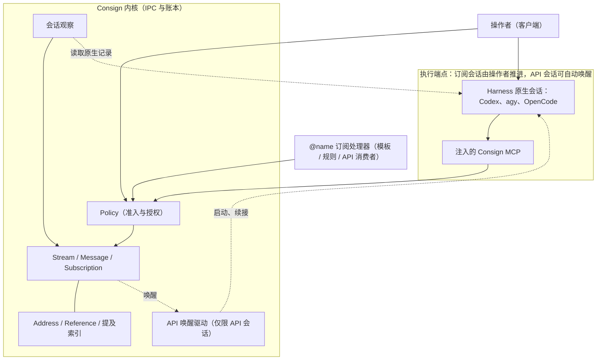

# Consign 设计

Consign 的出发点建立在两条基本判断上：

- **协同是认知过程之间的因果耦合，组织则是这种耦合在时间上的持续化、结构化与约束化。** 单个会话中的模型负责认知过程本身；框架不插手模型如何思考，只负责让不同认知过程之间的耦合跨会话延续、沉淀出清晰结构并受到边界约束。
- **组织记忆存在于主体之外。** 组织的扩展能力取决于它能否低摩擦地让局部认知成果脱离产生它的主体，成为其他主体可直接消费的公共信息，而不必绑定原会话的生命周期或继承其推理偏见。

基于这两条判断，Consign 是一个**人也可以参与其中的 Agent 协作环境**，本质上是**面向智能执行主体的 IPC（Inter-Process Communication）**。传统 IPC 传递数据和调用参数，Consign 传递**意图（Intent）、不可变引用（References）与工作关系**；如何理解和处理这些信息，交给具备智能的通信端点本身。

Consign 以中心化服务运行，通过 MCP 注入各个执行会话，同时观察各 Harness 落盘的原生记录。订阅会话由操作者亲手推进；用 API key 启动的会话和后台订阅处理器可以自动唤醒。操作者与 Agent 共享同一套协作语义，差异只落在策略与授权上。

本文说明 Consign 要解决的问题、核心模型、最小内核与机制方向。数据结构、协议、状态机与各 Harness 的接入细节见 [IMPLEMENTATION.md](IMPLEMENTATION.md)；人机交互立场与界面宿主边界见 [INTERACTION.md](INTERACTION.md)。

---

## 1. 现状

### 1.1 多模型协作与离散轨迹

一项工程工作往往同时用到几个模型，而它们的偏差是系统性的，各不相同。GPT 擅长执行，但做方案时容易过度设计、偏离项目风格；Gemini 文字好、能接受取舍，但容易发散和幻觉；DeepSeek 便宜，但 token 效率低。质量来自异构交叉检查和人对取舍的校准：同一件事交给不同模型，检查者不能是作者，取舍由操作者拍板。

这些工作分散在 Codex、agy、OpenCode 等执行环境（下称 Harness）的原生会话里，一次调查、审查或发布往往跨越几天和多个会话。单个 Agent 已经具备完成其中大部分步骤的执行能力，缺口不在执行，而在信息的连接。

下面这个场景说明问题出在哪里：两个 issue 分别在两个 Codex 会话里调查。第一个会话的首轮分析解释了测试断言为何失败，但实际只是复述了现象。操作者知道这块代码长期稳定，判断解释停得太早，追问上游原因后找到了真正的问题：某条路由路径在过期成员视图下使用了不一致的筛选规则。操作者随即怀疑另一个 issue 出自同一原因，挑出分析复制粘贴进第二个会话；第二个会话用自己的重放结果交叉核对，确认共享该缺陷，最终一个修复关闭两个 issue。

这个过程所需的全部信息都在原生记录里，但连接只存在于操作者的脑子里：

- 意图本身很短（"看这两处是不是同一个问题"），但为了把意图送达另一个会话，操作者要回忆出处、翻找段落、复制粘贴、补充背景，粘过去之后来源就此丢失。
- 两个 issue 共享的范围、各自验证到哪一步（一边的重放触发了故障条件，另一边没有），散落在两段对话里。
- "首轮解释停得太早"这一纠偏判断没有留下与原轮次的关联记录。
- 想确认某条决定现在是否仍有效，要回头翻很多轮。

### 1.2 人被迫成为串行中介

上面这些跨会话操作大多并不是在创造新信息，而是在建立已有信息之间的关系：让一个会话参考另一个会话的某轮设计，让新会话继承调查成果但不继承推理偏见，把某次讨论的工程取舍应用到后续实现。

只要跨 Harness 协作必须经过人来搬运，协作拓扑就是以人为中心的星形结构——人能同时操作的输入框只有一个。即使多窗口、侧边栏或群组界面做得再顺手，改善的也只是人在串行路径上的搬运效率，并发上限依然被锁在操作者的注意力上。

### 1.3 写进 prompt 和插件的代价

把协作逻辑写进 prompt 或单个 Harness 的插件，会让流程退化成散落文本，轨迹留在会话上下文里：难以追溯某次工作怎么走的，难以跨 Harness 复用，也无法在上下文压缩后保持稳定。Consign 把轨迹与通信机制从单个 Agent 的上下文里拿出来，由中心服务维护；注入会话的 MCP 只是访问这个服务的入口。

### 1.4 订阅条款的现实约束

日常执行最划算的方式是在 Codex、agy 等官方客户端里使用订阅额度，但消费级订阅普遍不允许第三方程序在外部自动循环地驱动客户端；按量计费的 API key 没有这个限制。

因此 Consign 采用接入倒置：订阅会话照常由操作者在官方客户端里使用，模型在操作者发起的轮次中通过注入的 MCP 主动调用 Consign；用 API key 启动的会话和后台处理器则可以自动唤醒。两种形态共用同一套寻址、消息与记录，区别只在由谁发出下一轮。

---

## 2. 核心模型

### 2.1 从传递 Context 转向传递 Intent

跨会话协作的最小交互原语是 **`Recipient + Intent + References`**，例如：

```text
To: @review  （或某个具体会话地址）
Intent: 根据下面的审查结果调整设计，只处理第二项，保留已接受的取舍。
Refs:
  consign://codex/01a2…/turn/42
  consign://agy/09f1…/span/L12-L18@sha256:…
```

Consign 不负责把所有引用展开成一份庞大的 prompt，也不替目标模型决定哪些信息值得阅读。它只保证引用稳定、可解析、可追溯；信息的选择权交给接收方模型，工作的方向由发起意图的参与者决定。

### 2.2 对等语义，不对等权限

剥离最终决策权之后，操作者在协作中做的多数动作——阅读历史、挑选值得传递的片段、提出新请求、引用过往决定、给出反馈、发起独立检查——模型本身都具备相应能力。

因此，Consign 遵循一条核心架构约束：**任何可以由操作者通过 Consign 发起的协作操作，在具备相应授权的情况下，也应当能够由 Agent 发起，反之亦然。** 基础设施层不区分“人工工作流”和“Agent 工作流”：操作者打开终端、输入任务、阅读历史，与另一个端点创建或投递任务给某个会话，在 Consign 里是同一种协作语义；人类界面只是同一套 IPC 机制的客户端。

对等的是通信语义，不对等的是**权限与唤醒能力**：

- **授权不对等**：操作者拥有修改目标、批准外部副作用、确认高风险动作和撤销委派的最终权限；Agent 的提议受策略约束。
- **鉴权通道隔离**：同一台机器、同一个系统用户下，操作者与机器接口分开监听和鉴权，避免 Agent 冒充操作者批准自己的请求。
- **投递与唤醒分离**：消息可以对等投递给任意端点，但能否自动唤醒目标取决于端点形态——订阅会话由操作者推进，API 会话与后台订阅处理器可自动唤醒。

### 2.3 Session 是一等通信端点

Harness 是执行能力的提供者，**Session** 才是带有具体工作上下文的协作端点。同一个 Harness 下并行运行的多个会话（一个查缺陷、一个审设计、一个写实现）在协作层彼此独立，只要可寻址、能收发消息，就能成为协作网络中的节点，不需要预先引入常驻虚拟角色作为前置条件。

由此，一个会话向另一个会话发起委派，性质接近于打开一个独立终端，而不是传统意义上由主 Agent 支配的树状 subagent：

```text
Human ──发起──→ Session A
                  │
                  ├──交接──→ Session B
                  │             │
                  │             └──交接──→ Session C
                  │
Human ──介入──→ Session B
```

创建与委派关系只是可追溯的历史血缘，不是永久的控制从属关系。操作者可以直接介入 Session B，B 可以继续交给 C，A 也可以先结束退出，其余协作关系依然存在。

### 2.4 架构最小性原则与三层划分

模型和官方 Harness 演进极快，上层自作聪明的编排与定制界面很容易在底层能力提升后失效。Consign 遵守一条**最小性原则**：**如果某个功能可以由模型利用现有机制自然完成，Consign 默认不实现它；只有当它需要持久性、确定性、外部访问能力，或者存在明显的重复操作成本时，才沉淀为基础设施。**

据此，系统明确分成三层：

- **机制（稳定内核，投入的重心）**：只提供正交、可组合的原语，包括 Consign 的 IPC 与账本内核（见第 3 节），以及承载动态界面的交互宿主（见 [INTERACTION.md](INTERACTION.md)）。
- **策略（外围，易变、廉价调整）**：路由、待办排序、权限分级、跳数熔断、预算上限、唤醒与窗口放置规则。策略常表现为配置、规则接口或一段 prompt，随时可调，不动内核。
- **场景特化的流程（按需组合与沉淀）**：具体场景下的多步协作与交互形态，交给模型和使用者在机制与策略之上现场组合，只有高频重复的才沉淀为命名处理器或固定模板。

### 2.5 环节独立与框架不变量

对等通信网络提供了拓扑上的自由，但不意味着鼓励多个模型无限制地来回辩论。模型能力存在边界，两个模型自由对话往往趋近互相迁就或共同强化错误假设，反而抹平判断独立性。Consign 的默认协作取向是**单环节独立交付**：每个模型只负责一个环节，交接时传递不可变引用与清晰意图，独立审查不继承作者的推理上下文，关键分歧交由操作者裁决。

有一类跨步骤才成立的不变量，无法靠单个模型自律保证，必须由框架守住：

- 检查者不是作者；
- 外部副作用需要授权；
- 消息不丢失，同一动作重试只生效一次；
- 同一个会话不会被两方同时写入。

落实分为两种力度：凡是框架处于执行路径上的动作（沙箱边界、服务端写入校验、数据库事务、API 驱动会话的准入），做到**事前硬阻断**；对于操作者亲自发出的订阅会话轮次，Consign 不拦截输入，通过观察做到**事后检出与告警**（例如复核意图落入作者血缘链内的会话时标出冲突，交给操作者裁决）。

---

## 3. 最小内核



内核由六个原语构成：

| 原语 | 职责 |
| --- | --- |
| **Address** | 定位任意协作端点与信息：操作者、原生会话、轮次、片段、Stream、Message、`@name` 命名入口及外部锚点（issue、PR、提交） |
| **Reference** | 不可变的上下文与产物引用：带内容哈希或 Git 对象 id，用于证据和交接依据（含 `git_snapshot`、`blob`、`transcript_span`） |
| **Message** | 意图（`to + intent + refs`）、请求与反馈的持久载体；支持幂等去重、确认版本与状态流转 |
| **Stream** | 只追加的有序轨迹。原生会话、工作主题、账本事件都是流；可绑定外部锚点以承载跨会话延续的工作状态、决定与证据 |
| **Subscription** | 持久消费游标与触发机制，让参与者发现需要处理的信息；支持批量合并、死信与持久等待 |
| **Policy** | 统一决策点：约束访问、投递准入、外部副作用审批、跳数熔断、预算与工具执行（经 Harness hook 或回调） |

### 3.1 统一寻址与反向索引

所有对象都通过文本链接指向。会话和轮次链接用于导航，内容随会话增长；作为证据或交接依据的内容必须通过 **Reference** 固定下来：片段链接带位置与内容哈希，被固定时保存选中内容，原记录清理或改写后依然可读；未提交代码先做成 Git 快照再引用。

各 Harness 的原生记录在轮次这一层语义相近，往下差别很大。Consign **寻址统一到片段，语义只统一到轮次**：轮次记录发起方、输入、最终输出和回应关系；轮次以下的工具调用和推理保留原生结构，通过片段链接访问。

Consign 扫描观察到的会话与流中的链接及外部锚点，维护**提及与反向索引**（类似 GitHub issue 的交叉引用）。操作者在一条会话里问“这和 #907 是不是同一回事”，两条会话就经由 `#907` 自动关联起来，无需人工归档。反向索引是派生数据，可随时从原生记录和账本重建；提及只说明指向关系，是否真正相关由读者判断。模型通过 `resolve`（返回限量内容与上下文）和 `backlinks`（返回提及位置）自主探索，沿哪些链接查下去由模型决定。

### 3.2 `@name` 作为命名流程入口

像 `@review`、`@verify` 这样的名字在内核里不是一种特殊对象，只是 **`Address + Subscription`** 的组合：

- 最初可以轻到只是一段固定 prompt 模板加默认目标偏好；
- 可以是一条确定性规则脚本（监听某条流上的特定事件，自动提出下一步意图）；
- 也可以是一个用 API 模型（如 DeepSeek）跑在后台的普通订阅消费者，负责整理上下文、检查重叠或推进 API 会话，并在需要等外部结果时持久化自己的等待状态。

对上游发起者而言，手动 `@review` 与某个 Agent loop 自动分流发出的 `@review` 在意图语义上完全一致，区别只在 `Policy` 的授权判定。

### 3.3 三种接入与执行通道

| 通道 | 适用对象 | 作用 |
| --- | --- | --- |
| **MCP 注入** | 所有执行会话 | 依赖倒置入口：模型在轮次中主动调用 `resolve`、`backlinks`、`inbox`、`send`、`record_evidence` 等工具；服务端守住不变量 |
| **会话观察** | 所有执行会话 | 默认关系：按游标增量读取 Harness 落盘的原生记录导入为流，不依赖模型是否调用工具，覆盖操作者自行打开和历史已有的会话 |
| **API 唤醒驱动** | 仅限 Consign 用 API key 启动的会话 | 自动唤醒能力：启动与续接轮次、接收审批回调、崩溃后核对；支持操作者随时接管与归还。订阅会话一律不驱动 |

---

## 4. 机制的方向

本节说明关键机制的设计取向，具体规格见 [IMPLEMENTATION.md](IMPLEMENTATION.md)。

### 4.1 自动化只替换意图的发起者

从手动协作到自动化流程，底层 IPC 机制不需要任何变化，变化只发生在两个正交维度上：

| 阶段 | 谁产生意图 | 谁唤醒执行会话 | Consign 的行为 |
| --- | --- | --- | --- |
| 手动协作 | 操作者 | 操作者 | 寻址、投递、记录 |
| 半自动协作 | 模型建议，操作者确认 | 操作者 | 寻址、投递、准入、记录 |
| 自动协作 | 模型或订阅处理器 | API 唤醒驱动（仅 API 会话） | 寻址、投递、准入、唤醒、记录 |
| 固定流程 | 确定性规则 | 操作者或 API 唤醒驱动 | 寻址、投递、准入、记录 |

同一条工作流可以先由操作者在订阅会话里手动跑通，积累轨迹；路径稳定后，再把“提出下一步”交给规则，或把执行切到 API 会话自动唤醒。账本记录每条意图的来源，方便比较规则和模型的效果。

### 4.2 模型调用工具，服务守住不变量

模型决定何时调用工具、登记哪条证据、向谁发出意图；Consign 服务端守住不变量：写入按调用 ID 去重，账本只追加，引用校验哈希，越权调用直接拒绝。模型漏掉一次工具调用，原始事实仍留在被观察的原生记录里；模型调用出错，服务端拒绝。

写入和上下文查询需要归属到具体会话，未绑定会话的全局只读 MCP 连接仍可按显式链接查询。机器接口只能提议和登记，确认、批准等动作只在人类接口上进行。后台订阅处理器调用工具时，使用绑定本次处理的短期凭据，结束后撤销。

### 4.3 使用前再核对：乐观并发准入

一条意图消息从确认到被真正使用之间，可能隔着排队、等待或跨天。期间相关决定可能变更，或者所在流已经推进了新的关键消息。

每条工作流维护单调递增的**决定集版本** `decision_version` 和流游标。意图确认后，其 `intent` 与选定 `refs` 不再变化；在使用前核对确认时的版本与当前版本：

- 版本未变：照常放行；
- 期间新增的决定全部是收窄型（只增加限制）：带着最新决定放行；
- 存在非收窄型变更（改变目标、放宽限制，默认归为此类）、引用已失效或证据变为 `stale`：标出差异并退回操作者重新确认。

交给操作者手动送达订阅会话的消息，正文末尾附带投递标记，Consign 只在目标会话的人工输入中识别该标记并记录送达；API 驱动发出的消息由驱动直接记录送达。

### 4.4 介入与轨迹留痕

操作者介入的地方，往往是模型对问题的理解与操作者分开的地方：编辑一条待确认的意图、驳回一项提议，或在原生会话里对停得太早的结论继续追问。

账本把介入和它所针对的内容放在一起记录：编辑、驳回和策略改写都在事件里保存修改前的原稿、改动与可选理由；操作者在原生会话里的追问保存原文，并在有明确依据时关联被回应的轮次。回看工作、比较模型、判断哪类流程值得沉淀时，都能直接查到哪里反复需要人纠偏。

后台订阅处理器对消息的筛选与转交同样是有损判断，其消费位置、取舍与产出都记入流中，避免成为新的黑箱。

### 4.5 约束分层落地

自然语言决定无法在工具调用层面完整执行，命令字符串匹配也可被绕过，因此约束分三层：

- **硬边界**：可写目录、网络访问、只读角色交给 Harness 沙箱。
- **机械规则**：路径和命令模式通过 Harness hook 或审批回调询问 Policy 决策点，挡住无意越界。
- **输出关口**：自然语言决定在拿到 diff 后对照检查，由异构模型或操作者裁决，不合格退回。

同一系统用户下，Agent 能读到的凭据和访问到的接口等于 Agent 也拥有。因此人类接口与机器接口分开监听与鉴权，消息 `origin` 由服务端写入，API 凭据不进入执行会话环境，驱动启动子进程时剥离凭据。自动循环还受跳数熔断、单工作流花费上限、强制沙箱和外部副作用人工审批约束。

### 4.6 恢复：区分已记录和已发生

崩溃恢复的关键是区分“意图已持久化”和“外部动作已发生”。外部动作（如在 issue 下评论）和 API 驱动发出的轮次，均先持久化启动意图再调用外部系统。重启后先核对外部或原生会话状态：确认已完成则幂等补记，确认未执行才重试，状态不明则进入人工核对。租约过期只说明原运行者失联，不能据此推断外部动作没有执行。

后台订阅处理器等待某条消息的结果时，将等待关系持久化后释放运行槽；结果入账后由内核唤醒继续，不依赖进程常驻内存。

---

## 5. 边界

- **不预设产品形态**：看板、群聊、审批台、Planner、Supervisor 都不是内核概念，而是建立在 IPC 原语之上的客户端或普通参与者。
- **不驱动订阅会话**：Consign 只对用 API key 启动的会话执行自动唤醒；订阅会话的每一轮由操作者在官方客户端里发起。
- **判断关联归参与者，不归内核**：内核让链接、提及和历史可见、可查；两件事是否相关、哪个结论答得太早，由操作者或模型判断。
- **单机起步**：单机阶段由本地服务与 SQLite 承载全部状态，跨机器的观察、寻址与产物物化放到多机阶段。

---

## 6. 待探索的方向

1. **轨迹能否改善后续判断**：保留介入记录和项目事实后，模型在后续任务中的第一反应是否更接近操作者预期，需要用真实历史回放与日常工作检验。
2. **订阅处理器的唤醒与防抖**：后台订阅者按批量与等待窗口唤醒的合适粒度，以及何时值得引入专门的后台整理者。
3. **消息内核的存储演进**：单机阶段在 SQLite 上实现流语义；何时、以何种边界替换为独立消息中间件。
