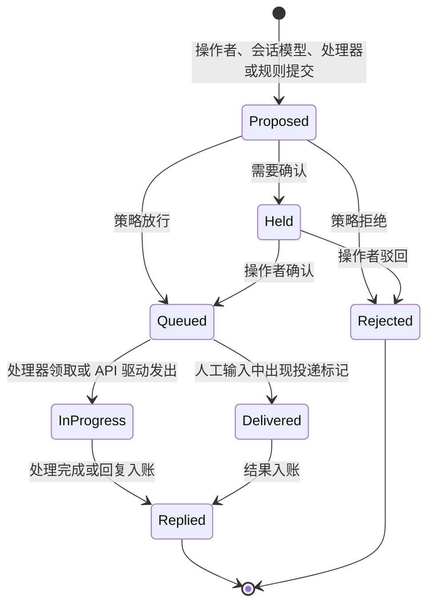
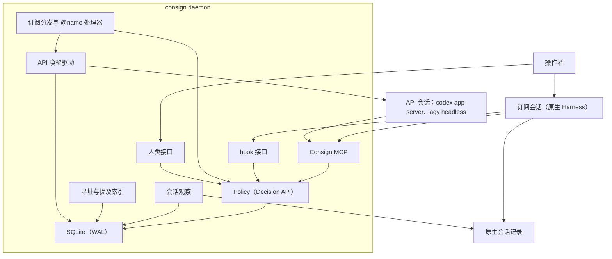

# Consign 实现规格

本文给出 Consign 的数据结构、协议、状态机和各 Harness 的接入细节。设计定位、核心模型与机制方向见 [DESIGN.md](DESIGN.md)，人机交互立场与界面宿主边界见 [INTERACTION.md](INTERACTION.md)，本文不再重复其中的理由。

## 1. 范围与原语

Consign 是一个本地中心服务：一个 daemon 持有 SQLite，向执行会话暴露 MCP 接口，向操作者暴露人类接口。所有参与者（操作者、执行会话、`@name` 订阅处理器）共享同一套 IPC 语义，差异落在策略、授权和唤醒方式上：

- **订阅会话**：由操作者在官方客户端里发出每一轮，模型通过注入的 Consign MCP 接入，daemon 同时观察其原生记录。Consign 不向订阅会话发送内容。
- **API 会话**：由 Consign 带着 API key 启动，可由驱动自动唤醒并发出下一轮（见第 6 节），同样注入 Consign MCP 并被观察。
- **`@name` 订阅处理器**：挂载在命名地址上的普通消费者，可以是固定 prompt 模板、规则脚本，或通过 API key 运行的后台消费者。

第一阶段交付观察与寻址：daemon 导入并跟进 Codex 原生会话，为会话、轮次和片段提供统一链接，建立提及索引，并通过 MCP 把解析和反查提供给会话里的模型。

| 组成部分 | 职责 | 状态归属 |
| --- | --- | --- |
| **Address & Link** | 端点、会话、轮次、片段、流、消息和外部锚点的统一文本地址；提及与反向索引 | `mentions` |
| **Reference** | 不可变的上下文与产物引用（哈希、`git_snapshot`、`blob`、`transcript_span`） | `artifacts` / `blobs` |
| **Stream** | 只追加的有序事件与工作轨迹；可绑定外部锚点以维护决定集版本与跳数 | `events` / `streams` / `decisions` / `evidence` |
| **Message** | 意图（`to + intent + refs`）与反馈的持久载体，支持幂等去重、准入校验与状态跟踪 | `messages` |
| **Subscription** | 持久消费游标、批量唤醒策略、`@name` 处理器配置与持久等待状态 | `subscriptions` / `handlers` |
| **Policy（Decision API）** | 统一策略决策点：访问、投递准入、资源锁、副作用审批、经 hook/回调送来的工具执行 | 规则配置、`approvals` / `policy_audit` |
| **Consign MCP** | 注入执行会话的工具集，调用按会话记录出处并去重 | `tool_calls` |
| **会话观察** | 导入和跟进原生记录，识别轮次、投递标记、工具调用与提及 | `sessions` / `turns` |
| **API 唤醒驱动** | 仅用于 API 会话：启动和续接轮次、接收审批回调、崩溃后核对、接管与归还 | `sessions` / `turns` / `attempts` |

---

## 2. 接入

### 2.1 MCP 注入

Consign MCP 是 daemon 暴露的一组工具，按各 Harness 支持的方式注册为 MCP server。工具分为只读和写入两类：

| 工具 | 类别 | 作用 |
| --- | --- | --- |
| `resolve(link)` | 只读 | 返回链接指向的内容和少量上下文，长度有上限。解析消息链接时返回当前准入判定及原因（见 3.3） |
| `backlinks(link)` | 只读 | 返回提及该对象的位置 |
| `self()` | 只读 | 返回当前会话和最近一轮的链接 |
| `inbox()` | 只读 | 返回发给当前会话或其关联流的未处理消息 |
| `use_message(link, idempotency_key)` | 写入 | 核对消息的使用准入并登记结果。需要重新确认时将消息退回 `Held`（见 3.3） |
| `send(to, intent, refs, stream?, reply_to?)` | 写入 | 向指定地址（会话、`@name` 或操作者）投递一条意图消息，经 Policy 准入 |
| `post(stream, body, refs?)` | 写入 | 向一条流追加记录，正文中的链接和外部锚点进入提及索引 |
| `record_evidence(stream, refs, summary)` | 写入 | 登记绑定快照或片段引用的证据 |

**会话身份**：写入与上下文查询需要归属到具体会话。身份有三个来源，按可靠程度排列：

1. 注入时绑定。Consign 启动的 API 会话在注入时即绑定会话标识；客户端为每个会话单独注入 MCP 时（如 `mcp --session <id>` 或 ACP `session/new`）也直接传入会话标识。
2. Harness 提供的环境信息。Codex 工具进程带有 `CODEX_THREAD_ID`，agy 带有 `ANTIGRAVITY_CONVERSATION_ID`（见附录 A）；MCP server 进程能否继承同样变量需分别验证。
3. 事后归属。MCP 调用及其参数出现在原生记录中，观察到后由 daemon 归属到对应会话和轮次。

受信客户端或 Harness 提供的元数据用于在调用时绑定会话；事后归属和自报身份只用于记录出处。读取权限由服务端按连接授权校验。没有可信会话绑定时，`self()` 和 `inbox()` 返回会话未绑定错误，显式链接查询仍按连接授权处理。写入工具只能提议和登记，确认、批准等动作只在人类接口上进行。

**去重**：写入工具接受调用方提供的去重键；未提供时按调用方、工具名和参数哈希在时间窗口内去重。重复提交返回之前的结果，同一去重键带不同参数则拒绝。

**说明**：MCP 附带简洁的使用说明，解释链接格式与各工具用途；模型也可以直接按链接位置读取原生记录，MCP 提供更省上下文且带确定性校验的路径。

### 2.2 会话观察

daemon 按游标增量读取 Harness 落盘的原生记录（位置和格式见附录 A），把每个会话作为一条流导入。观察不依赖 MCP，历史会话和未调用过工具的会话均可导入。

从原生记录中提取：

- **轮次**：能辨认原生轮次时，登记每轮的输入、最终输出、起止时间和用量。Codex 的 `task_started` / `task_complete` 带 `turn_id`，可直接划分轮次。
- **发起方与送达**：订阅会话中的轮次记为 `origin = operator`，API 驱动发出的轮次记为 `origin = driver`。交给操作者送达订阅会话的消息，正文末尾附带含消息链接的投递标记；Consign 只在原生会话的人工输入中识别投递标记，按消息版本和目标轮次去重登记为送达（`delivered_message_id`），其他位置出现的消息链接按普通提及索引。操作者删去投递标记时，可手动指定目标轮次。API 驱动发出的消息由驱动直接登记送达。
- **回应关系**：操作者自己的追问有明确依据时，用 `responds_to_turn_id` 关联被回应的轮次；新要求或对象不明时留空。
- **工具调用**：识别对 Consign MCP 的调用，用于事后归属（见 2.1）。
- **提及**：扫描输入和输出中的 Consign 链接与外部锚点，写入 `mentions`。

轮次以下的工具调用、推理和审批事件保留原生结构，通过片段链接访问，由各 Harness 解析器按需解释，并记录产生该记录的 CLI 版本。

### 2.3 统一寻址

链接采用文本地址：

```text
consign://codex/01a2…                            会话端点
consign://codex/01a2…/turn/019a…                 轮次
consign://codex/01a2…/span/L118-L131@sha256:…    片段
consign://stream/issue-812/42                    流中的记录
consign://msg/M17                                意图消息
consign://handle/review                          命名流程入口（@review）
```

外部锚点按来源规范化书写，例如 `github:owner/repo#812`、Git 提交 id。

- **片段链接**由记录内位置和内容哈希组成：位置用于回到原会话定位，哈希用于校验内容未变。
- **会话与轮次链接**用于导航，内容随会话增长。
- 片段被固定或用作证据、交接依据时，转为不可变的产物引用 `transcript_span` 并保存选中内容（见 3.5）。
- `resolve` 只返回目标内容和少量上下文，按需继续解析下一个链接。
- 提及索引是派生数据，可随时从原生记录和账本重建。

---

## 3. 协作与契约

### 3.1 端点与 `@name` 处理器

参与协作的端点有三类，使用同一套 `send / post / resolve / backlinks` 语义：

1. **操作者**：通过人类接口拥有最高授权（确认、批准、定决定、接管），也是订阅会话的唯一写入方。
2. **执行 Session**：原生会话本身是一等端点。创建与交接只记为历史血缘（`parent_session_id` / `reply_to`），不构成永久控制树。
3. **`@name` 订阅处理器**：绑定到命名地址（如 `@review`）的普通订阅者，按实现形态渐进演化：
   - **模板**：把收到的 `intent + refs` 渲染成标准请求，交由操作者或指定目标会话执行；
   - **规则脚本**：订阅特定流，满足条件时调用 `send` 提出下一步意图；
   - **后台 API 消费者**：用 API key 调用模型（默认 DeepSeek），按批量和等待上限合并唤醒，读取流与引用后整理结果或发出下一步意图。工具凭据绑定单次处理，结束后撤销。

后台处理器在发出一条需要等待结果的意图消息后，把等待关系持久化到 `subscriptions.waiting_on_json` 并释放运行槽；当目标轮次完成或回复入账时，由 daemon 唤醒继续处理。处理器对消息的筛选与转交全部记为流事件。

### 3.2 意图消息与状态机

每条意图消息承载 `Recipient (to_ref) + Intent + References`。确认后，意图正文与选定引用固定不变；相关决定与证据在使用时按最新状态核对（见 3.3）。

- 操作者可在确认前编辑消息，策略放行时也可按规则改写；编辑、驳回和改写均在事件中保留原稿、改动及可选驳回理由。
- 消息只携带链接和不可变引用，不复制大段正文。



目标是 `@name` 处理器或 API 驱动会话时，走 `Queued → InProgress → Replied`；目标是订阅会话时，`Queued` 表示消息在操作者待办中，送达后由观察层识别投递标记转为 `Delivered`，接收方通过 `record_evidence` / `send` / `post` 引用该消息登记结果（或操作者标记某轮为回复）后转为 `Replied`。

| 当前状态 | 条件 | 下一状态 |
| --- | --- | --- |
| `Queued` | 资源锁不可用，或目标 API 会话忙/被接管 | `WaitingResource` |
| `WaitingResource` | 资源或会话释放 | `Queued` |
| `Queued` / `Delivered` | 使用准入要求重新确认决定集或引用（见 3.3） | `Held` |
| `Queued` | 排队超时 | `Escalated` |
| `InProgress` | 处理器中断且可幂等重试 | `Queued` |
| `InProgress` | 中断且含不确定外部动作，或 API 驱动轮次启动状态不明 | `NeedsConfirmation` |
| `NeedsConfirmation` | 操作者确认重试 | `Queued` |
| `NeedsConfirmation` | 无法恢复结果 | `Escalated` |
| `Escalated` | 操作者改派或重试 | `Queued` |

进入 `Held` 的典型条件（由 Policy 配置）：

- 目标处理器的触发策略为 `manual`；
- 消息包含外部副作用；
- 同一工作流在自动协作中连续多跳无操作者介入（跳数熔断，在 `Proposed` 阶段检查）。

### 3.3 契约一：使用准入（乐观并发校验）

一条消息从确认到被使用之间，决定集或相关流可能已经变化。

**机制**：

- 每条工作流（`streams`）维护单调递增的**决定集版本** `decision_version` 和最新事件序号。本流或所属项目范围内的决定有新增、取代或撤销时，版本加一。
- 确认消息时记录当时看到的 `confirmed_decision_version`（以及可选的参考流游标 `expected_stream_seq`）。
- 准入检查在使用时刻执行：目标是 `@name` 处理器或 API 驱动会话时，在 `Queued → InProgress` 的同一笔事务中核对并固定本次执行的决定版本；目标是订阅会话时，由接收方通过 `use_message` 显式申请使用，在写入事务中重新核对。
  1. 版本未变：照常返回有效决定与引用。
  2. 版本已变，且期间变更全部为**收窄型**决定：带着最新决定放行。
  3. 版本已变，且存在**非收窄型**决定：消息退回 `Held` 并附上差异；`use_message` 返回差异提示等待重新确认。
  4. 选定证据已变为 `stale` 或引用无法解析（见 3.5）：同 3。
  5. 若设置了 `expected_stream_seq` 且目标流期间推进了新消息，允许策略暂缓发送，先将新增记录返回给发起者重新判断。

`resolve` 可预览上述判定而不改状态；状态仅在 `use_message`、处理器领取或驱动发出的事务中更新。

**决定类型**（`effect`）：`narrowing`（收窄型，只增加限制，如「这轮只加日志」「不改 `Cargo.toml`」）与 `other`（改变目标、放宽限制或无法判断，**默认 `other`**）。产出按准入时的版本入账；输出关口按**当前**决定检查 diff（见 4.2）。

### 3.4 契约二：动作入账与幂等

工具调用结果、状态变更与账本事件在同一笔 SQLite 事务中写入，按 `(caller, dedup_key)` 去重。

| 时机 | 同一个 SQLite 事务内的操作 |
| --- | --- |
| 处理器领取消息 | `Queued → InProgress`，固定准入决定版本，记录领取者与租约 |
| 处理器等待结果 | 更新 `subscriptions.waiting_on_json`，释放运行槽 |
| 会话写入工具调用 | 保存 `tool_calls`，写入消息、证据或流记录，追加事件 |
| 观察到投递标记 | `Queued → Delivered`，关联送达轮次，追加事件 |
| API 驱动发出一轮 | 创建 `attempts` 执行尝试；事务提交后调用 Harness，取得原生轮次 ID 后补写 |
| API 驱动轮次完成 | 保存原生输出与完成事件，更新尝试与消息状态，唤醒等待它的订阅者 |
| 观察到或登记了回复 | `Delivered / InProgress → Replied`，唤醒等待它的订阅者 |

**外部动作**（如在 issue 下发评论）经批准后由执行器先记意图、再执行、再记结果。重启后发现有意图无结果时先核对外部状态：已发生则幂等补记，确认未执行才重试，状态不明进入 `NeedsConfirmation`。

### 3.5 契约三：不可变产物引用

```json
{
  "kind": "git_commit | git_snapshot | file | blob | transcript_span",
  "node_id": "linux-pc",
  "repo": "flowmq",
  "path": "logs/run-118/trace.txt",
  "version": "sha256:… 或 git 对象 id",
  "size": 18234,
  "created_at": "…"
}
```

- **不可变性**：创建引用必须记录内容哈希或 Git 对象 id；读取时哈希不一致视为失效（消息退回 `Held`，关联证据标 `stale`）。
- **未提交代码快照（`git_snapshot`）**：基于选定文件构建 Git tree，用 `git commit-tree` 创建对象并写入隐藏引用 `refs/consign/<stream>/<n>`，可像普通 commit 一样 diff、检出和跨节点 fetch。
- **仓库外文件与固定片段（`blob` / `transcript_span`）**：按内容哈希去重保存（单机阶段默认存于 SQLite 的 blob 表，大文件可落盘到内容寻址目录）。`transcript_span` 同时记录原生文件路径与行范围，原记录改写或清理后仍可从已存 blob 读取。
- **解析**：单机本地直读；多机阶段按需物化（Git 隐藏引用通过 `git fetch`，`blob` 经节点间或控制面中转并设大小上限）。将来接入工作区存储层只需替换物化方式。

### 3.6 决定、证据、血缘与介入记录

- **决定**：操作者的短指令经确认成为决定，作用域分本轮、本流、本项目，新决定可取代旧决定；流级决定可升格为项目惯例。
- **证据**：审查发现、复现结果、测量数据通过不可变引用绑定快照，记录环境指纹与产出时的 `decision_version`。快照变化时标记 `stale`；决定变化时只附加「产出于旧决定集」提示，不自动作废。
- **会话血缘**：`sessions.parent_session_id` 来自原生分叉信息或显式标注。复核意图必须落入不在作者和修复者血缘链中的会话：API 驱动会话在准入阶段直接拒绝，订阅会话由观察层检出冲突并标出交给操作者。
- **介入记录**：消息编辑、驳回和策略改写保留原稿、改动与可选理由；操作者在原生会话中的输入保存原文到 `turns.raw_input`，有明确依据时用 `responds_to_turn_id` 关联被回应的轮次（接管 API 会话期间同样记为 `origin = operator`）。

---

## 4. 策略与安全

### 4.1 Decision API

消息投递、动作提议、资源锁申请，以及 Harness hook 或审批回调送来的工具执行请求，共用同一决策点：

```json
// Request
{
  "point": "msg.send | action.propose | resource.acquire | tool.exec",
  "caller": "codex:01a2...",
  "stream": "issue-812",
  "subject": { "tool": "Bash", "command": "cargo test", "cwd": "/wt/T7" }
}
// Response
{ "verdict": "allow | deny | hold | mutate", "reason": "string", "rule_id": "string", "tier": 0, "mutate": {}, "approval_id": "A42" }
```

决策点按 `caller` 反查关联工作流、worktree、有效决定和资源锁，裁决感知工作上下文。

| 层级 | 实现 | 职责 |
| --- | --- | --- |
| Tier 0 | Rust 内置规则、TOML 参数、外部脚本扩展点 | 去重路由、血缘检查、worktree 路径边界、只读角色、跳数熔断、预算上限、命令黑白名单 |
| Tier 1 | 廉价模型评判（可选，API key） | 灰区命令；只允许放行低风险或拒绝，高风险一律升级 |
| Tier 2 | 操作者审批 | 外部副作用、高风险命令、例外 |

**工具执行入口**：

| 场景 | 入口 | 说明 |
| --- | --- | --- |
| 订阅会话 | 用户级 hook：Codex `~/.codex/hooks.json`，agy `~/.gemini/config/hooks.json` 的 `PreToolUse` | 与工作流无关的会话沿用 Harness 自身策略；已关联工作流的会话按上下文裁决；daemon 不可用时退回 Harness 默认策略 |
| API 驱动 Codex 会话 | app-server 审批回调 `item/commandExecution/requestApproval` | 轮内等待操作者通过人类接口裁决 |
| API 驱动 agy 会话 | 同上用户级 hook | 同步 hook：命中 Tier 2 返回 `deny` 并建审批单，批准后写入一次性授权再续跑下一轮 |

API 驱动会话依赖策略裁决的操作，在 daemon 不可用时拒绝执行。

### 4.2 决定的三层执行

| 层 | 适用范围 | 机制 |
| --- | --- | --- |
| 硬边界 | 可写目录、网络访问、只读角色 | Harness 沙箱（`read-only` / `workspace-write`、禁用网络），唯一可靠边界 |
| 机械规则 | 路径或命令模式（如「不改 `Cargo.toml`」） | hook / 审批回调询问 Decision API，挡住大多数无意越界 |
| 输出关口 | 自然语言决定（如「这轮只加日志」） | 拿到 diff 后对照当前决定检查，由异构模型或操作者裁决，不合格退回 |

### 4.3 安全模型

同机同系统用户下，语义对等绝不等于接口合一：

| 措施 | 说明 |
| --- | --- |
| 鉴权接口分离 | MCP、hook、处理器工具等**机器接口**，与确认、批准、定决定等**人类接口**分开监听 |
| 机器接口只提议和登记 | 确认、批准、改派只在人类接口上进行 |
| 人类接口独立凭据 | Harness 工具进程读不到凭据，也访问不到人类接口监听入口 |
| `origin` 由服务端写入 | 来源由认证结果填写；自报会话身份仅用于记录出处，读取权限按连接授权校验 |
| 凭据隔离与子进程剥离 | 后台处理器与驱动使用的 API key 不进入执行会话环境；启动子进程剥离 `gh`、`git push` 等凭据 |
| API 会话强制沙箱 | `workspace-write` 禁用网络，daemon socket 置于沙箱不可达目录 |
| app-server 特权保护 | 优先权限 `0600` Unix socket；WebSocket 仅绑定本机并启用 capability token，令牌不进子进程环境 |
| 独立系统用户（后续） | daemon 以独立系统用户运行，人类接口仅对操作者登录会话开放 |

---

## 5. 系统架构

### 5.1 技术选型

- **Rust**：单二进制、常驻开销低、Linux 与 macOS 原生编译、强类型状态机。核心依赖为 `tokio`、`axum`、`rusqlite`（bundled，WAL）、`serde`、`schemars`、`reqwest`、`clap`，以及一个 Rust MCP SDK。

### 5.2 进程与部署



单机部署时，`consign up` 在单进程运行全部组件。人类接口与机器接口分别监听；客户端可通过 SSE 获知变更，断线后按事件序号补读。daemon 是状态唯一写入入口，状态变更与事件在同一笔事务提交。

**消息存储**：单机阶段在 SQLite 中实现 IPC 内核所需的流语义。Phase 1 先落地只追加记录、游标、去重与提及投影；`messages` 意图消息与 `subscriptions` 持久消费者随 Phase 2 引入，确认和去重由状态字段与唯一约束保证。接口按流、位置、持久消费者、确认和去重语义设计，存储层可替换为独立消息中间件。

**多机**：Harness 会话状态存放在各台机器本地，由 `sessions.node_id` 标识。多机阶段每台机器运行 `consign worker`，负责本地观察上报、转发 MCP，并在本机管理 API 驱动进程。

### 5.3 模块划分

以下是按职责划分的目标模块边界；初期合并在单 crate（`crates/consign`）中实现，随阶段推进再拆分。

```text
consign/
├── Cargo.toml
├── crates/
│   ├── consign-core/     # 领域模型、IPC 协议、Policy 协议、状态机（无 IO）
│   ├── consign-store/    # SQLite、迁移、事件投影、寻址与提及索引
│   ├── consign-policy/   # Decision API（Tier 0/1/2）
│   ├── consign-observe/  # 各 Harness 原生记录解析与跟进
│   ├── consign-mcp/      # Consign MCP 工具与会话归属
│   ├── consign-sub/      # 订阅分发、@name 模板/规则/API 处理器
│   ├── consign-drive/    # API 会话驱动：Codex app-server、agy headless；进程组；worktree
│   ├── consign-daemon/   # 人类接口与机器接口分离、调度、恢复
│   └── consign-cli/      # consign up / daemon / worker / open / status / hook 与查询命令
```

### 5.4 数据模型

| 表 | 字段 | 说明 |
| --- | --- | --- |
| `events` | `seq, ts, stream, kind, caller, payload_json` | 只追加事实来源；编辑、驳回和策略改写保留原稿 |
| `streams` | `id, anchor, repo, goal, status, decision_version, hop_count, hop_limit, budget_json, created_at` | 工作流元数据：可选绑定外部锚点（如 GitHub issue/PR），维护 `decision_version`、跳数与花费上限 |
| `handlers` | `handle, kind, config_json, trigger` | `@name` 命名入口定义：`kind` 为 `template` / `rule` / `api_consumer`；`trigger` 为 `manual` / `auto` |
| `subscriptions` | `id, subscriber, subject, cursor, batch_policy_json, waiting_on_json, created_at` | 持久消费者：订阅主题、消费游标、批量防抖策略及持久等待关系 |
| `messages` | `id, stream, origin, from_ref, to_ref, intent, refs_json, state, idempotency_key, confirmed_decision_version, expected_stream_seq, delivered_turn_id, reply_to, attempts, timeout_at` | 意图消息：`origin` 由服务端写入（`human` / `session` / `handler` / `rule` / `watcher`）；`to_ref` 为任意端点地址 |
| `attempts` | `id, message_id, session_id, native_turn_id, status, started_at, ended_at` | API 驱动发出的一次执行尝试，用于崩溃恢复与幂等上报 |
| `tool_calls` | `id, caller, tool, dedup_key, args_hash, result_json, created_at` | 按 `(caller, dedup_key)` 唯一 |
| `sessions` | `id, node_id, harness, native_id, mode, source_path, transcript_cursor, cli_version, parent_session_id, stream_id, worktree_id, lease_owner, lease_until` | `mode`：`observed`（订阅会话）/ `driven`（API 启动）；租约仅用于 `driven`；`stream_id` 可为空，关联也可来自提及 |
| `turns` | `id, session_id, native_turn_id, origin, responds_to_turn_id, delivered_message_id, attempt_id, resolved_context_json, decision_version, started_at, ended_at, status, raw_input, raw_output, exit_detail, usage_json, rate_limit_json` | `origin`：`operator` / `driver`；已知原生轮次 ID 时 `(session_id, native_turn_id)` 唯一，实时入账与补录写入同一条记录 |
| `artifacts` | `id, kind, node_id, repo, path, version, size, git_ref, created_at` | 不可变产物引用（见 3.5），含 `transcript_span` |
| `blobs` | `sha256, content, size, created_at` | 按 SHA-256 去重的本地内容快照（固定片段与小文件） |
| `mentions` | `id, source, target, target_kind, created_at` | 提及与反向索引，派生数据，可重建 |
| `worktrees` | `id, node_id, repo, path, base_rev, created_at, create_ms, size_bytes, removed_at` | 工作区生命周期记录 |
| `decisions` | `id, scope, scope_id, body, effect, status, supersedes_id, source_msg_id, created_at` | `effect`：`narrowing` / `other`，默认 `other` |
| `evidence` | `id, stream_id, kind, summary, artifact_ids, decision_version, env_json, stale_reason` | 绑定不可变引用的证据 |
| `approvals` | `id, point, stream_id, session_id, subject_json, state, decided_by, grant_once_key, created_at` | |
| `locks` | `name, node_id, holder, acquired_at, heartbeat_at` | |
| `policy_audit` | `id, ts, point, stream_id, session_id, rule_id, tier, verdict, latency_ms, subject_json` | |

---

## 6. API 会话的驱动

用 API key 启动的 Harness 会话（`sessions.mode = driven`）可由 Consign 自动唤醒，用于无人值守的多环节交接、异构复核与固定流程。观察到的订阅会话一律不驱动。被驱动会话同样注入 Consign MCP 并被观察。

### 6.1 传输方式

| Harness | 传输 | 能力 |
| --- | --- | --- |
| Codex | `codex app-server`，每台机器一个进程，由 daemon 或 `consign worker` 管理 | 线程创建、恢复、fork，`outputSchema`，审批回调，流式通知，额度与用量通知，TUI `--remote` 共享线程 |
| agy | headless 模式：`--print`、`--output-format stream-json`、`--json-schema`；多轮用 `--input-format stream-json` 保持 stdin 打开 | 结构化输出、续接会话、`PreToolUse` hook |

Codex 备用传输为 `codex exec --json --output-schema`。被驱动会话不使用临时线程：Codex `ephemeral` 线程无法读取历史轮次，也不能 fork（见附录 A.1）。

### 6.2 轮次入账与恢复

驱动按 3.4 的事务先创建 `attempts` 记录，再调用 Harness，取得原生轮次 ID 后补写。完成上报校验仍是当前尝试，重复上报返回已登记结果。

**崩溃恢复**：已启动但无完成记录的尝试，按原生轮次 ID 查询；原生 ID 未保存时尝试从原生历史可靠关联，无法判断则进入 `NeedsConfirmation`：

| 原生会话状态 | 处理 |
| --- | --- |
| 已完成 | 取回最终输出，执行完成事务 |
| 仍在运行 | 重新接入事件流继续等待 |
| 确认未执行 | 重新排队 |
| 无法确定 | 进入 `NeedsConfirmation`，交操作者核对 |

结果来源：Codex 用线程历史接口读取对应轮次；agy 读 `transcript_full.jsonl`。

### 6.3 接管与归还

操作者接管被驱动会话时，daemon 暂停投递、等当前轮次结束后交出会话（Codex 用 `codex resume --remote`，agy 用原生 TUI 打开）。接管期间轮次记为 `origin = operator`。Codex 经 app-server 实时入账，agy 在归还时按游标补录，均按 `(session_id, native_turn_id)` 幂等写入同一条轮次记录。状态不明时交操作者核对。

### 6.4 自动循环约束

- 强制沙箱（`workspace-write`、禁网）；只读环节用临时 detached worktree，写入环节每条工作流一个 worktree。
- 按工作流设 API 花费上限，依据 Harness 上报用量（如 `thread/tokenUsage/updated`）记入 `turns`，超限时消息进入 `Held`。
- 跳数熔断、外部副作用审批与输出关口生效。
- 启动子进程时剥离凭据（见 4.3）。

### 6.5 凭据

驱动仅使用 API key（Codex API key 接 app-server；agy 用 Gemini API key 加 `modelProvider=gemini`），账本只记凭据类型，不使用订阅凭据。

- [Codex 非交互模式](https://learn.chatgpt.com/docs/non-interactive-mode)
- [Antigravity CLI 认证](https://antigravity.google/docs/cli/install/)
- [Antigravity ACP](https://antigravity.google/docs/cli/acp)
- [Antigravity FAQ](https://antigravity.google/docs/faq/)

---

## 7. 端到端示例

### 7.1 跨会话关联

1. 操作者在两个 Codex 会话分别调查 `#901` 和 `#907`。Consign 观察并按提及的 issue 编号自动建索引。
2. `#901` 第一轮只复述了末端断言失败，操作者追问上游原因；该轮记为 `origin = operator`，`responds_to_turn_id` 指向第一轮。
3. 操作者问「和 #907 是不是同一回事」，`#907` 随即出现指向该轮的反向链接。
4. `#901` 中的模型将路由分析固定为 `transcript_span`，调用 `send` 向 `#907` 会话发出意图消息（附该片段引用），经确认进入待办。
5. 操作者将消息送入 `#907` 会话，观察层识别投递标记转为 `Delivered`；`#907` 模型先 `resolve` 预览准入，再调用 `use_message` 确认使用并拉取片段内容，对照自身重放结果确认共享缺陷。
6. 共同修复与两边各自验证分别调用 `record_evidence` 入账，从任一 issue 锚点都能沿链接回溯全貌。

### 7.2 通过 `@review` 触发单环节审查

1. 操作者（或上游规则）向 `@review` 发出意图消息，附上固定好的 `git_snapshot` 引用。
2. `@review` 对应的模板/处理器生成审查请求。若目标是订阅会话，进入操作者待办；操作者送入一个新会话完成独立审查，模型调用 `record_evidence` 登记发现。
3. 操作者勾选取舍形成决定，向修复会话发出意图（建议从审查会话分叉新会话），修复完成后再向独立复核会话发出意图。若复核消息被送入作者血缘链内会话，daemon 检出并标出冲突。
4. 修复生成新快照，原有发现自动标记 `stale`。

### 7.3 自动交叉复核（API 会话）

1. 操作者在订阅会话完成修复，模型调用 `record_evidence` 登记新快照。
2. 订阅了该工作流的 `@review` 规则处理器被唤醒，向一个由 API key 启动、且不在作者血缘链中的 agy 会话发出复核意图。
3. agy 会话解析快照和有效决定，完成独立审查并调用 `record_evidence` 登记结论。
4. 轮次完成后，通过则发出下一步建议，不通过则将差异汇总交操作者拍板；全程受跳数与花费上限约束。

---

## 8. 实施路线

| 阶段 | 交付物 | 验收 |
| --- | --- | --- |
| **Phase 1：观察与寻址** | Rust workspace、本地 daemon、SQLite 账本、Codex 原生记录导入与跟进、轮次识别、统一链接、提及与反向索引、`transcript_span` 及 blob 固定、Consign MCP 只读工具（`resolve` / `backlinks` / `self`）、Codex MCP 注册 | 导入两条独立调查会话：粘贴的链接能回到原片段；从任一 issue 锚点能看到两条会话与互相提及；Codex 中模型能解析链接 |
| **Phase 2：IPC 消息、流与准入** | `streams` / `messages` / `subscriptions`、MCP 写入工具（`send` / `post` / `use_message` / `record_evidence`）、投递标记识别、决定集版本与乐观准入、介入记录、血缘检查、agy 观察与 MCP 注册 | 一条意图消息从提交、确认、送达到回复完整入账；等待期间变更非收窄决定后，预览可见差异，显式申请使用时退回确认 |
| **Phase 3：命名流程与订阅处理器** | `@name` 模板与规则处理器、后台 API 消费者（DeepSeek）、批量防抖唤醒、短期凭据与持久等待 | 向 `@review` 发送意图触发流程；后台消费者发出意图后 daemon 重启，结果入账仍唤醒原等待者 |
| **Phase 4：API 会话驱动与恢复** | Codex app-server 与 agy headless 驱动、可控测试驱动、轮次入账与崩溃恢复、接管与归还、花费上限 | 自动唤醒 API 会话并接回结果；验证启动状态未知、原生已完成未入账、重复上报三种恢复；接管后归还轮次不重复 |
| **Phase 5：策略、Hook 与外部动作** | hook 接入 Decision API、输出关口、资源锁、外部副作用审批、Watcher | 按固定审查规则提出后续意图，异常与高风险动作进入操作者待办 |
| **Phase 6：多机** | 节点 `consign worker`、跨节点链接解析、产物物化与远程接管 | 不同机器上的会话可互相引用与接力，产物来源可追溯 |

---

## 9. 风险与对策

| 风险 | 对策 |
| --- | --- |
| 原生记录格式变化 | 解析层只提取少量字段；记录 CLI 版本；固定片段独立保存内容 |
| 模型不调用工具或调用不当 | 观察不依赖工具调用，出处和提及可从原生记录补齐；写入工具由服务端校验去重，越权拒绝 |
| 会话身份被伪造 | 自报身份仅用于出处；读取按连接授权校验；机器接口只能提议和登记 |
| 订阅条款变化 | Consign 只驱动自己用 API key 启动的会话；订阅会话每轮由操作者在官方客户端发起 |
| 驱动依赖的 Harness 接口变化 | 驱动层保持薄；记录 CLI 版本；app-server 不可用时回退 `codex exec` |
| 自动协作陷入模型互辩或死循环 | 默认单环节交接；跳数熔断在 `Proposed` 生效；沙箱、花费上限与副作用审批兜底（6.4） |
| 接管造成账本断档 | 接管期间暂停投递，按原生轮次 ID 幂等补录（6.3） |
| 提及索引噪声或膨胀 | 索引只呈现指向，相关性由读者判断；`resolve` / `backlinks` 返回设长度上限 |
| Agent 冒充操作者 | 见 4.3：接口分离、服务端写入 `origin`、人类接口独立凭据 |
| 命令匹配被绕过 | 沙箱为硬边界，Decision API 为第二道防线，自然语言决定在输出关口检查 |
| 意图按过期决定或过期上下文执行 | 决定集版本与可选流游标的乐观准入检查（3.3） |
| 重启导致重复外部动作或丢失等待 | 先记意图再执行，按外部/原生状态核对，状态不明交操作者；等待关系持久化（3.4、6.2） |
| 引用内容变更或不可读 | 引用不可变（哈希 / Git 对象 id），未提交代码建快照，固定片段存 blob（3.5） |

---

## 10. 待决问题

1. **MCP 的会话身份**：验证各 Harness 注册 MCP 的方式，以及 MCP server 进程能拿到哪些会话信息；确认原生记录中 MCP 调用形态能否支撑事后归属。
2. **沙箱与本地接口**：验证 Harness 沙箱（如 `workspace-write`、禁网）下 MCP 调用能否到达 daemon，同时人类接口监听入口与凭据对工具进程不可达，在 Linux 和 macOS 分别确认。
3. **原生记录的稳定性**：导入已通过前缀校验与投影重建兜底、已固定片段独立保存；仍需验证 Codex 和 agy 在上下文压缩、续接、分叉和清理时的重写行为，明确未固定片段的位置漂移边界，以及 agy 记录的长期稳定性。
4. **原生轮次关联**：验证 Codex 在启动响应丢失后能提供哪些持久信息，用于关联驱动的启动意图。
5. **agy 的驱动方式**：比较 headless 和 ACP 在轮内审批、结构化输出和重连后定位已提交轮次上的能力。

---

## 附录 A：Harness 接口事实

以下事实在 `codex-cli 0.171.0`、`agy 1.5.14` 至 `1.5.16`（ACP server 1.5.15）上验证。

### A.1 Codex

| 能力 | 用法 | 约束与细节 |
| --- | --- | --- |
| 会话记录 | `~/.codex/sessions/<年>/<月>/<日>/rollout-<本地时间>-<thread_id>.jsonl` | 每行一个 JSON 记录，会话进行中追加写入。首行 `session_meta` 含 `id`、`cwd`、`cli_version`、`originator`；在 Git 仓库中启动时还含会话开始时的 `git.commit_hash`、`branch`、`repository_url`。`response_item` 记录用户消息、Agent 消息（带 `phase`，如 `commentary`、`final_answer`）和工具调用；`event_msg` 中的 `task_started` / `task_complete` 带 `turn_id`，标出轮次边界，`task_complete` 含 `last_agent_message` |
| 非交互执行 | `codex exec --json --output-schema <file> -o <out>` | 首行事件 `thread.started` 含 `thread_id`；`-o` 文件是符合 schema 的 JSON |
| 续接与分叉 | `codex exec resume <id>`、`codex exec fork <id>` | fork 生成新的 `thread_id` |
| app-server 线程管理 | `thread/start`、`turn/start`、`thread/fork` | fork 结果包含 `forkedFromId`；临时线程（`ephemeral: true`）不能 fork，也不能读取 turns |
| app-server 结构化输出 | `turn/start` 的 `outputSchema` 参数 | 最终 `agentMessage`（`phase: final_answer`）的文本符合 schema |
| app-server 审批 | 服务端请求 `item/commandExecution/requestApproval` | 参数含 `command`、`cwd`、`threadId`、`turnId`、`availableDecisions`；客户端回复 `{"decision":"decline"}` 后命令被拒，该轮正常结束 |
| app-server 额度通知 | `account/rateLimits/updated`、`thread/tokenUsage/updated` | 用于额度统计 |
| TUI 共享线程 | `codex resume --remote <ws 或 unix 地址> <thread_id>` | TUI 显示已有历史；TUI 发起的轮次，其他客户端实时收到 `userMessage` / `agentMessage`；其他客户端发起的轮次，TUI 实时显示。同一 app-server 上会出现 TUI 自己的辅助线程 |
| 工具进程环境变量 | — | 包含 `CODEX_THREAD_ID`、`CODEX_SESSION_ID`、`CODEX_TOOL_CALL_ID`、`CODEX_SANDBOX_NETWORK_DISABLED` |
| 用户级 hook | `~/.codex/hooks.json` 的 `PreToolUse` | 在未信任的目录中同样加载（项目级 `.codex/hooks.json` 则不会加载）。stdin 字段：`session_id`、`turn_id`、`cwd`、`model`、`permission_mode`、`tool_name`（shell 工具为 `Bash`）、`tool_input.command`、`tool_use_id`。返回 `hookSpecificOutput.permissionDecision: "deny"` 即拦截。hook 进程中没有 `CODEX_THREAD_ID`，要用 stdin 中的 `session_id` 识别会话。首次使用需要在 Codex 中信任该 hook |

### A.2 agy

| 能力 | 用法 | 约束与细节 |
| --- | --- | --- |
| 会话记录 | 数据目录下的 `brain/<conversation_id>/.system_generated/logs/transcript.jsonl` 与 `transcript_full.jsonl`（本机数据目录为 `~/.gemini/antigravity-cli`） | 每行一个步骤，含 `step_index`、`type`（如 `USER_INPUT`）、`source`（如 `USER_EXPLICIT`）、`created_at`。`transcript.jsonl` 截断长字段并在 `truncated_fields` 中标出，完整内容在 `transcript_full.jsonl` 的对应行 |
| headless 结构化输出 | `agy --output-format stream-json --json-schema <file> --print "<prompt>"` | `--print` 会把紧随其后的参数当作 prompt，其他选项必须放在它前面。首个事件 `init` 含 `conversation_id`；最终 `result` 事件的 `structured_output` 是已解析的对象 |
| 续接会话 | `agy --conversation <id> ... --print "<prompt>"` | 可命中缓存 |
| 多轮会话 | `--input-format stream-json`，保持 stdin 打开 | 每行一个 JSON 事件；关闭 stdin 后，进程在当前轮次结束后退出 |
| hook | 工作区级 `.agents/hooks.json`，或全局 `~/.gemini/config/hooks.json` 的 `PreToolUse` | headless 下同样生效。stdin 含 `conversationId`、`cwd`、`modelName`、`toolCall.{id,name,args}`；返回 `{"decision":"deny","reason":"..."}` 约 100ms 内生效；还支持 `allow`、`ask`、`force_ask` 以及改写参数的 `overwrite`。hook 进程继承 agy 的环境变量 |
| 工具进程环境变量 | — | 包含 `ANTIGRAVITY_CONVERSATION_ID` |
| fork | — | 不支持原生 fork |
| ACP | `agy acp` | `initialize` 返回 ACP v1，声明 `load`、`resume`、`list`、`close`。按 ACP 协议，客户端在 `session/new` 中为每个会话传入 MCP server；agy 对此的支持需要验证 |
