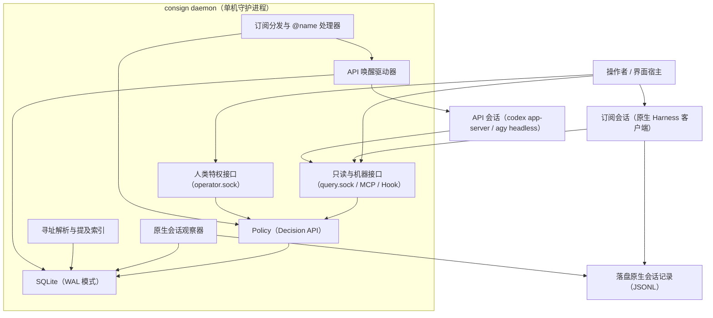
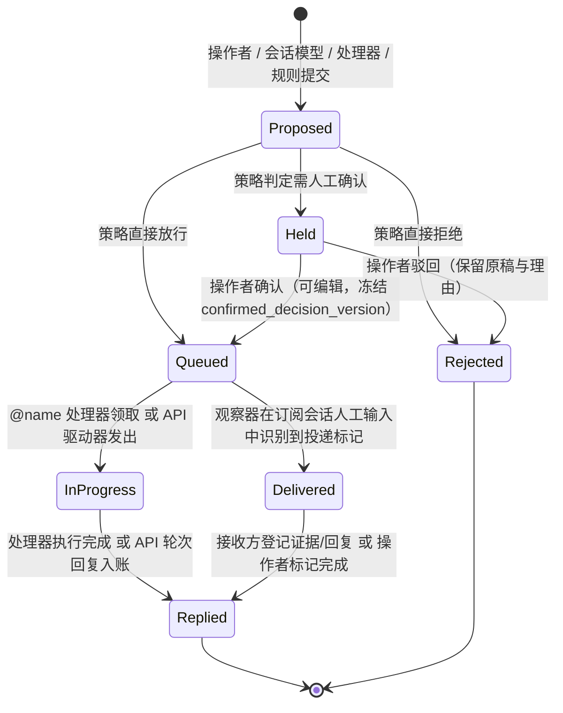

# Consign 实现规格

本文定义 Consign 的系统拓扑、寻址语法、数据模型、状态机契约、安全边界以及各 Harness 的接入规格。架构定位与核心理念见 [DESIGN.md](DESIGN.md)，人机交互契约与界面宿主边界见 [INTERACTION.md](INTERACTION.md)，本文不再重复设计动机。

---

## 1. 概览与进程架构

### 1.1 运行形态与协作端点

Consign 是一个运行在本地的中心化协作服务：守护进程（`consign daemon`）独占管理 SQLite 状态库（WAL 模式），向各执行会话暴露 MCP 接口与 Hook 决策接口，向操作者与界面宿主暴露人类特权接口。

系统中所有参与者共享同一套 IPC 原语（`resolve / backlinks / send / post / record_evidence`），差异仅体现在授权级别与唤醒方式上：

- **操作者（Operator）**：通过人类接口拥有最高裁决权（确认待办、批准外部副作用、设立工程决定、接管会话），同时也是所有消费级订阅会话的唯一输入发起方。
- **订阅会话（Observed Session，`mode = observed`）**：由操作者在 Codex、agy 等官方客户端内亲自发起每一轮交互；会话内的模型通过注入的 Consign MCP 主动访问协作网络，守护进程同时在后台增量观察其落盘的原生记录。**Consign 绝不向订阅会话注入或自动发送轮次输入。**
- **API 会话（Driven Session，`mode = driven`）**：由 Consign 显式携带按量计费的 API key 启动，可由内部驱动器根据消息入队事件自动唤醒并推进下一轮（见第 6 节），同时同样注入 Consign MCP 并接受原生记录观察。
- **`@name` 订阅处理器（Named Handler）**：挂载在命名地址（如 `@review`）上的持久订阅消费者，可按需配置为静态 prompt 模板、确定性规则脚本，或携带 API key 运行的后台模型消费者。

### 1.2 核心组件与状态归属

| 组件 / 原语 | 核心职责 | SQLite 状态表归属 |
| --- | --- | --- |
| **Address & Link** | 端点、会话、轮次、片段、流、消息与外部锚点的统一文本寻址；双向提及投影 | `mentions` |
| **Reference** | 不可变的上下文与产物快照（内容哈希、`git_snapshot`、`blob`、`transcript_span`） | `artifacts` / `blobs` |
| **Stream** | 只追加的有序事件与工作流轨迹；可选绑定外部锚点，维护决定集版本与跳数计数 | `events` / `streams` / `decisions` / `evidence` |
| **Message** | 意图（`to + intent + refs`）与反馈的持久化载体，支持幂等去重、乐观准入与状态机跟踪 | `messages` |
| **Subscription** | 持久消费游标、批量防抖策略、`@name` 处理器定义及跨重启的持久等待状态 | `subscriptions` / `handlers` |
| **Policy（Decision API）** | 统一策略决策点：读取授权、投递准入、血缘隔离、资源锁、副作用审批与 Hook 工具拦截 | 规则配置、`approvals` / `policy_audit` / `locks` |
| **Consign MCP** | 注入执行会话的工具集，调用按会话绑定或记录出处，写入操作强制幂等去重 | `tool_calls` |
| **原生会话观察器** | 按游标与前缀哈希增量导入原生日志，提取轮次、投递标记、工具调用与提及关系 | `observation_config` / `sessions` / `transcript_lines` / `turns` |
| **API 唤醒驱动器** | 仅作用于 API 会话：启动与续接轮次、对接审批回调、崩溃后状态核对、操作者接管与归还 | `sessions` / `turns` / `attempts` / `worktrees` |

### 1.3 进程拓扑与部署模型



- **单进程启动与私有状态目录**：单机部署时，`consign up` 在单进程内启动全部组件。状态目录（默认 `$XDG_STATE_HOME/consign` 或 `~/.local/state/consign`）强制校验 `0700` 私有权限，并通过文件锁 `daemon.lock` 防止多实例并发写坏同一个数据库；每个状态目录通过 `observation_config` 唯一绑定一个原生会话根目录。
- **双通道物理隔离**：守护进程分别监听 `query.sock`（底层绑定 SQLite `PRAGMA query_only = true` 的只读连接，供全局 MCP 进程与普通查询使用）与 `operator.sock`（具备写入权限的人类特权接口，供片段固定 `pin`、消息确认、策略审批与决定录入使用）。客户端可通过流式事件或按 `events.seq` 游标增量拉取状态变更。
- **存储演进与多机扩展**：单机阶段在 SQLite 上实现完整的只追加流、消费游标、乐观准入与唯一约束去重；接口严格按流、游标、持久消费者与确认语义抽象，后续可平滑替换底层消息中间件。多机阶段中，各节点的原生会话由 `sessions.node_id` 标识，每台工作机运行轻量级 `consign worker`，负责本机日志观察上报、MCP 代理转发以及本机 API 驱动进程管理。

### 1.4 模块划分

以下为按职责解耦的目标 Workspace 模块边界；第一阶段（观察与寻址）合并在单 crate `crates/consign` 内实现，随后续阶段演进逐步拆分为独立子 crate：

```text
consign/
├── Cargo.toml
├── crates/
│   ├── consign-core/     # 领域模型、URI 解析、IPC 协议、Policy 协议与状态机定义（纯逻辑无 IO）
│   ├── consign-store/    # SQLite 存储引擎、Schema 迁移、事件投影、内容寻址 Blob 与提及索引
│   ├── consign-policy/   # Decision API 策略引擎（Tier 0 内置/TOML/脚本、Tier 1 模型评判、Tier 2 审批）
│   ├── consign-observe/  # 各 Harness 原生日志（Codex / agy）增量扫描、前缀校验与轮次投影
│   ├── consign-mcp/      # Consign MCP stdio 服务端、会话身份绑定与工具调用去重转发
│   ├── consign-sub/      # 订阅游标分发、批量防抖唤醒、@name 模板/规则/后台 API 消费者
│   ├── consign-drive/    # API 会话驱动器（Codex app-server / agy headless）、进程组与 Worktree 管理
│   ├── consign-daemon/   # 双通道 Socket 监听、事务调度、崩溃恢复核对与事件推送
│   └── consign-cli/      # consign up / sessions / resolve / backlinks / span / pin / mcp 等命令行入口
```

---

## 2. 统一寻址、不可变引用与提及索引

### 2.1 地址语法与外部锚点规范化

Consign 中的所有内部实体均采用规范化的 `consign://` 文本 URI 寻址：

```text
consign://codex/01a2…                            原生会话端点（Session）
consign://codex/01a2…/turn/019a…                 会话中的单次轮次（Turn）
consign://codex/01a2…/span/L118-L131@sha256:…    带行号区间与内容哈希的原始片段（Span）
consign://stream/issue-812/42                    工作流中的有序记录（Stream Entry）
consign://msg/M17                                意图消息（Intent Message）
consign://handle/review                          命名流程入口（对应 @review）
```

外部协作锚点在提取时统一规范化为小写标准形式：

- 显式锚点 `github:Owner/Repo#812` 与完整 URL `https://github.com/Owner/Repo/issues/812`（或 `pull/812`）统一归一为 `github:owner/repo#812`；
- 当原生会话的 Git 元数据指向某个 GitHub 仓库（如 `session_meta.payload.git.repository_url`）时，会话文本中出现的短引用 `#812` 会自动结合该会话所属仓库补全为 `github:owner/repo#812`。

### 2.2 不可变产物引用契约（Reference）

会话链接与轮次链接用于上下文导航，其返回视图会随会话推进而动态更新；而**任何作为工程证据（Evidence）或跨会话交接依据（Message References）传递的上下文，必须转化为不可变的产物引用（Artifact Reference）**：

```json
{
  "kind": "git_commit | git_snapshot | file | blob | transcript_span",
  "node_id": "linux-pc",
  "repo": "flowmq",
  "path": "logs/run-118/trace.txt",
  "version": "sha256:… 或 Git 对象 OID",
  "size": 18234,
  "created_at": "2026-11-26T06:00:00Z"
}
```

- **记录片段（`transcript_span`）与固定（Pinning）**：片段链接由 1-based 连续行号区间 `L<first>-L<last>`（单次上限 `100` 行、`256 KiB`）与覆盖原始 JSONL 字节（含换行符）的 SHA-256 摘要共同构成。未固定时，`resolve` 从已导入的 `transcript_lines` 实时读取并校验 SHA-256，若原文件被改写导致哈希不匹配则报错拒绝（`span content changed`）；通过人类接口执行 `consign pin <span_link>`（或被消息/证据引用自动固定）后，原始字节按 SHA-256 去重存入 `blobs` 与 `artifacts` 表，即使原日志文件事后被重写或清理，该片段链接依然可确定性解析。
- **未提交代码快照（`git_snapshot`）**：针对工作区尚未提交的改动，基于选定文件构建临时 Git tree 并通过 `git commit-tree` 生成不可变 commit 对象，挂载到隐藏引用 `refs/consign/<stream>/<n>` 下，既不污染用户当前分支，又能像普通 commit 一样执行精确 diff、检出与跨节点 `git fetch`。
- **仓库外文件（`blob`）**：测试日志、构建产物等仓库外文件按 SHA-256 内容寻址去重保存（小文件直接存入 SQLite `blobs` 表，超大文件落盘至内容寻址对象目录）。
- **失效传播**：在解析引用时，凡发现实际内容哈希与记录不一致，一律判定引用失效——引用该产物的未执行消息自动退回 `Held`，关联证据自动标记为 `stale`。

### 2.3 链接解析与提及反向索引

- **限量解析（`resolve`）**：`resolve(link)` 仅返回目标对象的核心摘要与受控长度的内容预览（如会话返回元数据及最近 20 条轮次链接；轮次返回状态、时间、用量、截断至 4000 字符的输入输出预览，以及对应的单行 `input_span` / `output_span` 链接；片段返回最多 8000 字符的原文及 `pinned / truncated` 标志）。解析意图消息链接时，一并返回当前准入判定预览（见 4.4 节）。
- **反向索引（`backlinks`）**：观察器与流写入器自动扫描文本中的 `consign://` 链接与外部锚点并写入 `mentions` 表。调用 `backlinks(link, after?)` 按字典序分页（每页 50 条，返回 `next_after` 游标）列出所有提及该目标的轮次、会话或流记录。`mentions` 表完全是派生投影数据，可随时从原生日志与事件账本全量重建。

---

## 3. 原生会话观察与 MCP 接口

### 3.1 原生记录增量观察与前缀一致性校验

守护进程后台线程定期扫描并跟进各 Harness 落盘的原生会话日志（具体路径与格式见附录 A）。观察器完全独立于 MCP 运行，无论是历史遗留会话还是从未调用过工具的会话均可无感导入：

1. **元数据快速跳过**：对比文件的 `(source_path, device, inode, source_size, source_stamp)`（其中 `source_stamp` 组合了秒与纳秒级的 `mtime` 和 `ctime`），若完全未变则零 IO 开销直接跳过。
2. **已提交前缀校验（Prefix Verification）**：原生客户端在上下文压缩或异常恢复时可能原地改写已有 JSONL 文件。当文件发生变化时，观察器先读取此前已提交的字节偏移量 `[0, transcript_cursor)` 并计算 SHA-256，与 `sessions.prefix_hash` 比对：
   - **前缀哈希一致**：仅从 `transcript_cursor` 处开始读取新增的**完整 JSONL 行**（末尾若存在尚未写完的半行则留待下一轮读取），在同一笔 SQLite 事务中追加写入 `transcript_lines`、更新轮次与提及投影，并推进 `transcript_cursor` 与 `prefix_hash`。
   - **前缀哈希不一致（或文件被截断缩小）**：说明早期记录被重写，观察器在同一事务内清空该会话派生的 `mentions`、`turns` 与 `transcript_lines`，从头重建投影；此前已通过 `pin` 固定在 `artifacts / blobs` 表中的片段快照不受影响。

### 3.2 轮次语义提取与投递标记识别

观察器在扫描原生记录行时提取以下结构化信息：

- **轮次边界与有效载荷**：识别每轮的开始事件（如 Codex `task_started`）、结束/中止事件（`task_complete` / `turn_aborted`）、起止时间戳及 token 用量（`token_usage_record`）。提取用户输入时自动过滤掉 Harness 注入的系统上下文（例如在 Codex 中仅保留 `provenance.type == "user"` 的文本块，忽略 `agents_md` 等自动注入块）；提取模型输出时锁定最终答复（`phase == "final_answer"` 或 `last_agent_message`）。
- **发起方（`origin`）与投递标记（Delivery Marker）**：订阅会话的轮次标记为 `origin = operator`，API 驱动器触发的轮次标记为 `origin = driver`。对于交由操作者手工送达订阅会话的意图消息，消息正文末尾附带包含 `consign://msg/<id>` 的标准投递标记；**观察器仅在原生会话的用户输入（`role == "user"`）中识别该投递标记**，按消息版本与目标轮次去重后将消息状态更新为 `Delivered`（关联 `turns.delivered_message_id`），而在模型输出或其他位置出现的消息链接仅作为普通提及写入 `mentions`。若操作者粘贴时手动删去了投递标记，可通过人类接口显式指定送达轮次。
- **操作者追问关联（`responds_to_turn_id`）**：当操作者在原生会话中针对上一轮结论继续追问且具备明确指向依据时，记录 `responds_to_turn_id` 指向被回应的轮次；提出全新任务或指向不明时留空。
- **MCP 工具调用归属**：识别原生日志中对 Consign MCP 工具的调用记录，用于事后补充会话与轮次出处。

### 3.3 Consign MCP 工具集

`consign mcp` 以 stdio 方式运行，按各 Harness 的规范注册为 MCP Server，内部通过本地 socket 向守护进程转发请求。工具集严格划分为只读查询与受控写入两类：

| 工具名称 | 读写类别 | 参数签名 | 核心职责与服务端不变量 |
| --- | --- | --- | --- |
| `resolve` | 只读 | `(link)` | 解析会话、轮次、片段、流或消息链接，返回受控长度的内容与上下文；解析消息链接时预览当前准入裁决（不改变状态） |
| `backlinks` | 只读 | `(link, after?)` | 分页返回所有提及该链接或外部锚点（如 `github:owner/repo#123`）的源轮次与记录 |
| `self` | 只读 | `()` | 返回当前已绑定会话的 `consign://` 地址及其最新一轮的链接 |
| `inbox` | 只读 | `()` | 返回投递给当前绑定会话或其关联工作流的未处理意图消息列表 |
| `use_message` | 写入 | `(link, idempotency_key)` | 显式申请消费一条意图消息：在事务内执行决定集版本与引用准入核对（见 4.4）；若发现非收窄变更则将消息退回 `Held` 并返回差异 |
| `send` | 写入 | `(to, intent, refs, stream?, reply_to?)` | 向目标地址（另一会话、`@name` 或操作者）提议一条意图消息，自动固定所选片段引用并交由 Policy 裁决准入 |
| `post` | 写入 | `(stream, body, refs?)` | 向指定工作流追加一条进展记录，正文中的链接与外部锚点自动进入提及索引 |
| `record_evidence` | 写入 | `(stream, refs, summary)` | 在工作流上登记绑定不可变引用（快照或固定片段）的工程证据 |

### 3.4 会话身份绑定与调用幂等

写入操作以及依赖上下文的查询（`self`、`inbox`）需要识别当前调用所属的会话身份。身份来源按可信等级分为三级：

1. **启动/注入时可信绑定（最高优先级）**：Consign 启动 API 会话时，或界面宿主按会话拉起独立 MCP 进程时（如 `consign mcp --session <id>` 或 ACP `session/new`），直接将受信任的会话 ID 注入 MCP 进程。
2. **Harness 工具进程环境变量**：部分 Harness 在派生工具子进程时注入会话标识（如 Codex 的 `CODEX_THREAD_ID`、agy 的 `ANTIGRAVITY_CONVERSATION_ID`，见附录 A）；若 MCP Server 进程由 Harness 按会话拉起并继承该变量，可据此识别会话。
3. **原生日志事后归属**：若 MCP 以全局单例方式注册，调用发生时的参数与返回结果会落盘到对应会话的原生 JSONL 记录中，由观察器在扫描日志时事后关联回具体会话与轮次。

**安全与降级准则**：只有受信任宿主或 Harness 注入的绑定信息才允许解锁 `self()` 与 `inbox()`（未绑定时调用这两个工具会明确返回 `MCP connection has no trusted session binding` 错误，但显式传入链接的 `resolve` 与 `backlinks` 仍按连接授权正常服务）；自报身份与事后归属仅用于审计出处，读取权限一律由服务端按 socket 连接级别校验。机器接口发起的所有写入工具只能创建提议（`Proposed`）或追加事实，确认、批准、裁决等特权操作仅在 `operator.sock` 人类接口上开放。

**调用去重**：所有写入工具均接受调用方传入的去重键（`idempotency_key` / `dedup_key`）；未显式提供时，服务端按 `(caller, tool_name, args_sha256)` 在时间窗口内自动去重。重复提交相同参数直接返回首次持久化的 `result_json`；同一去重键携带不同参数则报错拒绝。

---

## 4. 协作对象、状态机与并发契约

### 4.1 `@name` 订阅处理器与持久等待

挂载在 `consign://handle/<name>`（简写为 `@name`，如 `@review`）上的订阅处理器与普通端点共享同一套消息收发语义，按实现形态支持三阶段平滑演进：

1. **静态模板（`kind = template`）**：将收到的 `intent + refs` 填充进预定义的审查/验证请求模板，投递至操作者待办队列或预设的目标会话。
2. **确定性规则（`kind = rule`）**：订阅特定工作流事件（如“新代码快照证据入账”），当条件满足时自动调用 `send` 生成下一步意图消息。
3. **后台 API 消费者（`kind = api_consumer`）**：使用 API key 调用轻量级模型（默认 DeepSeek），按配置的批量窗口与最大等待时间（`batch_policy_json`）防抖唤醒，自主调用 `resolve` 阅读引用并整理摘要或派发下游任务。其工具访问凭据仅绑定单次唤醒周期，执行完毕即行撤销。

**持久等待（Durable Waiting）**：当后台处理器发出一封需要等待下游回复的意图消息后，不会阻塞驻留内存，而是将等待条件写入 `subscriptions.waiting_on_json` 并立即释放进程运行槽；待目标轮次完成或回复消息入账时，守护进程在事务提交后自动检索并重新唤醒该订阅者。处理器对消息的每一次筛选、合并与转发均作为事件记入流中，保证后台判断全程可审计。

### 4.2 决定、证据、会话血缘与介入留痕

为支撑跨会话的认知对齐与质量不变量，账本维护四类核心协作实体：

- **工程决定（Decision）**：操作者确认的工程约束或取舍，按作用域分为**本轮（turn）**、**本工作流（stream）**与**本项目（repo）**三级；新决定可显式取代（`supersedes_id`）旧决定，流级决定经检验后可升格为项目级惯例。每条决定标注其变更性质 `effect`：
  - `narrowing`（收窄型）：纯粹在既有方向上增加约束或缩小范围（例如“本轮仅补充日志”、“严禁修改 `Cargo.toml`”）；
  - `other`（非收窄型，**默认值**）：改变目标方向、放宽既有限制或性质无法自动判定。
- **工程证据（Evidence）**：审查发现、故障复现结果、基准测试数据等，必须通过 `artifact_ids` 绑定至少一个不可变引用（如 `git_snapshot` 或已固定的 `transcript_span`），并记录产出时的环境指纹（`env_json`）与决定集版本（`decision_version`）。一旦所绑定的底层代码快照被新快照取代，该证据自动标记为过期（`stale_reason`）；而若仅仅是工作流决定集版本推进，证据只附加“产出于旧决定集 vN”提示，不自动作废。
- **会话血缘（Lineage）**：通过 `sessions.parent_session_id`（提取自 Harness 原生 fork 元数据或交接时的显式标注）追踪会话派生链。系统强制执行**独立复核血缘隔离不变量**：承载“审查 / 复核”意图的目标会话，绝不能位于被审代码的作者会话或修复者会话的血缘链内。若目标是 API 驱动会话，策略引擎在准入阶段直接硬阻断；若目标是操作者推进的订阅会话，观察器在识别到投递标记后立即标出利益冲突告警，交由操作者裁决。
- **操作者介入记录（Intervention）**：凡是操作者在确认前编辑意图消息、驳回提议，或策略引擎按规则改写消息（`mutate`），事件表 `events` 均在 `payload_json` 中完整保存**修改前原稿、修改后内容及驳回/改写理由**；结合原生会话中记录的 `raw_input` 与 `responds_to_turn_id`，构成完整的认知纠偏轨迹。

### 4.3 意图消息生命周期与状态机

每条意图消息包含 `to_ref`（接收方地址）、`intent`（意图说明）与 `refs_json`（不可变引用列表，消息本身绝不内联复制大段上下文正文）。消息一旦确认进入 `Queued`，其 `intent` 与 `refs_json` 即被冻结。



- **发往 `@name` 处理器或 API 会话**：走 `Queued → InProgress → Replied` 自动执行路径；
- **发往订阅会话**：`Queued` 表示消息正位于操作者待办队列中等待人工送达；操作者将其送入目标会话输入框并由观察器识别到投递标记后转为 `Delivered`；接收方模型调用 `record_evidence` / `send` / `post` 引用该消息交付结果（或由操作者手动标记回复轮次）后转为 `Replied`。

除主路径外，涉及资源互斥、并发变更与故障恢复的状态流转如下：

| 当前状态 | 触发条件 | 目标状态 |
| --- | --- | --- |
| `Queued` | 目标关联的排他资源锁不可用，或目标 API 会话正忙 / 处于被操作者接管状态 | `WaitingResource` |
| `WaitingResource` | 资源锁释放 或 目标 API 会话恢复空闲 | `Queued` |
| `Queued` / `Delivered` | 使用前乐观准入校验发现非收窄型决定变更，或依赖的引用/证据已失效（见 4.4） | `Held` |
| `Queued` | 超过 `timeout_at` 仍未获处理 | `Escalated` |
| `InProgress` | 后台处理器意外中断，且所做操作满足纯幂等重试条件 | `Queued` |
| `InProgress` | 执行中断且包含不确定外部副作用，或 API 驱动轮次启动状态不明（见 6.2） | `NeedsConfirmation` |
| `NeedsConfirmation` | 操作者核对现场后确认安全重试 | `Queued` |
| `NeedsConfirmation` | 操作者判定无法自动恢复，需人工接手处理 | `Escalated` |
| `Escalated` | 操作者改派目标端点或修正后重新入队 | `Queued` |

在 `Proposed` 阶段由 Policy 拦截并转入 `Held` 的典型条件包括：目标处理器的触发模式配置为 `trigger = manual`；消息带有外部系统副作用；或同一工作流在全自动协作下连续无人工介入跳数达到上限（`hop_count >= hop_limit` 跳数熔断）。

### 4.4 契约一：使用准入（乐观并发校验）

一条消息从确认（记录 `confirmed_decision_version` 及可选的参考流游标 `expected_stream_seq`）到真正被目标端点消费之间，所属工作流的决定集版本 `streams.decision_version` 可能已经向前推进。

内核在**消息真正被消费的时刻**强制执行乐观并发准入：若目标是 `@name` 处理器或 API 会话，在 `Queued → InProgress` 的领取事务内自动执行；若目标是订阅会话，则由接收方模型调用 `use_message(link, idempotency_key)` 在写入事务内显式触发：

1. **版本未变（`current_version == confirmed_decision_version`）**：准入通过，返回当前有效决定集与解析后的引用内容。
2. **版本已推进，且区间内新增/变更的决定全部为 `effect = narrowing`（收窄型）**：准入通过，自动附带最新决定集一并返回，使执行方直接遵守收窄后的最新约束。
3. **版本已推进，且存在任意一条 `effect = other`（非收窄型）决定变更**：准入拦截，事务将该消息状态退回 `Held` 并附上前后决定差异，等待操作者重新确认。
4. **消息引用的 Artifact 哈希校验失败，或所依赖的 Evidence 已变为 `stale`**：同第 3 条，退回 `Held` 并标出失效引用。
5. **流游标推进冲突**：若消息设置了 `expected_stream_seq` 且目标流在此期间追加了新关键记录，策略层可暂停投递并将新增记录退回发起方重新评估。

调用只读的 `resolve(msg_link)` 可随时预览上述准入判定结果及版本差异，但绝不修改消息状态；状态流转仅发生在 `use_message`、处理器领取或驱动器发出的写事务中。轮次产出按准入时固定的决定版本入账，而事后的输出关口（Output Gate）则始终对照**当前最新决定集**核验代码 diff（见 5.3 节）。

### 4.5 契约二：事务入账与外部动作幂等

Consign 保证工具调用结果、实体状态迁移与账本事件（`events`）在同一笔 SQLite 事务内原子提交：

| 核心时机 | 单笔 SQLite 事务内原子完成的操作 |
| --- | --- |
| **处理器领取消息** | `messages.state: Queued → InProgress`，固定本次执行的准入决定版本，记录领取者与租约到期时间 |
| **处理器进入持久等待** | 将等待目标写入 `subscriptions.waiting_on_json`，追加等待事件，释放执行槽位 |
| **会话调用写入工具** | 校验并写入 `tool_calls (caller, dedup_key)`，创建或更新消息/证据/流记录，追加 `events` 记录 |
| **观察到人工投递标记** | `messages.state: Queued → Delivered`，将 `turns.delivered_message_id` 与 `messages.delivered_turn_id` 双向关联，追加事件 |
| **API 驱动器发起轮次** | 创建 `attempts` 执行尝试记录并提交事务；随后调用 Harness 接口，拿到原生 `turn_id` 后立即补写关联 |
| **API 驱动轮次完成** | 写入原生输出与用量至 `turns`，更新 `attempts` 与关联 `messages` 状态为 `Replied`，检索并唤醒 `waiting_on_json` 匹配的订阅者 |
| **观察或登记到订阅会话回复** | `messages.state: Delivered → Replied`，追加事件，检索并唤醒等待该消息的订阅者 |

**外部副作用三阶段协议**：对于发往外部系统的动作（如在 GitHub Issue 下发表评论），经 Tier 2 批准后，执行器严格按**“先在事务内持久化启动意图 → 调用外部接口 → 持久化执行结果”**三步执行。若守护进程在第二步期间崩溃，重启后发现“有意图无结果”时，**必须先查询外部系统核实动作是否已生效**：已生效则幂等补记完成状态；确认未生效才发起重试；外部状态无法唯一核实时一律转入 `NeedsConfirmation` 交操作者裁决。

---

## 5. 策略引擎与同机安全模型

### 5.1 统一策略决策点（Decision API）

消息投递（`msg.send`）、动作提议（`action.propose`）、排他资源锁申请（`resource.acquire`）以及由 Harness Hook 或审批回调转发来的工具执行请求（`tool.exec`），全部汇入同一个策略决策接口：

```json
// Decision Request
{
  "point": "msg.send | action.propose | resource.acquire | tool.exec",
  "caller": "codex:01a2...",
  "stream": "issue-812",
  "subject": { "tool": "Bash", "command": "cargo test", "cwd": "/wt/T7" }
}

// Decision Response
{
  "verdict": "allow | deny | hold | mutate",
  "reason": "命中只读审查会话角色限制",
  "rule_id": "readonly-reviewer",
  "tier": 0,
  "mutate": {},
  "approval_id": "A42"
}
```

Decision API 根据 `caller` 自动反查该会话绑定的工作流（`stream_id`）、分配的 `worktree`、当前有效决定集与持有的资源锁，实现**上下文感知的策略裁决**，并按每次调用的耗时与结果写入 `policy_audit` 审计表。策略评估按成本与确定性分为三层：

| 评估层级 | 实现机制 | 管控范围 |
| --- | --- | --- |
| **Tier 0（确定性规则）** | Rust 内置守卫、TOML 声明式配置、外部脚本扩展点 | 幂等去重路由、作者/审查者血缘隔离、Worktree 路径越界检查、只读会话角色限制、连续跳数熔断、单流预算上限、命令黑白名单 |
| **Tier 1（轻量模型评判）** | 可选的廉价 API 模型快速分类 | 落入灰区的 Shell 命令风险初筛；**权限严格受限：仅允许放行明确的只读/低风险操作或直接拒绝，凡疑似高风险一律向上升级至 Tier 2** |
| **Tier 2（操作者人工审批）** | 生成 `approvals` 审批单，推送至人类特权接口 | 外部系统副作用、高危命令执行、跨边界例外放行 |

### 5.2 工具执行拦截入口

| 运行场景 | 拦截与回调机制 | 降级与阻塞语义 |
| --- | --- | --- |
| **订阅会话（Codex / agy）** | 用户级 `PreToolUse` Hook（Codex `~/.codex/hooks.json`，agy `~/.gemini/config/hooks.json`） | 未关联工作流的普通日常会话直接放行，沿用 Harness 原生权限；已关联 Consign 工作流的会话按上下文规则裁决；若守护进程未启动则安全退回 Harness 默认策略 |
| **API 驱动的 Codex 会话** | `codex app-server` 异步审批回调 `item/commandExecution/requestApproval` | 命中 Tier 2 时在轮次内挂起等待，操作者通过人类接口批准或拒绝后，驱动器向 `app-server` 回传裁决，当前轮次无缝继续 |
| **API 驱动的 agy 会话** | 全局或工作区级同步 `PreToolUse` Hook | 同步 Hook 有约 100ms 超时预期：命中 Tier 2 时立即返回 `deny` 并在后台创建 `approvals` 审批单；待操作者批准后写入一次性放行令牌（`grant_once_key`），并由驱动器自动续接下一轮 |

**硬性安全底线**：凡是由 Consign 自动唤醒的 API 驱动会话，在守护进程或 Decision API 不可达时，所有受策略管控的操作一律**拒绝执行（Fail-closed）**。

### 5.3 工程决定的三层执行体系

| 防线层级 | 覆盖的决定类型 | 强制执行机制 |
| --- | --- | --- |
| **第一层：物理硬边界** | 可写目录范围、网络访问权限、只读角色隔离 | **Harness 操作系统级沙箱**（`read-only` / `workspace-write` + 禁用网络），作为唯一不可被命令变形绕过的安全边界 |
| **第二层：机械规则拦截** | 显式路径禁令或命令模式（如“禁止改动 `Cargo.toml`”） | `PreToolUse` Hook / 审批回调实时询证 Decision API Tier 0 规则，拦截绝大多数无意越界 |
| **第三层：输出关口（Output Gate）** | 自然语言语义决定（如“本轮仅增加追踪日志，不改变业务逻辑”） | 执行轮次产出 `git_snapshot` 后，在关口对照当前最新决定集审查 diff，由异构模型或操作者裁决，违背决定则退回重做 |

### 5.4 同机同用户安全隔离模型

在同一台机器、同一系统用户下运行 Agent 时，“语义对等”绝不意味着“接口合并”。Consign 采取纵深隔离措施防止权限提升与自我审批：

| 隔离措施 | 技术实现规范 |
| --- | --- |
| **双通道监听分离** | 供 MCP、Hook 与后台处理器调用的**机器/只读接口**（`query.sock` 等），与供确认、审批、定决定、固定片段使用的**人类特权接口**（`operator.sock`）物理分开监听 |
| **机器接口仅限提议与登记** | 机器接口在协议层不包含任何能够将消息从 `Held` 改为 `Queued`、或将审批单改为 `Approved` 的方法 |
| **特权接口与沙箱路径隔离** | API 会话强制运行在禁网且限定工作区可写的沙箱内，Consign 状态目录与 socket 置于沙箱可写范围之外；人类接口可进一步启用独立鉴权凭据，确保 Harness 工具子进程不可读、不可达 |
| **`origin` 服务端强制标注** | 所有消息与轮次的 `origin` 字段一律由服务端根据接入通道与认证身份直接写入，完全忽略客户端请求体中的自报来源 |
| **API 凭据隔离与子进程环境清洗** | 守护进程用于驱动 API 会话和后台处理器的 API key 仅保存在守护进程内存中，绝不注入被驱动会话的工具执行环境；驱动器派生子进程时主动清理 `GH_TOKEN`、SSH 代理及 `git push` 等外部发布凭据 |
| **`app-server` 控制通道保护** | Codex `app-server` 优先采用 `0600` 权限的本地 Unix socket 通信；若使用本地 WebSocket 则强制启用 Capability Token，且该 Token 绝不进入工具子进程环境变量 |
| **独立系统用户演进（后续阶段）** | 生产级高安全部署下，`consign daemon` 以独立系统用户运行，人类特权接口仅对操作者所属的桌面/终端登录会话开放 |

---

## 6. API 会话驱动与生命周期管理

携带 API key 启动的受控会话（`sessions.mode = driven`）由 Consign 自动唤醒推进，支撑无人值守的多环节交接、异构交叉复核与确定性规则流水线；**所有消费级订阅会话（`mode = observed`）严禁进入驱动器调度。**

### 6.1 驱动传输协议

| 目标 Harness | 首选受控传输方式 | 关键控制能力与约束 |
| --- | --- | --- |
| **Codex** | `codex app-server`（每节点单常驻进程，由 daemon 或 `consign worker` 托管；备用回退为 `codex exec --json --output-schema`） | 支持线程创建（`thread/start`）、恢复、原生分叉（`thread/fork`，保留 `forkedFromId`）、轮次级 `outputSchema` 结构化输出、轮内命令审批回调、流式事件与 token 用量通知，以及 TUI `codex resume --remote` 实时共享同一线程。**严禁使用 `ephemeral: true` 临时线程**（临时线程不支持读取历史 turns，也无法 fork，见附录 A.1） |
| **agy** | Headless 流式模式：`agy --output-format stream-json --json-schema <file> --print "<prompt>"`；多轮交互启用 `--input-format stream-json` 保持 stdin 打开 | 支持 `--conversation <id>` 续接会话并命中上下文缓存、最终 `result` 事件直接产出解析好的 `structured_output` JSON 对象，且 Headless 模式下 `PreToolUse` Hook 照常生效 |

### 6.2 轮次入账与崩溃恢复核对

驱动器在唤醒 API 会话前，严格按照 4.5 节的事务契约先行写入 `attempts` 表（记录 `message_id`、`session_id`、`status = starting`），事务提交后再调用 Harness 启动轮次，并在收到启动响应中的原生轮次 ID（`native_turn_id`）后立即补写回 `attempts` 与 `turns`。轮次完成上报时校验该 `attempt_id` 仍为当前活动尝试，重复上报直接幂等返回已登记结果。

**崩溃后状态核对协议**：守护进程重启后，扫描所有处于未完成状态的 `attempts` 记录。绝不盲目重发，而是先凭已保存的 `native_turn_id`（若崩溃发生在补写 `native_turn_id` 之前，则按会话历史末尾轮次时间戳与输入内容比对）向 Codex 线程历史接口或 agy 的 `transcript_full.jsonl` 查询真实状态：

| 核对到的原生会话状态 | 守护进程恢复动作 |
| --- | --- |
| **原生轮次已成功完成** | 从原生记录取回最终输出与 token 用量，幂等执行轮次完成事务并唤醒下游等待者 |
| **原生轮次仍在运行中** | 重新挂载到 `app-server` 或子进程事件流，继续等待完成 |
| **确认原生轮次从未启动** | 将尝试标记为中止，关联消息安全退回 `Queued` 重新排队 |
| **状态无法唯一判定** | 停止自动重试，将关联消息转入 `NeedsConfirmation`，交由操作者核对现场后拍板 |

### 6.3 操作者随时接管与归还

当操作者需要中途介入某个正在被驱动的 API 会话时：

1. **接管（Takeover）**：守护进程暂停向该会话派发新消息，等待当前正在运行的轮次自然结束后释放控制租约；操作者通过 `codex resume --remote <addr> <thread_id>` 或 agy 原生 TUI 直接打开该会话进行交互。
2. **接管期间留痕**：操作者在接管期间发起的所有轮次均记为 `origin = operator`。其中 Codex 经由共享的 `app-server` 实时推送事件入账，agy 则在归还时由观察器按日志游标增量补录。
3. **幂等归还（Return）**：实时入账与日志观察补录统一按唯一键 `(session_id, native_turn_id)` 幂等合并至同一条 `turns` 记录，绝不产生重复轮次。操作者归还会话后，守护进程恢复对该会话的自动投递；若归还时存在状态不明的中间轮次，先交操作者确认后再恢复队列。

### 6.4 自动循环护栏与凭据合规

- **工作区与网络隔离**：所有 API 驱动会话默认置于 `workspace-write` 且禁用网络的沙箱内；只读审查环节分配临时的 detached `git worktree`，代码修改环节为每条工作流分配独立的专属 `worktree`（记录于 `worktrees` 表）。
- **单流预算守卫**：每条工作流在 `streams.budget_json` 中配置 API 消耗上限；驱动器根据 Harness 实时上报的 token 用量（如 Codex 的 `thread/tokenUsage/updated`）累加写入 `turns.usage_json`，一旦触及预算阈值，后续自动消息立即转入 `Held`。
- **跳数熔断与输出关口**：连续自动交接达到 `hop_limit`、触发外部副作用或未通过输出关口 diff 核验时，自动挂起并转交操作者。
- **凭据合规**：驱动器仅接受显式配置的按量计费 API key（Codex 使用 OpenAI API key 接入 `app-server`；agy 使用 Gemini API key 配合 `modelProvider=gemini`），账本仅记录凭据类别，彻底隔离任何消费级订阅登录态。参考文档：
  - [Codex 非交互模式文档](https://learn.chatgpt.com/docs/non-interactive-mode)
  - [Antigravity CLI 安装与认证](https://antigravity.google/docs/cli/install/)
  - [Antigravity ACP 协议说明](https://antigravity.google/docs/cli/acp)
  - [Antigravity 常见问题（FAQ）](https://antigravity.google/docs/faq/)

---

## 7. SQLite 数据模型

单机状态全部托管于同一 SQLite 数据库中。其中 `observation_config`、`sessions`、`transcript_lines`、`turns`、`mentions`、`events`、`blobs` 与 `artifacts` 已在 Phase 1（观察与寻址基线）中落地运行；其余表随 Phase 2–5 渐进启用。

### 7.1 观察、寻址与产物基线表（Phase 1 已启用，随后续阶段扩展字段）

| 表名 | 核心字段与约束 | 职责说明 |
| --- | --- | --- |
| `observation_config` | `singleton (PK=1), source_root` | 确保每个状态目录唯一绑定一个原生会话观察根目录 |
| `sessions` | `id (PK), node_id, harness, native_id (UNIQUE), mode, source_path, transcript_cursor, last_line, prefix_hash, active_turn, cli_version, cwd, github_repo, device, inode, source_size, source_stamp`（Phase 2+ 扩展：`parent_session_id, stream_id, worktree_id, lease_owner, lease_until`） | 原生会话元数据与增量观察游标：`mode` 区分 `observed`（订阅）与 `driven`（API 驱动）；`prefix_hash` 校验 JSONL 前缀是否被改写；租约字段仅用于 `driven` 会话 |
| `transcript_lines` | `session_id, line, raw (BLOB)`，`PK (session_id, line) WITHOUT ROWID` | 按 1-based 行号保存已导入的原始 JSONL 字节，支撑未固定片段的实时读取与 SHA-256 校验 |
| `turns` | `session_id, native_turn_id, origin, first_line, last_line, started_at, ended_at, status, raw_input, input_line, raw_output, output_line, usage_json`（Phase 2+ 扩展：`responds_to_turn_id, delivered_message_id, attempt_id, resolved_context_json, decision_version, exit_detail, rate_limit_json`），`PK (session_id, native_turn_id) WITHOUT ROWID` | 统一到轮次粒度的结构化记录：`origin` 为 `operator` 或 `driver`；`input_line / output_line` 指向首条输入与最终输出所在行以生成单行 Span 链接；唯一复合主键保证实时入账与观察补录幂等合并 |
| `mentions` | `session_id, source, target, target_kind`，`PK (source, target) WITHOUT ROWID` | 双向提及与反向索引（`target_kind` 区分 `consign` 与 `github` 等），纯派生投影数据，可随时重建 |
| `blobs` | `sha256 (PK), content (BLOB)`（可扩展 `size, created_at`） | 按 SHA-256 去重的本地不可变内容存储（保存已固定的 `transcript_span` 原文与小型仓库外文件） |
| `artifacts` | `id (PK), kind, node_id, path, version (FK → blobs.sha256), size, created_at`（可扩展 `repo, git_ref`） | 不可变产物引用元数据（见 2.2 节），Phase 1 中 `id` 为被固定的片段链接、`kind = transcript_span` |
| `events` | `seq (PK), subject, type, ts`（Phase 2+ 扩展：`stream, kind, caller, payload_json`） | 只追加（Append-only）的账本事实源；所有消息编辑、驳回与策略改写均在此保留原稿与变更载荷 |

### 7.2 IPC 协作、策略与驱动扩展表（Phase 2+ 启用）

| 表名 | 核心字段与约束 | 职责说明 |
| --- | --- | --- |
| `streams` | `id (PK), anchor, repo, goal, status, decision_version, hop_count, hop_limit, budget_json, created_at` | 工作流元数据：可选绑定外部锚点（如 `github:owner/repo#812`），维护单调递增的 `decision_version`、连续自动跳数与花费上限 |
| `handlers` | `handle (PK), kind, config_json, trigger` | `@name` 命名流程入口定义：`kind` 为 `template / rule / api_consumer`；`trigger` 为 `manual / auto` |
| `subscriptions` | `id (PK), subscriber, subject, cursor, batch_policy_json, waiting_on_json, created_at` | 持久消费者状态：订阅目标流或地址、消费游标、批量防抖策略及跨重启的持久等待条件 |
| `messages` | `id (PK), stream, origin, from_ref, to_ref, intent, refs_json, state, idempotency_key, confirmed_decision_version, expected_stream_seq, delivered_turn_id, reply_to, attempts, timeout_at` | 意图消息信封：`origin` 由服务端按通道强制写入（`human / session / handler / rule / watcher`）；`to_ref` 支持任意端点地址 |
| `attempts` | `id (PK), message_id, session_id, native_turn_id, status, started_at, ended_at` | API 驱动器发起的单次轮次执行尝试，用于崩溃恢复核对与完成上报去重 |
| `tool_calls` | `id (PK), caller, tool, dedup_key, args_hash, result_json, created_at`，`UNIQUE (caller, dedup_key)` | MCP 写入工具调用日志与幂等去重缓存 |
| `decisions` | `id (PK), scope, scope_id, body, effect, status, supersedes_id, source_msg_id, created_at` | 工程决定表：`scope` 区分 `turn / stream / repo`；`effect` 为 `narrowing` 或 `other`（默认 `other`） |
| `evidence` | `id (PK), stream_id, kind, summary, artifact_ids, decision_version, env_json, stale_reason` | 绑定不可变产物引用的工程证据，底层快照变更时自动填写 `stale_reason` |
| `worktrees` | `id (PK), node_id, repo, path, base_rev, created_at, create_ms, size_bytes, removed_at` | 为 API 驱动会话分配的隔离 Git Worktree 生命周期记录 |
| `approvals` | `id (PK), point, stream_id, session_id, subject_json, state, decided_by, grant_once_key, created_at` | Tier 2 人工审批单及一次性放行令牌 |
| `locks` | `name (PK), node_id, holder, acquired_at, heartbeat_at` | 跨会话排他资源锁 |
| `policy_audit` | `id (PK), ts, point, stream_id, session_id, rule_id, tier, verdict, latency_ms, subject_json` | Decision API 策略裁决全量审计日志 |

---

## 8. 端到端协作流程示例

### 8.1 跨会话缺陷关联与证据交接（纯订阅会话）

1. **自动建链**：操作者在两个独立的 Codex 订阅会话中分别排查 `#901` 与 `#907`。守护进程后台增量导入原生日志，根据会话所属仓库自动将短引用规范化为 `github:owner/repo#901` 与 `github:owner/repo#907` 并建立提及索引。
2. **追问留痕**：`#901` 会话首轮分析仅复述了末端断言失败，操作者判断停在表面，继续追问上游路由原因；观察器将该轮记为 `origin = operator`，并将 `responds_to_turn_id` 指向首轮。
3. **跨会话反查**：操作者在 `#901` 会话中随口提到“这和 #907 是不是同一回事”，`github:owner/repo#907` 的 `backlinks` 列表中随即自动出现指向 `#901` 该轮次的反向链接。
4. **片段固定与意图投递**：`#901` 会话定位出路由筛选规则缺陷后，将该轮核心分析固定为不可变的 `transcript_span`，调用 `send` 向 `#907` 会话投递一条意图消息（附带该片段链接），经操作者确认后进入 `Queued`。
5. **受控送达与乐观准入**：操作者将带有末尾投递标记的意图消息送入 `#907` 会话输入框，观察器识别标记后将消息推进为 `Delivered`；`#907` 中的模型先调用 `resolve` 预览，再调用 `use_message` 通过准入校验并读取 `#901` 的固定片段原文，结合自身重放日志确认两者共享同一根因。
6. **证据闭环**：共同补丁与两边各自的回归验证分别通过 `record_evidence` 绑定 `git_snapshot` 入账；日后从 `#901` 或 `#907` 任一锚点出发，均可沿反向链接完整回溯两条会话的推理交汇过程。

### 8.2 通过 `@review` 触发单环节独立审查与血缘冲突检出

1. **发起审查**：操作者（或上游规则）向 `@review` 投递意图消息，附上当前未提交改动生成的 `git_snapshot` 引用。
2. **独立审查交付**：`@review` 模板处理器渲染出标准审查指令。当目标为订阅会话时，操作者将其送入一个全新的独立会话执行审查；审查模型仅读取 `git_snapshot` 与当前有效决定，不继承作者会话的对话历史，完成后调用 `record_evidence` 登记三条审查发现。
3. **取舍转化为决定与血缘告警**：操作者在界面上勾选采纳其中两条发现，确认为工作流决定（`decision_version` 递增），并向修复会话发出修改意图；修复完成后再发起独立复核。若操作者误将复核消息送入了处于作者或修复者血缘链内的会话，观察器立即检出利益冲突并在界面上高亮告警。
4. **过期自动传播**：修复会话产出新的 `git_snapshot` 后，此前绑定在旧快照上的审查发现自动标记为 `stale`。

### 8.3 基于 API 会话的自动异构交叉复核

1. **事件触发**：操作者在 Codex 订阅会话中完成缺陷修复，模型调用 `record_evidence` 登记新代码快照。
2. **异构派发**：订阅了该工作流证据事件的 `@review` 规则处理器被自动唤醒，向一个由 Gemini API key 启动、且不在作者血缘链中的 agy 会话投递复核意图。
3. **自动唤醒与独立核验**：API 唤醒驱动器在隔离的只读 worktree 中自动唤醒 agy 会话；agy 会话在 `Queued → InProgress` 事务中锁定当前 `decision_version`，调用 `resolve` 拉取代码快照与有效决定，完成独立复核后调用 `record_evidence` 登记结论。
4. **关口分流**：复核轮次完成后，若全部通过则由规则提出下一步合并建议；若发现违背决定或存在新缺陷，则自动汇总差异并将消息转入 `Held` 交操作者拍板。全程受跳数上限与单流 API 预算硬性约束。

---

## 9. 实施路线图

| 阶段 | 核心交付物 | 验收标准 |
| --- | --- | --- |
| **Phase 1：观察与寻址（已完成基线）** | Rust 单二进制守护进程、双通道 Socket（`query.sock` / `operator.sock`）、SQLite WAL 账本、Codex 原生日志增量观察与前缀校验、轮次提取、统一 `consign://` 链接、提及与 `backlinks` 索引、`span` 生成与 `pin` 不可变固定、Consign MCP 只读工具（`resolve` / `backlinks` / `self`） | 导入两条独立排查会话：粘贴的片段链接能精确回到原文；改写原文件后已 `pin` 的片段依然可解析，未固定片段准确报告内容变化；从任一 GitHub Issue 锚点能反查到所有提及会话；Codex 会话内模型可直接调用 MCP 解析链接 |
| **Phase 2：IPC 消息、工作流与乐观准入** | `streams` / `messages` / `decisions` / `evidence` / `tool_calls` 表、MCP 写入工具（`send` / `post` / `use_message` / `record_evidence` / `inbox`）、`git_snapshot` 隐藏引用快照、人工输入投递标记识别、决定集版本与乐观并发准入、介入原稿留痕、血缘冲突检查、agy 原生日志观察与 MCP 接入 | 一条意图消息从提议、编辑确认、送达到回复完整入账；在消息排队期间新增一条非收窄型决定后，`resolve` 预览可见差异，调用 `use_message` 时准确拦截并退回 `Held` |
| **Phase 3：命名流程与后台订阅处理器** | `handlers` / `subscriptions` 表、`@name` 模板与规则脚本处理器、后台 API 消费者（DeepSeek）、批量防抖唤醒、单次唤醒短期凭据与 `waiting_on_json` 持久等待 | 向 `@review` 发送意图触发完整分流；后台 API 消费者发出下游消息并进入持久等待后重启 daemon，下游结果入账时仍能准确唤醒原订阅者继续执行 |
| **Phase 4：API 会话驱动与崩溃恢复** | `attempts` / `worktrees` 表、Codex `app-server` 与 agy `headless` 驱动器、可控故障注入测试驱动、轮次入账与四分支崩溃恢复、操作者接管与幂等归还、单流预算守卫 | 自动唤醒 API 会话并接回结构化结果；通过故障注入分别验证“启动响应丢失”、“原生已完成但未入账”、“重复完成上报”三种恢复路径；验证操作者接管后归还不产生重复轮次记录 |
| **Phase 5：策略引擎、Hook 拦截与外部动作** | Decision API（Tier 0/1/2）、`approvals` / `locks` / `policy_audit` 表、Codex 与 agy `PreToolUse` Hook 接入、输出关口 diff 核验、排他资源锁、外部系统副作用三阶段执行器 | 越界命令与血缘冲突在 Hook / 准入处被确定性拦截；高危动作与外部评论生成审批单进入操作者待办；重启后外部动作不重复执行 |
| **Phase 6：多机协同** | 节点级 `consign worker`、跨节点 `consign://` 链接路由与解析、`git_snapshot` 隐藏引用跨机 fetch 与 `blob` 按需物化、远程会话接管 | 分布在不同开发机上的会话可无缝互相引用片段与快照并接力执行，所有产物来源节点可追溯 |

---

## 10. 风险与对策

| 潜在风险 | 架构对策 |
| --- | --- |
| **Harness 原生日志格式随版本变化** | 观察层仅提取轮次级最小公共字段，轮次内部保持原生 JSONL 行并通过 Span 访问；记录产生日志的 `cli_version`；已固定片段独立保存在 `blobs` 表中，与原文件解耦 |
| **模型漏调工具或参数传入不当** | 基础轨迹观察完全不依赖模型是否调用 MCP，出处与提及从原生日志兜底提取；所有写入工具由服务端校验哈希与状态并强制幂等去重，非法调用直接拒绝 |
| **客户端伪造会话身份或消息来源** | 自报身份仅作审计参考；读取权限按连接校验；所有 `origin` 字段由服务端按受信任通道直接写入；机器接口在协议上无权执行确认或批准 |
| **消费级订阅条款合规风险** | 严格区分 `observed` 与 `driven` 模式：Consign 仅自动唤醒自身携带 API key 启动的会话；所有订阅会话每一轮均由操作者在官方客户端内亲自触发 |
| **驱动器依赖的 Harness 非交互接口变更** | 驱动层保持极薄适配并记录 CLI 版本；Codex `app-server` 不可用时可平滑回退至 `codex exec --json` |
| **全自动协作陷入模型互辩或死循环** | 默认单环节独立交接；在 `Proposed` 阶段强制执行 `hop_limit` 连续跳数熔断；辅以禁网沙箱、单流预算上限与副作用人工审批兜底（见 6.4 节） |
| **操作者接管 API 会话导致账本断档或重复** | 接管期间暂停自动投递，实时事件与归还时的日志游标扫描按 `(session_id, native_turn_id)` 唯一键幂等合并（见 6.3 节） |
| **提及索引随时间膨胀或产生噪声** | 索引仅忠实记录指向关系，因果相关性交由读者判断；`resolve` 与 `backlinks` 均设有严格的内容截断上限与游标分页 |
| **Shell 命令字符串匹配被变形绕过** | 绝不把正则匹配当成唯一边界：操作系统级沙箱守住物理硬边界，Decision API 拦截常见越界，输出关口在事后对照决定审查真实 Git diff（见 5.3 节） |
| **排队消息按过期决定或过期代码执行** | 基于 `decision_version` 与引用哈希的乐观并发准入：非收窄型决定变更或快照失效时自动拦截并退回 `Held`（见 4.4 节） |
| **进程崩溃重启导致重复执行外部副作用** | 先在事务内持久化启动意图再调用外部系统，重启后先核对外部/原生真实状态，无法唯一判定时转入 `NeedsConfirmation` 交操作者裁决；订阅等待关系持久化落盘（见 4.5、6.2 节） |

---

## 11. 待决工程问题

1. **各 Harness 下 MCP 进程的会话身份传递**：逐一实测各 Harness 注册 MCP Server 的启动生命周期（全局单例 vs. 按会话拉起），确认 MCP 进程能否直接继承 `CODEX_THREAD_ID` 或 `ANTIGRAVITY_CONVERSATION_ID`，以及原生日志中记录的 MCP 调用格式在何种粒度上支撑事后精确归属。
2. **沙箱内 MCP 连通性与特权 Socket 隔离**：在 Linux 与 macOS 上分别实测，当 Harness 开启严格沙箱（`workspace-write` + 禁用网络）时，工具进程如何可靠连接 `query.sock`，同时确保 `operator.sock` 与特权凭据对沙箱内进程绝对不可达。
3. **上下文压缩与分叉时的原生日志重写规律**：当前已通过 `prefix_hash` 前缀校验、投影自动重建与 `pin` 快照兜底；仍需系统性实测 Codex 与 agy 在触发上下文压缩（Compaction）、`resume`、`fork` 及历史清理时的文件改写行为，界定未固定片段的行号稳定窗口。
4. **驱动启动响应丢失后的原生轮次反查**：验证当 Codex `turn/start` 刚发出即遭遇崩溃、尚未拿到返回的 `turnId` 时，重连后可通过哪些持久字段（如客户端请求幂等标记或首条输入哈希）在原生线程历史中唯一找回该轮次。
5. **agy 驱动通道对比（Headless vs. ACP）**：横向实测 `agy` 的 Headless `stream-json` 模式与 `agy acp` 模式在轮内工具审批延迟、`structured_output` 稳定性以及断线重连后定位已提交轮次上的表现。

---

## 附录 A：已验证的 Harness 接口事实

以下接口事实均已在 `codex-cli 0.171.0` 以及 `agy 1.5.14` 至 `1.5.16`（内置 ACP Server `1.5.15`）实机验证。

### A.1 Codex（`codex-cli 0.171.0`）

| 能力维度 | 调用方式 / 落盘位置 | 已验证的约束与实现细节 |
| --- | --- | --- |
| **原生会话日志** | `~/.codex/sessions/<YYYY>/<MM>/<DD>/rollout-<本地时间戳>-<thread_id>.jsonl` | 每行一条 JSON 记录，会话运行期间流式追加写入。首行 `type: "session_meta"` 包含 `id`、`cwd`、`cli_version`、`originator`；在 Git 仓库内启动时还包含会话初始的 `git.commit_hash`、`branch` 与 `repository_url`。`response_item` 记录用户消息（通过 `internal_chat_message_metadata_passthrough.content_item_metadata[i].provenance.type` 区分 `"user"` 与 `"agents_md"` 等注入项）、Agent 消息（带 `phase: "commentary" \| "final_answer"`）及工具调用；`event_msg` 中的 `task_started` / `task_complete` / `turn_aborted` 均携带 `turn_id` 标定轮次边界，其中 `task_complete` 包含 `last_agent_message`；`token_usage_record` 携带该轮 token 消耗 |
| **非交互单轮执行** | `codex exec --json --output-schema <file> -o <out>` | 标准输出首行事件 `thread.started` 包含 `thread_id`；`-o` 输出文件为严格符合指定 JSON Schema 的结构化结果 |
| **会话续接与分叉** | `codex exec resume <id>`、`codex exec fork <id>` | `fork` 会派生出全新的 `thread_id` 并继承此前历史 |
| **`app-server` 线程管控** | JSON-RPC 方法 `thread/start`、`turn/start`、`thread/fork` | `thread/fork` 返回结果中显式包含 `forkedFromId`；**注意：声明为 `ephemeral: true` 的临时线程既无法调用 `fork`，也无法读取历史 `turns`** |
| **`app-server` 结构化输出** | `turn/start` 请求体传入 `outputSchema` 参数 | 该轮最终产出的 `agentMessage`（`phase: "final_answer"`）文本严格遵循所传 JSON Schema |
| **`app-server` 轮内审批** | 服务端向客户端发起 `item/commandExecution/requestApproval` 请求 | 请求参数含 `command`、`cwd`、`threadId`、`turnId`、`availableDecisions`；客户端回复 `{"decision": "decline"}` 后该命令被拦截拒绝，且当前轮次可正常收尾结束 |
| **`app-server` 用量通知** | 服务端推送 `account/rateLimits/updated`、`thread/tokenUsage/updated` | 支撑按轮次与工作流实时计量 API 开销与速率限制 |
| **TUI 远程共享线程** | `codex resume --remote <ws 或 unix 地址> <thread_id>` | 原生 TUI 直接加载已有历史；操作者在 TUI 内发起的轮次，连接到同一 `app-server` 的其他客户端可实时收到 `userMessage` / `agentMessage` 通知；反之其他客户端发起的轮次也会在 TUI 中实时渲染。注意：TUI 接入时会在同一 `app-server` 上额外创建自身的辅助线程，观察与调度时需按 `thread_id` 过滤 |
| **工具子进程环境变量** | — | 工具执行子进程环境中自动注入 `CODEX_THREAD_ID`、`CODEX_SESSION_ID`、`CODEX_TOOL_CALL_ID`、`CODEX_SANDBOX_NETWORK_DISABLED` |
| **用户级 `PreToolUse` Hook** | `~/.codex/hooks.json` 中的 `PreToolUse` 配置 | 用户级配置在未授信目录中同样生效（而项目级 `.codex/hooks.json` 在未授信目录中不会加载）。Hook 进程通过 stdin 接收 JSON：`session_id`、`turn_id`、`cwd`、`model`、`permission_mode`、`tool_name`（Shell 工具固定为 `"Bash"`）、`tool_input.command`、`tool_use_id`。stdout 返回 `hookSpecificOutput.permissionDecision: "deny"` 即可拦截命令。**注意：Hook 进程环境中不注入 `CODEX_THREAD_ID`，必须从 stdin JSON 的 `session_id` 字段识别当前会话**；首次启用需在 Codex 客户端内确认信任该 Hook |

### A.2 agy（`agy 1.5.14` – `1.5.16`）

| 能力维度 | 调用方式 / 落盘位置 | 已验证的约束与实现细节 |
| --- | --- | --- |
| **原生会话日志** | 数据目录下的 `brain/<conversation_id>/.system_generated/logs/transcript.jsonl` 与 `transcript_full.jsonl`（Linux 默认数据目录为 `~/.gemini/antigravity-cli`） | 每行对应一个执行步骤（Step），包含 `step_index`、`type`（如 `"USER_INPUT"`）、`source`（如 `"USER_EXPLICIT"`）、`created_at`。其中 `transcript.jsonl` 会截断超长字段并在 `truncated_fields` 数组中标出，未截断的完整载荷保存在 `transcript_full.jsonl` 的相同行号处 |
| **Headless 结构化输出** | `agy --output-format stream-json --json-schema <file> --print "<prompt>"` | **`--print` 会将紧随其后的参数直接解析为 prompt 文本，因此其他 CLI 选项必须置于 `--print` 之前。** 首条输出事件 `init` 包含 `conversation_id`；末尾 `result` 事件中的 `structured_output` 字段即为已解析好的 JSON 对象 |
| **会话续接** | `agy --conversation <id> ... --print "<prompt>"` | 在原会话基础上续接新轮次，可复用上下文缓存 |
| **流式多轮交互** | 传入 `--input-format stream-json` 并保持 stdin 管道打开 | 通过 stdin 按行写入 JSON 事件发起后续轮次；关闭 stdin 后，进程在当前轮次执行完毕后优雅退出 |
| **`PreToolUse` Hook** | 工作区级 `.agents/hooks.json` 或全局 `~/.gemini/config/hooks.json` 的 `PreToolUse` | 在 Headless 模式下同样生效。stdin 接收 JSON：`conversationId`、`cwd`、`modelName`、`toolCall.{id, name, args}`；stdout 返回 `{"decision": "deny", "reason": "..."}` 约 100ms 内生效拦截；此外还支持 `"allow"`、`"ask"`、`"force_ask"` 以及用于改写工具调用参数的 `"overwrite"`。Hook 进程完整继承 `agy` 主进程的环境变量 |
| **工具子进程环境变量** | — | 工具执行子进程环境中自动注入 `ANTIGRAVITY_CONVERSATION_ID` |
| **原生分叉（Fork）** | — | 当前版本不支持原生会话 fork |
| **ACP 协议服务端** | `agy acp` | `initialize` 握手返回 ACP v1，声明支持 `load`、`resume`、`list`、`close` 能力。按 ACP 标准协议，客户端可在 `session/new` 请求中为每个会话单独传入 MCP Server 配置（`agy` 对该字段的完整支持度需在接入时专项验证） |
