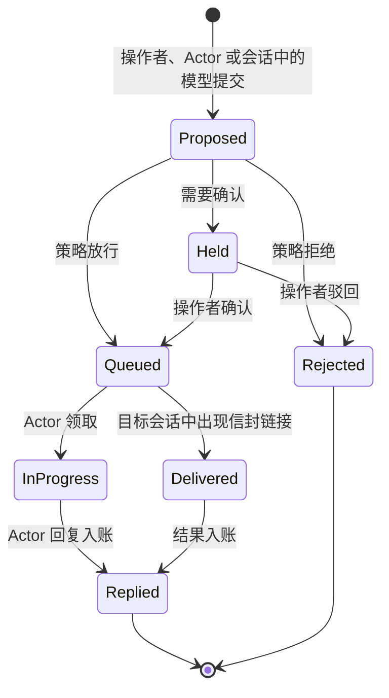
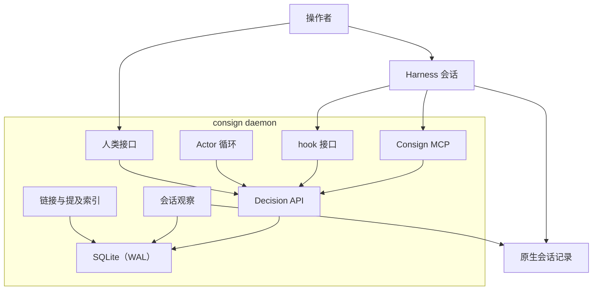

# Consign 实现规格

本文给出 Consign 的数据结构、协议、状态机和各 Harness 的接入细节。设计的出发点、责任划分和抽象层次见 [DESIGN.md](DESIGN.md)，本文不再重复其中的理由。

## 1. 范围与形态

Consign 是一个本地中心服务：一个 daemon 持有 SQLite，向执行会话提供 MCP 接口，向操作者提供人类接口。工作分成两个循环：

- **协调循环**：Actor 通过 API key 调用模型（默认 DeepSeek），由 daemon 按消息唤醒，自动运行。
- **执行循环**：操作者在官方客户端里使用 Harness，发出每一轮。会话里的模型通过注入的 Consign MCP 调用 Consign。

Consign 不启动、不驱动执行会话，也不向其中发送内容。它对执行会话的了解来自两处：模型主动发起的 MCP 调用，以及 Harness 落盘的原生记录。

第一阶段交付观察与寻址：daemon 导入并跟进 Codex 原生会话，为会话、轮次和片段提供链接，建立提及索引，并通过 MCP 把解析和反查提供给会话里的模型。

| 对象 | 职责 | 状态归属 |
| --- | --- | --- |
| **Stream & Message** | 只追加的有序流、主题订阅、持久消费者游标、确认与去重 | `events` / `messages` / `subscriptions` |
| **Ticket & Ledger** | 工单（可锚定 GitHub issue、PR、分支）、账本事件、结构化的决定、绑定快照的证据 | `tickets` / `events` / `decisions` / `evidence` |
| **Link** | 会话、轮次、片段和组织对象的统一文本地址；提及与反向索引 | `mentions`；片段通过 `artifacts` 固定内容 |
| **Actor** | `@handle`、职责档案、委派偏好、触发策略（`manual` / `auto`） | `actors` / `actor_runs` |
| **Decision API** | 统一的策略决策点：投递准入、动作提议、资源获取、经 hook 送来的工具执行 | 规则配置、`approvals` / `policy_audit` |
| **Consign MCP** | 注入执行会话的工具集，调用按会话记录出处 | `tool_calls` |
| **会话观察** | 导入和跟进原生记录，识别轮次、送达的信封和工具调用 | `sessions` / `turns` |

---

## 2. 接入

### 2.1 MCP 注入

Consign MCP 是 daemon 暴露的一组工具，按各 Harness 支持的方式注册为 MCP server。工具分为只读和写入两类：

| 工具 | 类别 | 作用 |
| --- | --- | --- |
| `resolve(link)` | 只读 | 返回链接指向的内容和少量上下文，长度有上限。解析信封链接时返回当前准入判定及原因（见 3.3） |
| `backlinks(link)` | 只读 | 返回提及该对象的位置 |
| `use_envelope(link, idempotency_key)` | 写入 | 核对信封的使用准入并登记结果。需要重新确认时将信件退回 `Held`（见 3.3） |
| `self()` | 只读 | 返回当前会话和最近一轮的链接 |
| `inbox()` | 只读 | 返回发给当前会话或其所属工单的消息 |
| `post(subject, body)` | 写入 | 向一条流发布消息，正文中的链接和外部锚点进入提及索引 |
| `propose_handoff(to, ask, refs)` | 写入 | 提出交接，生成一封 `Proposed` 状态的信 |
| `record_evidence(refs, summary)` | 写入 | 登记证据，引用片段或产物 |

**会话身份**：每次调用都要归属到一个会话。身份有三个来源，按可靠程度排列：

1. 注入时就绑定会话。客户端为每个会话单独注入 MCP 时（例如 ACP 的 `session/new` 允许客户端传入 MCP server 列表），配置里直接带上会话标识。
2. Harness 提供的环境信息。Codex 的工具进程带有 `CODEX_THREAD_ID`，agy 的带有 `ANTIGRAVITY_CONVERSATION_ID`（见附录 A）。MCP server 进程能否拿到同样的信息，需要分别验证。
3. 事后归属。MCP 调用及其参数会出现在原生记录里，观察到这条记录后，daemon 把调用归属到对应会话和轮次。

受信客户端或 Harness 提供的元数据可用于在调用时绑定会话。事后归属和调用方自报的身份只用于记录出处。读取权限由服务端按 MCP 连接的授权校验。没有可信会话绑定时，`self()` 和 `inbox()` 返回会话未绑定错误。查询显式链接仍按连接的授权处理。写入工具只能提议和登记，确认、批准等动作只在人类接口上进行。

**去重**：写入工具接受调用方提供的去重键。未提供时，daemon 按会话、工具和参数哈希在一个时间窗口内去重。重复提交返回之前的结果，同一个去重键带不同参数则拒绝。

**说明**：MCP 附带一段使用说明，解释链接的格式和含义、各工具的用途，以及什么时候应该登记证据、附上链接。模型读了说明，也可以不经过工具，直接去读原生记录。

### 2.2 会话观察

daemon 按游标增量读取 Harness 落盘的原生记录（位置和格式见附录 A），把每个会话作为一条流导入。观察不依赖 MCP：没有调用过工具的会话、历史会话都可以导入。

从原生记录中提取：

- **轮次**：能辨认原生轮次时，登记每一轮的输入、最终输出、起止时间和用量。Codex 的 `task_started` / `task_complete` 事件带 `turn_id`，可以直接划分轮次。
- **输入类型**：输入中带有信封链接的轮次记为送达了这封信（`input_kind = envelope`），其余是操作者自己的输入（`input_kind = operator`）。有明确依据时，用 `responds_to_turn_id` 关联被回应的轮次；新要求或回应对象不明时留空。
- **工具调用**：识别对 Consign MCP 的调用，用于事后归属（见 2.1）。
- **提及**：扫描每一轮的输入和输出中的 Consign 链接和外部锚点，写入 `mentions`。

轮次以下的工具调用、推理和审批事件保留原生结构，通过片段链接访问，由各 Harness 的解析器解释。解析层只提取上面这些字段，并记录产生记录的 CLI 版本。

### 2.3 统一寻址

链接是文本形式的地址：

```text
consign://codex/01a2…                            会话
consign://codex/01a2…/turn/019a…                 轮次
consign://codex/01a2…/span/L118-L131@sha256:…    片段
consign://stream/ticket.T7/42                    流中的消息
consign://ticket/T7                              工单
```

外部锚点按来源书写，例如 `github:owner/repo#812`、提交 id。

- **片段**由记录内的位置和内容哈希组成：位置用于回到原会话定位，哈希用于发现内容变化。
- **会话和轮次链接**用于导航，指向的内容会随会话增长。
- 片段被用作证据或交接依据时，转为不可变的产物引用 `transcript_span`，并保存当时选中的内容（见 3.5）。
- `resolve` 只返回指向的内容和少量上下文，需要更多时由模型继续解析下一个链接。
- 提及索引是派生数据，可以从原生记录和账本重建。

---

## 3. 协调

### 3.1 Actor Run

Actor 运行在协调循环里。daemon 在 Actor 订阅的流有新消息时唤醒它，消费侧按批量和等待上限合并唤醒。一次 Actor Run 读取职责、相关账本事件和本批消息，通过工具调用提交组织动作：查询、发布、起草交接、登记证据、请求操作者判断。工具凭据绑定这次 Run，运行结束即撤销，调用按 Run 和调用 ID 去重。

Actor 起草的交接如果目标是执行会话，经确认后进入操作者待办。Run 记下自己在等哪封信，然后释放运行槽。信封链接出现在某个会话的输入里、那一轮完成并被观察到时，daemon 唤醒原来那次 Run。重启后，Run 从账本恢复等待关系。

Actor 从不写入执行会话。它消费了哪些消息、决定转交什么、实际交出的内容，都作为事件记录。

### 3.2 交接协议与信件状态机

每次交接，系统根据工单生成一份**信封**。信封分为两部分：

- **请求**：目标、要求、选定的引用。操作者确认的是这一部分，确认后不再变化。
- **上下文**：当前有效决定、相关证据。这一部分在使用时重新解析，不使用生成信封时的快照（见 3.3）。

其他规则：

- 操作者可在确认前编辑信封。编辑和驳回作为事件入账，保留提议的原稿和操作者的改动，驳回可以附一句理由。策略放行时也可以按规则改写信封，同样保留改写前的内容。
- 信封只携带链接和产物引用，不复制大段正文。信封正文末尾带有它自己的链接，用来识别它被哪个会话收到。

信封的目标可以是 Actor，也可以是执行会话：



目标是 Actor 时，信件按 `Queued → InProgress → Replied` 推进。目标是执行会话时，`Queued` 表示信件在操作者待办里；操作者把它送进目标会话后，观察到信封链接，信件转为 `Delivered`；接收方通过 `record_evidence` 或 `post` 引用这封信登记结果，或者操作者把某一轮标记为回复，信件转为 `Replied`。

| 当前状态 | 条件 | 下一状态 |
| --- | --- | --- |
| `Queued` | 资源锁不可用 | `WaitingResource` |
| `WaitingResource` | 资源释放 | `Queued` |
| `Queued` / `Delivered` | 准入要求重新确认决定集或引用（见 3.3） | `Held` |
| `Queued` | 排队超时 | `Escalated` |
| `InProgress` | Actor Run 中断且可幂等重试 | `Queued` |
| `InProgress` | 中断且含不确定的外部动作 | `NeedsConfirmation` |
| `NeedsConfirmation` | 操作者确认重试 | `Queued` |
| `NeedsConfirmation` | 无法恢复结果 | `Escalated` |
| `Escalated` | 操作者改派或重试 | `Queued` |

进入 `Held` 的情况：

- 目标 Actor 的触发策略为 `manual`；
- 信件包含外部副作用；
- 单张工单在协调循环里连续多跳没有操作者介入（跳数熔断，在 `Proposed` 阶段检查）。

### 3.3 契约一：信封的使用准入

信封从确认到被使用之间，可能经过排队、等待操作者送达，甚至隔了几天。这段时间里决定可能变化。

**机制**：

- 每张工单维护单调递增的**决定集版本** `decision_version`。本工单或本项目范围内的决定有任何新增、取代或撤销，版本都加一。
- 操作者确认信封时，记录当时看到的版本 `confirmed_decision_version`。
- 准入检查发生在信封被使用的时刻：目标是 Actor 时，在 `Queued → InProgress` 的同一笔事务里；目标是执行会话时，由接收方通过 `use_envelope` 显式申请使用。服务端在写入事务中重新检查当前状态，记录准入结果。
  1. 版本没变：照常返回上下文。
  2. 版本变了，且期间的变化全部是**收窄型**决定：重新解析上下文，带着新决定返回。
  3. 版本变了，且有任何**非收窄型**决定：返回结果中标出决定差异，提示模型先等待确认；信件回到 `Held`，等操作者重新确认。
  4. 请求中选定的证据已变为 `stale`，或引用无法解析（见 3.5）：同 3。

`resolve` 可以预览上述判定。信件状态只在显式使用或 Actor 领取的事务中更新。操作者直接将内容粘贴到原生会话时，由操作者决定是否发送。该会话的操作仍由 Harness 的 hook 和沙箱约束。

**决定的类型**：确认决定时标注 `effect`。

- `narrowing`（收窄型）：只增加限制，例如「这轮只加日志」「不改 `Cargo.toml`」。收窄只会缩小授权范围，所以原请求仍然有效。
- `other`（其他）：改变目标、放宽限制，或无法判断。**默认是 `other`**，宁可多确认一次。

**使用之后的变化**：本轮产出按准入时的版本入账；输出关口则按**当前**决定检查 diff（见 4.2）。

### 3.4 契约二：组织动作入账

一次工具调用的处理结果、产生的状态变更和对应事件在同一笔 SQLite 事务中写入。调用方是 Actor Run 时按 Run 和调用 ID 去重，是执行会话时按 2.1 的去重键去重。交接和外部动作先登记为提议，再按各自的准入和审批条件处理。

| 时机 | 同一个 SQLite 事务内的操作 |
| --- | --- |
| Actor 领取信件 | 信件从 `Queued` 转为 `InProgress`，创建 Actor Run 并记录准入上下文 |
| Actor 等待交接结果 | 记录 Run 在等哪封信，释放运行槽 |
| 会话中的写入工具调用 | 保存调用结果，写入提议、证据或消息，追加事件 |
| 观察到信封送达 | 信件转为 `Delivered`，登记送达的轮次，追加事件 |
| 观察到或登记了回复 | 信件转为 `Replied`，唤醒等待它的 Actor Run |
| Actor 完成回复 | 保存回复和完成事件，信件转为 `Replied` |

**外部动作**，例如在 issue 下发评论，经批准后由执行器执行：先记下意图，再执行，再记结果。重启后发现有意图没有结果时，先核对外部状态：确认已完成就补记，确认未执行才重试，状态不明进入 `NeedsConfirmation`。

### 3.5 契约三：产物引用

信封和证据只携带引用。被引用的内容必须固定下来，否则读到的可能已经不是当初的内容。

**统一的引用格式**：

```json
{
  "kind": "git_commit | git_snapshot | file | blob | transcript_span",
  "node_id": "linux-pc",
  "repo": "flowmq",
  "path": "logs/run-118/trace.txt",
  "version": "sha256:… 或 git 对象 id",
  "size": 18234,
  "created_at": "…"
}
```

**规则**：

- **引用不可变**：创建引用时就记录内容哈希或 git 对象 id。只有路径的引用不合法，因为路径指向的内容会变。读取时如果哈希不一致，就视为引用失效：信件回到 `Held`，相关证据标记为 `stale`。
- **未提交状态做成 git 快照**：基于明确选定的文件构建 Git tree，再用 `git commit-tree` 创建提交对象，写入隐藏引用 `refs/consign/<ticket>/<n>`。它的 `kind` 是 `git_snapshot`，可以像普通 commit 一样被 diff、检出、在节点之间 fetch。
- **仓库外的文件**（日志、报告）作为 `blob`，按内容哈希存放在内容寻址目录中。
- **会话片段**作为 `transcript_span`：`path` 指向原生记录文件并附带片段在记录中的位置，`version` 是选中内容的哈希。创建引用时，选中内容另存为 blob，原生记录被清理或改写后仍可读取。
- **解析**：第一阶段在本地读取保留的 Git 对象或内容寻址 blob；多机阶段，消费节点与来源节点不同时按需物化，`git_commit` / `git_snapshot` 通过 `git fetch` 隐藏引用获取，`blob` 在节点之间传输或经控制面中转（设大小上限）。

这里也是将来接入工作区存储层（快照、低成本分叉、按需加载）的位置：存储层只需要替换引用的物化方式，引用格式和上层语义保持不变。

### 3.6 决定、证据与会话血缘

- **决定**：操作者的短指令经确认后成为决定。作用域分为本轮、本工单、本项目，新决定可以取代旧决定。工单级决定可以升格为项目惯例，此后每次起草信封都会带上。
- **证据**：审查发现、复现结果、测量数据通过产物引用绑定到快照，并记录环境指纹和产出时的决定集版本。快照变化时，证据标记为 `stale`；决定变化时，只附加「产出于旧决定集」的提示，不自动作废。
- **会话血缘**：`sessions.parent_session_id` 记录会话从哪里分叉而来，来源是原生记录中的分叉信息，或操作者的标注。复核会话必须不在作者和修复者的血缘链中：复核信封送达一个血缘链内的会话时，daemon 标出冲突，交给操作者处理。Actor 起草修复信封时，可以建议操作者从审查会话分叉出新会话，先重新梳理方案。

### 3.7 介入记录

操作者介入的地方，往往是 Agent 对问题的理解和操作者分开的地方。账本把介入和它所针对的内容放在一起记录：

- 信封或提议被编辑、驳回时，事件中保存原稿、改动和可选的驳回理由。
- 执行会话里操作者自己的输入（`input_kind = operator`）保存原文到 `turns.raw_input`，有明确依据时用 `responds_to_turn_id` 关联被回应的轮次。

---

## 4. 策略与约束

### 4.1 Decision API

信件投递、动作提议、资源获取，以及 Harness hook 送来的工具执行请求，都调用同一个决策点：

```json
// Request
{
  "point": "mail.deliver | action.propose | resource.acquire | tool.exec",
  "actor": "@review",
  "session_id": "codex:01a2...",
  "subject": { "tool": "Bash", "command": "cargo test", "cwd": "/wt/T7" }
}
// Response
{ "verdict": "allow | deny | hold | mutate", "reason": "string", "rule_id": "string", "tier": 0, "mutate": {}, "approval_id": "A42" }
```

决策点根据 `session_id` 反查工单、worktree、有效决定和资源锁，所以审批是感知工单上下文的。例如：在工单的 worktree 内运行测试自动放行；越界修改主工作区，或未持有 `bench` 锁就运行压测，则拦截。

| 层级 | 实现 | 职责 |
| --- | --- | --- |
| Tier 0 | Rust 内置规则、TOML 参数、外部脚本扩展点 | 去重路由、会话血缘检查、worktree 路径边界、只读角色、跳数熔断、命令白名单与黑名单 |
| Tier 1 | 廉价模型评判（可选，使用 API key） | 灰区命令。只能放行低风险或拒绝，高风险一律升级 |
| Tier 2 | 操作者审批 | 外部副作用、高风险命令、例外 |

**工具执行的入口**是各 Harness 的用户级 hook：Codex 的 `~/.codex/hooks.json`，agy 的 `~/.gemini/config/hooks.json`，都在 `PreToolUse` 时调用决策点。hook 同时覆盖所有会话：与工单无关的会话沿用 Harness 自身的审批策略；关联了工单的会话按工单上下文裁决。daemon 不可用时，hook 退回 Harness 自身的审批策略。

### 4.2 决定的执行

决定是自然语言，无法在工具调用层面完整执行；对命令字符串做匹配也不构成安全边界，因为模型可以换一种写法绕过。所以决定分三层执行：

| 层 | 适用的决定 | 机制 |
| --- | --- | --- |
| 硬边界 | 可写目录、网络访问、只读角色 | Harness 沙箱（`read-only` / `workspace-write`、禁用网络）。这是唯一可靠的边界 |
| 机械规则 | 能写成路径或命令模式的决定，如「不改 `Cargo.toml`」 | hook 调用决策点，在工具调用时拦截。可以被绕过，但能挡住大多数无意越界 |
| 输出关口 | 自然语言决定，如「这轮只加日志」 | 拿到 diff 后，对照有效决定检查，由异构复核模型或操作者判断；不合格则退回 |

信封会携带所有有效决定，但这只是告知模型；真正的执行靠上面三层。

### 4.3 安全模型

Agent 与操作者在同一台机器上、以同一个系统用户身份执行 shell。Agent 能读到的凭据、能访问的接口，都等于 Agent 也拥有。需要防范的情况包括：Agent 调用本地接口批准自己的审批单，或伪造一条来自操作者的确认。

| 措施 | 说明 |
| --- | --- |
| 接口分离 | MCP、hook、Actor 工具等**机器接口**，与确认、批准、决定等**人类接口**分开监听 |
| 机器接口只能提议和登记 | 确认、批准、改派都只在人类接口上进行 |
| 人类接口授权 | 操作者接口使用独立的本地凭据，Harness 工具进程读不到凭据，也访问不到监听入口 |
| `origin` 由服务端写入 | 消息来源由服务端根据认证结果填写；自报的会话身份只用于记录出处，读取权限由连接授权确定 |
| 协调循环的凭据隔离 | Actor 使用的 API key 和 Run 凭据不进入执行会话能读到的环境 |
| 独立系统用户（后续） | daemon 以独立的系统用户运行，人类接口只对操作者的登录会话开放 |

---

## 5. 系统架构

### 5.1 技术选型

- **Rust**：单二进制、常驻开销低、Linux 与 macOS 原生编译、强类型状态机。核心依赖为 `tokio`、`axum`、`rusqlite`（bundled，WAL）、`serde`、`schemars`、`reqwest`、`clap`，以及一个 Rust MCP SDK。

### 5.2 进程与部署



单机部署时，`consign up` 在一个进程中运行全部组件。人类接口和机器接口分别监听；客户端可通过 SSE 获知变更，断线后按事件序号重新查询。

daemon 是消息状态的唯一写入入口。每次状态变化和对应的账本事件在同一事务写入。

**消息存储**：第一阶段在 SQLite 中实现消息内核所需的流语义。`events` 是只追加的流，序号就是位置；`messages` 承载交接协议的信件；`subscriptions` 保存消费者游标；确认和去重由状态字段和唯一约束实现。接口按流、位置、持久消费者、确认和去重这些语义设计，存储层可以替换为独立的消息中间件。

**多机**：Harness 的会话记录存放在各台机器本地。多机阶段，每台机器运行一个观察进程，读取本地记录并上报给控制面，Consign MCP 也经由它转发。

### 5.3 模块划分

```text
consign/
├── Cargo.toml
├── crates/
│   ├── consign-core/     # 领域模型、交接协议、Decision 协议、状态机（无 IO）
│   ├── consign-store/    # SQLite、迁移、事件投影、链接解析与提及索引
│   ├── consign-policy/   # Decision API（Tier 0/1/2）
│   ├── consign-observe/  # 各 Harness 原生记录的解析与跟进
│   ├── consign-mcp/      # Consign MCP 工具与会话归属
│   ├── consign-actor/    # Actor 循环、模型 API 客户端、唤醒策略
│   ├── consign-daemon/   # axum（人类接口与机器接口分离）、调度、恢复
│   └── consign-cli/      # consign up / daemon / status / hook，以及操作者的查询命令
```

### 5.4 数据模型

| 表 | 字段 | 说明 |
| --- | --- | --- |
| `events` | `seq, ts, stream, kind, ticket_id, actor, payload_json` | 只追加，是所有视图的事实来源。编辑、驳回和策略改写类事件保留修改前的内容 |
| `subscriptions` | `id, subscriber, subject, cursor, batch_policy_json, created_at` | 持久消费者：订阅的主题、已消费的位置、批量和等待上限 |
| `actors` | `handle, profile, trigger, delegation_preferences_json` | 持久身份和委派偏好 |
| `actor_runs` | `id, actor, status, trigger_seq, waiting_on_json, resolved_context_json, decision_version` | 一次 Actor Run；`waiting_on_json` 记录在等的信件 |
| `tool_calls` | `id, caller, tool, dedup_key, args_hash, result_json, created_at` | `caller` 是 Actor Run 或会话；按 `(caller, dedup_key)` 唯一 |
| `tickets` | `id, anchor, repo, goal, status, decision_version, hop_count, hop_limit, created_at` | `decision_version` 是决定集版本（见 3.3） |
| `messages` | `id, ticket_id, stream, origin, from_ref, to_ref, kind, state, idempotency_key, request_json, confirmed_decision_version, delivered_turn_id, reply_to, attempts, timeout_at` | `origin` 由服务端写入：`human` / `actor` / `session` / `watcher` / `rule`；`to_ref` 是 Actor 或会话链接 |
| `sessions` | `id, node_id, harness, native_id, source_path, transcript_cursor, cli_version, parent_session_id, ticket_id, worktree_id` | `source_path` 是原生记录位置，`transcript_cursor` 是观察进度；`ticket_id` 可为空，会话与工单的关联也可以来自提及 |
| `turns` | `id, session_id, native_turn_id, input_kind, responds_to_turn_id, delivered_message_id, started_at, ended_at, status, raw_input, raw_output, usage_json` | `input_kind`：`operator` / `envelope`；已知原生轮次 ID 时，`(session_id, native_turn_id)` 唯一 |
| `artifacts` | `id, kind, node_id, repo, path, version, size, git_ref, created_at` | 不可变的产物引用（见 3.5），包括会话片段 `transcript_span` |
| `mentions` | `id, source, target, target_kind, created_at` | 提及索引：`source` 是出现提及的链接，`target` 是被提及的链接或外部锚点。派生数据，可重建 |
| `worktrees` | `id, node_id, repo, path, base_rev, created_at, create_ms, size_bytes, removed_at` | 同时记录工作区生命周期数据，为评估存储层积累轨迹 |
| `decisions` | `id, scope, scope_id, body, effect, status, supersedes_id, source_msg_id, created_at` | `effect`：`narrowing` / `other`，默认 `other` |
| `evidence` | `id, ticket_id, kind, summary, artifact_ids, decision_version, env_json, stale_reason` | 证据通过 `artifacts` 绑定快照 |
| `approvals` | `id, point, ticket_id, session_id, subject_json, state, decided_by, grant_once_key, created_at` | |
| `locks` | `name, node_id, holder, acquired_at, heartbeat_at` | |
| `policy_audit` | `id, ts, point, ticket_id, session_id, rule_id, tier, verdict, latency_ms, subject_json` | |

---

## 6. 端到端示例

### 6.1 跨会话关联

1. 操作者在两个 Codex 会话中分别调查 `#901` 和 `#907`。Consign 观察这两个会话，按首条输入提及的 issue 编号把它们归到对应工单下。
2. `#901` 会话的第一轮只解释了末端断言为何失败。操作者追问上游原因，这一轮记为操作者输入，回应第一轮。
3. 操作者在 `#901` 会话中问「和 #907 是不是同一个问题」。这句话提及 `#907`，`#907` 的工单和会话随即出现指向这一轮的反向链接。
4. 会话里的模型调用 `post`，把路由分析连同片段链接发到 `#907` 的工单流。Actor 收到后起草一封给 `#907` 会话的信封，经操作者确认后进入待办。
5. 操作者把信封送进 `#907` 会话。Consign 观察到信封链接，信件转为 `Delivered`；被引用的片段转为 `transcript_span` 并保存内容。`#907` 会话里的模型通过 `resolve` 查看原始分析和准入判定，再调用 `use_envelope` 登记使用并取得当前决定。
6. 共同的修复和两边各自的验证分别登记为证据，引用对应会话中的片段。从任一 issue 出发，都能沿链接找到另一条调查、带过去的原文，以及两边分别验证了什么。

### 6.2 变更审查

1. 操作者请 `@review` 审查 `HEAD~3..HEAD`。`@review` 读取相关记录，固定一个 `git_snapshot`，起草审查信封，带上快照、关注点和有效决定。操作者确认后，信封进入待办。
2. 操作者把信封送进一个新的执行会话。信件转为 `Delivered`，`@review` 的 Run 进入等待。
3. 会话里的模型完成审查，调用 `record_evidence` 登记发现，引用快照和片段。那一轮完成并被观察到，`@review` 被唤醒，整理发现，请操作者选择要修的条目。
4. 操作者勾选条目和提交边界，形成决定。`@review` 起草修复信封，建议从审查会话分叉出新会话。
5. 修复完成后，`@review` 起草复核信封。复核信封如果被送进作者或修复者血缘链内的会话，daemon 标出冲突。
6. 修复产生新的快照，原有发现标记为 `stale`。

---

## 7. 实施路线

| 阶段 | 交付物 | 验收 |
| --- | --- | --- |
| **Phase 1：观察与寻址** | Rust workspace、本地 daemon、SQLite 账本、Codex 原生记录导入与跟进、轮次识别、统一链接、提及与反向索引、`transcript_span` 及 blob 引用、Consign MCP 只读工具（`resolve` / `backlinks` / `self`）、Codex 的 MCP 注册 | 导入两条各自进行的调查会话：从一方粘贴进来的轮次能回到另一方的原始片段；从任一 issue 锚点能看到两条会话以及它们之间的提及；Codex 会话里的模型能解析链接 |
| **Phase 2：交接与账本** | 流与订阅、MCP 写入工具、交接协议、信封送达识别、决定集版本与使用准入、介入记录、会话血缘、agy 的观察与 MCP 注册 | 一封信从起草、确认、送达到回复完整入账；排队期间改变决定后，接收方查询信封时看到差异，显式申请使用时信件退回确认 |
| **Phase 3：Actor 协调循环** | DeepSeek Actor 循环、批量唤醒、按 Run 授权的工具、持久等待 | Actor 起草交接并等待；daemon 重启后，信封送达和结果入账仍能唤醒原来的 Run |
| **Phase 4：策略与固定流程** | hook 接入 Decision API、输出关口、外部动作审批、资源锁、Watcher、由交接轨迹提炼的流程规则 | 按固定审查流程提出后续交接，异常进入操作者待办 |
| **Phase 5：多机** | 各机器的观察进程、跨节点的链接解析和产物物化 | 不同机器上的会话可以互相引用，产物来源可追溯 |

---

## 8. 风险与对策

| 风险 | 对策 |
| --- | --- |
| 原生记录格式变化 | 解析层只提取少量字段；记录 CLI 版本；片段引用保存选中内容 |
| 模型不调用工具或调用不当 | 观察不依赖工具调用，漏掉的出处和提及可以从原生记录补上；写入工具由服务端校验，越权调用被拒绝 |
| 会话身份被伪造 | 身份只用于出处；机器接口只能提议和登记 |
| 订阅条款变化 | Consign 不操作执行会话，每一轮由操作者在官方客户端发起 |
| 提及索引噪声或膨胀 | 索引只呈现指向关系，相关性由读者判断；`resolve` 和 `backlinks` 的返回设长度上限 |
| Agent 冒充操作者 | 见 4.3：接口分离、服务端写入 `origin`、人类接口独立凭据 |
| 命令匹配被绕过 | 沙箱是硬边界，Decision API 是第二道防线，自然语言决定在输出关口检查 |
| 协调循环里的 Actor 互发信死循环 | 跳数熔断在 `Proposed` 阶段生效，超限进入 `Held` |
| 信封按旧决定被使用 | 决定集版本与使用准入（3.3） |
| 重启导致重复的外部动作或丢失等待 | 外部动作先记意图再执行，状态不明交给操作者；Actor Run 的等待关系持久化（3.4） |
| 引用无法读取或内容已变 | 引用不可变，未提交状态生成 git 快照，片段保存内容（3.5） |

---

## 9. 待决问题

1. **MCP 的会话身份**：验证各 Harness 注册 MCP 的方式，以及 MCP server 进程能拿到哪些会话信息；确认原生记录中 MCP 调用的形态，能否支撑事后归属。
2. **沙箱与本地接口**：验证 Harness 沙箱（如 `workspace-write`、禁用网络）下 MCP 调用能否到达 daemon，同时人类接口的监听入口和凭据对工具进程不可达，在 Linux 和 macOS 分别确认。
3. **原生记录的稳定性**：验证 Codex 和 agy 的会话记录在上下文压缩、续接、分叉和清理时是否保持只追加，片段位置能否长期定位。

---

## 附录 A：Harness 接口事实

以下事实在 `codex-cli 0.171.0`、`agy 1.5.14` 至 `1.5.16` 上验证。

### A.1 Codex

| 能力 | 用法 | 约束与细节 |
| --- | --- | --- |
| 会话记录 | `~/.codex/sessions/<年>/<月>/<日>/rollout-<本地时间>-<thread_id>.jsonl` | 每行一个 JSON 记录，会话进行中追加写入。首行 `session_meta` 含 `id`、`cwd`、`cli_version`、`originator`；在 Git 仓库中启动时还含会话开始时的 `git.commit_hash`、`branch`、`repository_url`。`response_item` 记录用户消息、Agent 消息（带 `phase`，如 `commentary`、`final_answer`）和工具调用；`event_msg` 中的 `task_started` / `task_complete` 带 `turn_id`，标出轮次边界，`task_complete` 含 `last_agent_message` |
| 续接与分叉 | `codex exec resume <id>`、`codex exec fork <id>` | fork 生成新的 `thread_id` |
| 工具进程环境变量 | — | 包含 `CODEX_THREAD_ID`、`CODEX_SESSION_ID`、`CODEX_TOOL_CALL_ID`、`CODEX_SANDBOX_NETWORK_DISABLED` |
| 用户级 hook | `~/.codex/hooks.json` 的 `PreToolUse` | 在未信任的目录中同样加载（项目级 `.codex/hooks.json` 则不会加载）。stdin 字段：`session_id`、`turn_id`、`cwd`、`model`、`permission_mode`、`tool_name`（shell 工具为 `Bash`）、`tool_input.command`、`tool_use_id`。返回 `hookSpecificOutput.permissionDecision: "deny"` 即拦截。hook 进程中没有 `CODEX_THREAD_ID`，要用 stdin 中的 `session_id` 识别会话。首次使用需要在 Codex 中信任该 hook |

### A.2 agy

| 能力 | 用法 | 约束与细节 |
| --- | --- | --- |
| 会话记录 | 数据目录下的 `brain/<conversation_id>/.system_generated/logs/transcript.jsonl` 与 `transcript_full.jsonl`（本机数据目录为 `~/.gemini/antigravity-cli`） | 每行一个步骤，含 `step_index`、`type`（如 `USER_INPUT`）、`source`（如 `USER_EXPLICIT`）、`created_at`。`transcript.jsonl` 截断长字段并在 `truncated_fields` 中标出，完整内容在 `transcript_full.jsonl` 的对应行 |
| hook | 工作区级 `.agents/hooks.json`，或全局 `~/.gemini/config/hooks.json` 的 `PreToolUse` | stdin 含 `conversationId`、`cwd`、`modelName`、`toolCall.{id,name,args}`；返回 `{"decision":"deny","reason":"..."}` 约 100ms 内生效；还支持 `allow`、`ask`、`force_ask` 以及改写参数的 `overwrite`。hook 进程继承 agy 的环境变量 |
| 工具进程环境变量 | — | 包含 `ANTIGRAVITY_CONVERSATION_ID` |
| fork | — | 不支持原生 fork |
| ACP | `agy acp` | `initialize` 返回 ACP v1，声明 `load`、`resume`、`list`、`close`。按 ACP 协议，客户端在 `session/new` 中为每个会话传入 MCP server；agy 对此的支持需要验证 |
